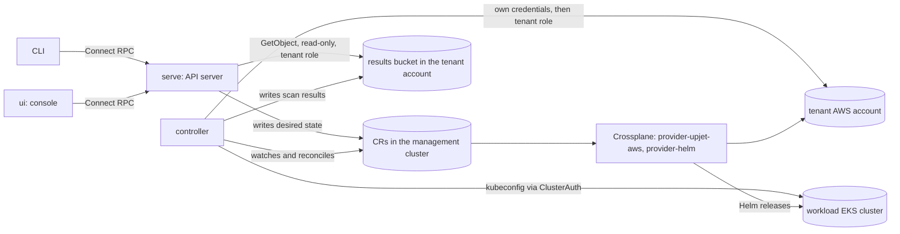

# cluster-vending architecture

This is the one design document of the repository. It describes the code on
`main` as it is: where an older document and the code disagreed, the code was
taken as the truth. Things the code does not do are listed in
[7. Known limits](#7-known-limits), not described as planned.

Contents:

1. [Overview](#1-overview)
2. [What we have](#2-what-we-have)
3. [How it works](#3-how-it-works)
4. [CR definitions](#4-cr-definitions)
5. [Configuration](#5-configuration)
6. [Operating it](#6-operating-it)
7. [Known limits](#7-known-limits)

## 1. Overview

cluster-vending creates AWS networks (VPCs) and EKS clusters for tenants by
writing Crossplane managed resources (provider-upjet-aws, namespaced
`*.aws.m.upbound.io` kinds) into a management cluster. It can also import an
existing VPC or EKS cluster read-only and, later, take it over. On top of that
it installs platform components (Karpenter, cluster-autoscaler, and others),
installs tenant components on request, rolls Kubernetes minors and platform
releases out through release channels, and scans workload clusters for
deprecated APIs, policy violations and resource recommendations.

The repository builds one binary, `cluster-vending`, with three roles:

| Role | Command | AWS access | What it does |
|---|---|---|---|
| API server | `cluster-vending serve` | Read-only, to a cluster's results bucket, through the tenant role | Serves the Connect API (`cloud.v1`). Validates requests, stores the desired state as custom resources, reads scan results. It runs no reconcile loop and installs nothing. |
| Controller | `cluster-vending controller` | Yes: the lookups, the account access check, and the Crossplane providers (which run as the management role) | Reconciles the custom resources: tenants, sub-tenants, accounts, networks, clusters, releases and rollouts, scanners. Installs the CRDs, the providers and the component catalog on start. |
| CLI | `cluster-vending <group> <verb>` | None | Calls the API server (`--server`) and prints tables, JSON or YAML. |

The tenant console (`ui/`) is a Next.js application. It calls the same Connect
API, keeps no state of its own, and has no AWS access.



Who talks to AWS: the controller and the providers make every change in AWS.
The controller also makes read-only lookups (the VPC or EKS cluster of an
import, the EKS name of a new cluster, the versions EKS offers, the account
access check). The API server makes one kind of call: it reads a cluster's
results objects from that cluster's bucket. Every access to a tenant's account
goes through the tenant role stored on the account, never through the
platform's own credentials alone ([AWS access and accounts](#aws-access-and-accounts)).

## 2. What we have

**Accounts and tenants**

- Tenants: a cluster-scoped `Tenant` registers a tenant and owns its namespace
  `tenant-<id>`. Tenant listing, and tenant freezes (see Freeze).
- AWS accounts: `CloudAccount` onboards an account with an external ID per
  account. The API serves three CloudFormation role templates (reader,
  updater, provisioner) and prints the create-stack command.
- Access check: the controller assumes the tenant role in each region the
  account uses and checks the calls the platform makes. It runs on create,
  on change, every 6 hours, and on request (`account verify`). Networks and
  clusters are refused until the account is verified.

**Networks**

- Create with a CIDR layout (carved default subnets, or explicit zonal
  subnets), NAT mode `Single` or `PerZone` (`Regional` is refused), optional
  VPC flow logs and tags.
- Import of an existing VPC (read-only), review of its plan, then takeover.
- Update of display name, tags and tier. Delete in AWS dependency order.

**Clusters**

- EKS clusters: Kubernetes minor (from the channel, or pinned), endpoint
  access, secrets encryption (a platform KMS key or an existing key), EKS
  access (admin principals, access entries, access policies), IRSA, control
  plane log group, EKS add-ons with recommended versions, launch templates and
  custom AMIs.
- Cluster OIDC sign-in (Microsoft Entra ID, or any OIDC issuer) through an EKS
  identity provider association ([Cluster OIDC](#cluster-oidc)).
- Import of an existing EKS cluster, then takeover, and a kubeconfig download
  (IAM, or OIDC with `kubectl oidc-login`).
- Node groups: one platform-managed system node group, autoscaled by
  cluster-autoscaler, and the tenant's own Karpenter node groups under an
  allowlist ([Node layout](#node-layout)).
- Retry of failed components and automatic upgrades (`cluster retry`).

**Components**

- Platform components, installed with every cluster and never enabled by a
  tenant: Karpenter, cluster-autoscaler, AWS Load Balancer Controller,
  External Secrets, Kyverno, the Istio ambient bundle, and Capsule when the
  cluster sets `naas`.
- Tenant components, enabled per cluster with validated values: `gpu-operator`
  and `kyverno-policies`.
- The catalog (`ComponentDefinition` objects) is synced from the build by the
  controller. A definition can be disabled or removed without a build.
- Helm reliability: classified errors, backoff, one Helm operation per
  cluster at a time, recovery of stuck releases.

**Releases, channels and upgrades**

- Releases are built from `pkg/catalog/release.yaml`: Kubernetes minors,
  chart pins per minor, the renderer version. Channels: `alpha` (pinned to the
  shipped release), `beta` and `stable` (automatic, after a release soak).
- Kubernetes rollouts by tier (Tier2, then Tier1, then Tier0), with
  `maxInProgress`, `maxFailed`, soak, maintenance windows and per-cluster gates.
  Automatic upgrades are off by default and irreversible when on.
- Platform component moves to a new release, one component at a time, and
  code changes (a new controller build that renders objects differently) with
  the same rollout rules.
- Admin read views: `admin release` and `admin channel`, with the rollout plan
  of each channel.

**Freeze and pause**

- Platform, tenant, network or cluster freezes (`admin freeze`,
  `tenant freeze`). A freeze pauses the Crossplane resources and Helm releases
  of its scope (`crossplane.io/paused`), stops upgrades, repairs, import
  discovery and deletion, and is confirmed by the controller (`--wait`).
- Exceptions let one cluster through a platform freeze. `--until` ends a
  freeze by itself.

**Sub-tenants and NaaS**

- `SubTenant` is a namespace allocation inside a cluster that runs Capsule
  (`naas: true`): namespace keys, quotas, a policy profile, and access
  bindings to identity groups.
- A sub-tenant's access opens only when its groups are in the platform's
  `naas.allowedGroups`, its EKS OIDC association is active and its Tenant and
  namespaces are observed as rendered ([SubTenants and NaaS](#subtenants-and-naas)).

**Scans and visibility**

- Deprecated and removed API versions (Pluto's rules, read from the objects'
  last-applied manifests and Helm release records), every 6 hours.
- Resource recommendations from a week of usage (metrics-server and VPA),
  sampled every 5 minutes.
- Policy violations and retained admission events (PolicyReports, Gatekeeper
  constraints, events), collected every 5 minutes.
- Results are kept in an S3 bucket per cluster, in the tenant's account
  ([Results in S3](#results-in-s3)). The custom resource keeps summaries.
- Events: the controller's events on each object, the last ten on the
  object's status, and `cluster events` / `network events`.
- Cluster and network topology views in the console, from the API's
  `architecture` projection of the recorded status.

**Authentication and metrics**

- API authentication with OIDC bearer tokens, off by default. Authentication
  only: there are no roles, and any authenticated user can act on every tenant.
  The CLI has `login`, `logout` and `whoami`.
- Prometheus metrics on both processes (RPC metrics on the API; fleet, freeze
  and reconcile metrics on the controller).

## 3. How it works

### Request flow

A create, from the API to Crossplane:

1. A client calls an RPC (the CLI, the console, or another Connect client).
   With authentication on, the interceptor verifies the bearer token and checks
   the caller's role for the RPC's tenant ([Authentication](#authentication)).
2. The handler validates the request against the contract, reads the target
   account, network or cluster from the store, and resolves the defaults
   (`pkg/network` for the layout, `pkg/cluster` for the node pool and the
   version). A network or cluster in an account that is not verified is
   refused with `FAILED_PRECONDITION` and nothing is stored.
3. The handler writes the custom resource (a `Network` or `Cluster` in the
   tenant's namespace) with the resolved spec and phase `Provisioning` (an
   import: `Imported`, with its import `Discovering`). The call returns the
   object's ID, its etag and the name. Nothing has been written to AWS.
4. The controller's watch sees the change of spec, labels or annotations.
   Changes of status alone do not wake it, so its own writes do not loop. The
   controller calls the reconciler for that object (`Reconcile(tenant, id)`).
5. The reconciler renders the desired objects (`pkg/crossplane/aws`:
   `NetworkSet`, `ClusterSet`), applies them with server-side apply through the
   sequence engine (`pkg/crossplane/sequence`), and only what is ready. What
   waits is held back and applied on a later pass.
6. Crossplane creates the cloud resources and reports conditions on the
   objects. provider-helm installs the platform and tenant components.
7. The reconciler records the status on the object: phase, conditions,
   inventory, recent events. A network becomes `Ready`, a cluster `Running`,
   when every resource is ready and the generation is applied. Failures appear
   in the status (`Failed`, or a message saying it is retrying). A call does
   not fail because AWS did.

Requeue times: 5 s while a generation is not applied in full, 20 s while AWS
works on it, 1 m for an import that is only observed, 30 s after a failed pass,
and a 10 m resync once settled.

### Packages

Each layer has one job. The import rules were checked with `go list -deps`.

| Package | Job | May import |
|---|---|---|
| `idl/cloud/v1` | The `cloud.v1` protos, the contract. Generated Go in `pkg/gen`, TypeScript in `ui/src/gen`. | Nothing in the repository. |
| `pkg/crossplane/aws` | Renders a plan into the provider objects (the upstream provider-upjet-aws and Crossplane types), as lists and as ordered sets. | `pkg/crossplane/sequence`. |
| `pkg/crossplane/sequence` | The engine. `Apply` makes the management cluster match a set: applies what is ready, holds back what waits, builds late values, removes what the set dropped. `Delete` removes an owner's objects tier by tier. | Kubernetes only. Knows nothing about networks or clusters. |
| `pkg/crossplane/managed` | Reads an object's state from its conditions, deletes objects, releases Usages whose user is gone. | Kubernetes only. |
| `pkg/network`, `pkg/cluster`, `pkg/component`, `pkg/rollout`, `pkg/upgrade` | Logic with no API and no storage: defaults, layouts, render plans, import plans, update changes, catalog checks, rollout plans. | No RPC library, no storage, no server. |
| `pkg/reconcile` | `Deps` (the store, the management cluster, the AWS lookups), the bookkeeping every owner shares, the checks a request and a reconciler share, and `AWSAccess` (always through the tenant role). | No RPC library, no `pkg/server`. |
| `pkg/reconcile/network`, `cluster`, `account`, `deprecations`, `recommendations` | A reconciler for each kind. They are the only code that looks at AWS, besides the access and results readers. | As `pkg/reconcile`. |
| `pkg/management` | Prepares the management cluster for the two commands: the manager, the store, and (for the controller) the providers, CRDs and AWS lookups. | No RPC library. |
| `pkg/server/*` | The RPC handlers: validate, read and write rows, map errors to Connect codes. They make no AWS call except reading results. | Everything above. |
| `pkg/auth`, `pkg/server/authn` | Who calls the API: the `auth` settings, OIDC token verification, and the audit log of writes. No authorization. | No storage. |
| `pkg/database/repository`, `pkg/database/cloudstore`, `pkg/database/model` | The storage interface, its one implementation on the custom resources, and the row types. | `repository` and `model` import nothing else from the repository. |
| `pkg/controller/*`, `pkg/convert`, `pkg/owner`, `api/v1alpha1` | The custom resource types, the controllers, the manager, owner references, and the conversion between the typed spec and the contract. | Types import nothing from `pkg/`. |
| `pkg/results`, `pkg/reconcile/resultsink` | Writes and reads a cluster's results objects in S3, with bounds and ETags. | The S3 client only. |
| `pkg/naas`, `pkg/catalog`, `pkg/release` | Sub-tenant and Capsule logic, the shipped catalog and release, and their checks. | Kubernetes types and `pkg/`-level checks. |
| `pkg/cli`, `pkg/cli/login`, `cmd/` | The CLI commands and the command tree. `cmd/` is thin. | `pkg/cli` imports only the generated client. |

### Storage

- There is no database. The custom resources are the store: `Tenant`,
  `CloudAccount`, `Network`, `Cluster`, `SubTenant`, `Component`,
  `ComponentDefinition`, `Release`, `ReleaseChannel`, `ReleaseHold`
  ([CR definitions](#4-cr-definitions)). `pkg/database/cloudstore` implements
  the repository interface on a direct (uncached for ownership decisions)
  Kubernetes client.
- Object names: a network's or cluster's name is its object name in the
  tenant's namespace. Its ID is a UUID, stored in the label
  `cloud.cluster-vending.io/id`; the API takes IDs.
- Uniqueness that is not an object name (a create request ID, an imported VPC
  per account and region) is a claim object whose name is derived from the
  value, so of two concurrent creates one wins.
- An update must present the object's etag. Recording status does not change
  the etag.
- Deletes are real deletes. There is no history of deleted rows.
- Inventory: each owner's `status.inventory` lists every Crossplane object it
  rendered, with its external name and creation order. `status.componentInventory`
  does the same for the platform components of a cluster.
- Owner references follow the chain: a network is owned by its account, a
  cluster by its network. A finalizer on each kind keeps an owner until nothing
  depends on it; deleting an owner never cascades.

### AWS access and accounts

One rule holds for the controller's lookups and for the Crossplane providers:

```
own credentials  ->  tenant role (always)
```

- **Own credentials** are whatever the AWS SDK's default chain finds: IRSA in
  production, environment keys for local runs. They are never a flag value or
  a file of the project.
- **The tenant role** is the role the account was onboarded with. Each
  account's Crossplane `ProviderConfig` assumes it (`assumeRoleChain`). Nothing
  is read with the own credentials directly, so the keys of one account cannot
  read another. A role that is not the account's is refused.
- **Source role** (optional, `aws-source-role-arn`): the own credentials assume
  it first; the tenant role is then assumed with its credentials.
- **External ID**: 64 random hex characters, generated when the account is
  first onboarded and kept. It is passed as `sts:ExternalId` on every tenant
  role assumption, and given only to the account's tenant.

Onboarding:

1. `account create -f` (or the `BootstrapTenant` RPC) records the account in
   the tenant's namespace. The tenant and its namespace must exist (`tenant create`
   first). The API prints the template URL, its parameters and the create-stack
   command. Parameters: `RoleName`, `ManagementRoleArn`, `ExternalId`, and
   `ServerPrincipalArn` (the API server's role, which reads results) when set.
2. The tenant runs the command with its own AWS credentials. The role's trust
   trusts the management role, and the server principal when given, and both
   only with the external ID.
3. The CloudAccount controller applies the namespace's `ProviderConfig`. In
   the local secret mode it also copies the configured key of the platform
   Secret into the tenant namespace.
4. `account verify --wait` asks for the access check, and waits for the verdict.

The templates are generated by `scripts/generate.py` (troposphere and awacs)
into `pkg/cloudformation/templates`, embedded in the binary and served read-only
at `/cloudformation/`. Three roles, each a superset of the one before:

| Role | Allows | Use |
|---|---|---|
| `reader` | Describe and list of EC2, EKS, IAM, KMS, CloudWatch Logs, SQS and EventBridge | Imports and observation. The access check reports `ec2:CreateVpc` and `ec2:CreateTags` as not allowed; the account is usable for import only. |
| `updater` | `reader`, plus changes to what exists (tags, rules, EKS updates, IAM trust and policy versions, KMS aliases) | Accounts that take over and update existing resources. The `ec2:CreateTags` DryRun passes; `ec2:CreateVpc` does not, so it imports and takes over but creates nothing. |
| `provisioner` | `updater`, plus creating and deleting VPCs, subnets, gateways, EKS clusters and node groups, add-ons, IAM roles and policies | Accounts meant for the platform to create resources in. |

The stack name and role name follow `cluster-vending-<role>` (or
`cluster-vending-<anything>-<role>`, up to 64 characters). Deleting the account
removes the platform's `ProviderConfig`; the role's stack is the tenant's to
delete.

**The access check** (controller, `pkg/reconcile/account`): for each region the
account's networks use, plus `us-east-1` and any region added with `--region`:

| Call | How | Needed for |
|---|---|---|
| `sts:GetCallerIdentity` after assuming the tenant role | regional STS endpoint | Every call. The account and role of the answer must match. |
| `ec2:DescribeAvailabilityZones` | read | Network layouts and zones |
| `ec2:DescribeVpcs` (one page) | read | Import and observation |
| `ec2:CreateVpc` | dry run: `DryRunOperation` when allowed, `UnauthorizedOperation` when not | Creating networks |
| `eks:ListClusters` (one page) | read | EKS name checks, import, observation |
| `iam:GetRole` of the tenant role | read, once | IAM roles the platform creates and reads |

Usability is per capability, from the per-check results (`pkg/reconcile/account/capability.go`):
`Create` needs every check (`status.access.verified`); `Import` needs the reads
(`DescribeAvailabilityZones`, `DescribeVpcs`, `ListClusters`) in the region; `TakeOver`
needs those and the `ec2:CreateTags` DryRun. CreateCluster and CreateNetwork ask for
`Create`, ImportCluster and ImportNetwork for `Import`, the take-overs for `TakeOver`.
A reader or updater account is not denied: `AccessVerified` is `True` with reason
`VerifiedForImport` and says what it allows and what failed, and a request for more is
refused as `FAILED_PRECONDITION` with that message. A region that failed still refuses all.

Its result is `status.access` (time, principal, each region and call with its
reason) and the condition `AccessVerified`. Reasons: `AssumeRoleDenied`,
`DeniedBySCP`, `NotAllowed`, `WrongAccount`, `RegionNotEnabled`, `Unavailable`
(transient), `NoTenantRole`. A denied account is `Failed`. A transient failure
keeps the last verdict, marked `stale`, and retries after 15 minutes. Reads,
updates, deletes, pauses and resumes never check.

**Template versions.** `cloudformation.TemplateVersion` (`pkg/cloudformation/version.go`) is
bumped whenever a template's permissions or trust change; a test (`version_test.go`) fails when
a template changes without it. Every template writes the version as the tag
`cluster-vending.io/template-version` on the tenant role and as the stack output
`TemplateVersion`. The access check reads the tag (`iam:ListRoleTags`, which every role
grants itself) once per check and keeps it among `status.access.checks` (`iam:ListRoleTags`,
always `ok`, message `template version N`). A role without the tag is version 0. When the
stack is older than the build, the account gets the condition `RoleTemplateCurrent` `False`
(reason `TemplateOutdated`) saying "the account's role template is version N, this platform
needs M; update the stack: ..."; the account is not failed. `account create -f` for such an
account prints `update-stack` instead of `create-stack`. A refusal of take over or create
names the old template. A tag that cannot be read leaves the version unknown and says nothing.

**Bounded AWS calls.** Every SDK operation is bounded by `aws.Config.CallTimeout` (default
20s, retries included; each page of a list separately), whatever context the caller gives; S3 is
left to the HTTP timeouts, since its calls return a body read after the call. The SDK config has
3 attempts with at most 5s of backoff, a 30s HTTP timeout, and dial, TLS and response-header
timeouts. The reconciler's lookups (`resolve`) add a 60s bound, and an access check bounds
a region at 90s. A call that times out is `Unavailable`: retried, never a denial or a failure.

### Create, import and takeover

**Create** (network or cluster). Cluster-specific steps before the first
render: the EKS name is reserved and checked against EKS (no cluster of that
name in the account); the Kubernetes minor and add-on versions are resolved
against EKS for the channel. The result is written to the spec and recorded
with `resolvedGeneration`, so an update that changes neither the version nor
the add-ons does not repeat the lookups. After the apply, the reconciler tags
the network's subnets for the cluster. Replaced node groups are retired after
the new one is ready.

**Import.** `network import` and `cluster import` store the request as an
object in phase `Imported` with its import `Discovering`. They do not look at
AWS. The controller looks the VPC (or EKS cluster) up once, and turns what it
found into a plan, stored in `status.importPlan` before anything is applied.
The plan has one line per resource with a disposition: `Matches`,
`WillUpdate`, `WillCreate`, `NotImported`, `Blocking` or `CarriedOver`.

- A plan with a `Blocking` line imports nothing. The import is `Blocked` with
  that reason. Delete it and import again.
- Otherwise the object is `Imported`. Its managed resources use
  `managementPolicies: [Observe]` (a network) or `Observe` with late
  initialization (a cluster). Crossplane reads them and changes nothing.
- A lookup that did not answer, or credentials that cannot read the resource,
  keep it `Discovering` and are retried. A VPC or cluster that does not exist
  where the import says is final.
- An imported object is read-only. A change made with `kubectl` on its object
  is ignored (`SpecEditIgnored`) and the remembered spec is put back.
- **Carried-over** objects came with the import and no spec field describes them
  (for example an existing flow log). They are marked and never removed on a
  re-render. They are deleted with their owner.

**Takeover** (`takeover <id>`, with `--acknowledge-not-imported` when the plan
has `NotImported` lines). It makes the platform the owner: the set is rendered
again as owned and applied through the engine. Nothing is read and edited in
place, and AWS is not looked up again: the objects discovered by the import are
stored with the object for this. An imported network is never rendered from
its spec, since that would create a second VPC. An import from before its
discovery was stored has nothing to render from, and its takeover fails with a
message to import it again.
A takeover is also refused (`FAILED_PRECONDITION`, listing the differences) when the cluster
changed in AWS after the import: the Observe-only objects report another Kubernetes version,
endpoint access or CIDRs, node group scaling or instance types, add-on version or access
entry groups than the stored plan, which full management would push back. The user imports
it again and reviews the new plan (discovery is not re-run on its own). The takeover also
needs the release of the cluster's channel (stable when it names none) to offer the minor
the cluster runs, unless it skips the platform components.

A taken-over cluster gets the platform components like any other cluster,
unless the takeover asked for `skip_platform_components`. The platform never
deletes or adopts what a cluster came with: a component the cluster already
runs fails with the provider's error, and is installed once that is removed.

### Ordering rules

The engine applies a set in dependency order. These rules are conditions on
creation: once an owner has an object, or an object that waited for the same
condition, it is applied whatever the condition says. While anything waits, the
engine removes nothing.

| Rule | Where it lives |
|---|---|
| NAT gateways are created only once the internet gateway is ready. | A `Ready` condition on the NAT items of `NetworkSet`. |
| Add-ons, access entries, policy associations and pod identity associations wait for the EKS cluster to be `ACTIVE`. A Usage whose user waits waits with it. | A `Field` condition in `ClusterSet`. |
| Values that exist only after another object: the platform's KMS key ARN, the cluster's OIDC issuer (for IRSA), its security group. A new cluster waits for its log group. | Items with a `Build` in `ClusterSet`, filled by `ClusterPlan.FillLive`. |
| During a Kubernetes upgrade, node groups and add-ons stay at the running version until the control plane reports the target. | `upgrade.phase` (`pkg/reconcile/cluster/upgrade.go`), reported as `status.upgrade`. |
| A change EKS cannot make in place on a node group (instance types, capacity type, AMI type, disk size, launch template) creates a new node group. The old one is retired once the new one is ready. | `NodeGroupName` and retirement on a later pass in `pkg/reconcile/cluster`. |
| A node group's Karpenter pools and classes are applied only after Karpenter is ready. | `pkg/reconcile/cluster/nodegroups.go`. |

### Deletion

Deletion runs in reverse order of creation. A network with a dependent cluster,
or an account with a network, is not deleted: the condition `DeletionBlocked`
names the dependents.

**Networks** are deleted tier by tier, in the order AWS accepts: flow log, ACL
rules, routes and associations; then log group, route tables and NAT gateways;
then role, policy and Elastic IPs; then subnets and the internet gateway; then
the VPC. A tier starts only when the one before it is gone. A VPC that AWS
refuses to delete for dependencies says so in the message, naming the VPC to look in.

**Clusters** go in seven stages (`driveDelete`, `pkg/reconcile/cluster/delete_stage.go`).
A stage starts only when the one before is fully gone, and the message names the
stage and what it waits for.

1. **Load balancers** in the workload cluster, while the AWS Load Balancer
   Controller still runs: the ALB Ingresses and every Service of type
   `LoadBalancer`. A load balancer left behind blocks the VPC's deletion.
2. **Tenant components**, a component after those that require it.
3. **Platform components above sequence 0**, highest sequence first. Each is
   uninstalled (its Helm releases, then its IAM objects) before the next lower
   sequence starts.
4. **Node groups**: the Karpenter NodePools (users' and any old platform pool),
   then the remaining NodeClaims (Karpenter terminates the nodes), then the
   EC2NodeClasses.
5. **Karpenter** (sequence 0): its chart and IAM role, then its interruption
   queue, its EventBridge rules and targets, and the node role and access entry.
   Before the node role is deleted, it is taken out of the instance profiles
   Karpenter made for this cluster (tagged `karpenter.k8s.aws/ec2nodeclass` or
   `karpenter.sh/managed-by`, and for this cluster), and those profiles are
   deleted, through the tenant role. A forced or timed-out node group stage
   leaves them, and IAM refuses to delete a role a profile still holds. No
   other profile is touched.
6. **EKS add-ons** with their pod identity associations, roles and policies.
7. **The rest**, ordered by Usages: the default managed node group, the EKS
   cluster, the cluster's IAM, the results bucket (emptied first, every pass
   until the bucket is gone), unrecorded leftovers (including Helm Releases and
   the Helm ProviderConfig), the subnet tags, and the records. A bucket that
   cannot be emptied holds back only the Bucket and its settings: everything
   else is deleted, and the cluster's status names the bucket problem.

Rules that apply throughout:

- Helm reliability never blocks an uninstall. Deletion lifts the platform's own
  backoff pause on the releases it uninstalls, and recovers a stuck release. A
  pause set by an operator or a freeze is not lifted, and the stage waits and says so.
- The load balancer stage ends after `--teardown-timeout` (default 15 m), and
  the node group stage after the same time from the request. Each ends with a
  `TeardownTimedOut` warning naming what is left, and the deletion goes on.
- Whether the workload cluster is used is decided by trying, not by the EKS
  status alone: with a kubeconfig Secret and an EKS cluster that is `ACTIVE` or
  `UPDATING` (an upgrade), the API is called, and stages 1 and 4 retry a failing
  API until `--teardown-timeout`. A forced deletion (`cluster delete --force`),
  a cluster with no kubeconfig Secret or whose EKS cluster does not answer
  (`CREATING`, `DELETING`, `FAILED`) skips the workload stages
  (`TeardownSkipped`, with the cause in the message), and its Helm Releases are
  let go without an uninstall.
- An `ACTIVE` or `UPDATING` cluster whose API is down in stages 2 and 3 waits
  `--teardown-timeout` from when it was first seen down (at once when the
  teardown stage already gave up), then its Helm Releases are let go without an
  uninstall (`HelmReleasesLetGo` warning). The stage message names the cause and
  `cluster delete --force`, which skips the wait. The wait restarts with the
  controller. Releases let go stay without Delete.
- The Usage webhook may refuse a deletion while a user exists. That is "waiting
  for its users", not a failure.
- The reconciler asks the API server directly before it forgets: the records and
  the row are removed only when nothing is left in the cloud.
- PersistentVolumeClaims are not deleted. Their volumes block nothing in the VPC,
  and deleting a claim deletes data.
- Cloud accounts: the `ProviderConfig` is removed, then the finalizer. The
  tenant namespace stays.

### Platform components

A `ComponentDefinition` with `management: Platform` is installed on every
cluster of its cloud by the cluster's reconcile, once the cluster is `Running`
(its node group is ready and its kubeconfig exists). Components install in
ascending `sequence` (default 100), and within a sequence in `requires` order.
Each component installs its IAM role first (`cloudResources.iamRole`, IRSA),
then its CRD chart (when it has one), its chart, and its companions.

The install order of a new cluster:

1. The EKS cluster, its node groups and its add-ons (part of reaching `Running`).
2. Karpenter (sequence 0, the platform's first component; everything after it
   waits for it).
3. The other platform components by sequence (default 100), in `requires`
   order: cluster-autoscaler, AWS Load Balancer Controller, External Secrets,
   Kyverno, the Istio bundle, and Capsule when `naas` is set. Nothing waits
   for cluster-autoscaler: a failed autoscaler does not hold the rest back,
   because the system node group works at its minimum size without it.
4. The tenant components, when the tenant enables them.

Each platform component's version and locked values come from the release the
cluster's channel offered when the components were first installed
(`status.platformRelease`). A release move (see below) changes them. The component states are on the cluster:
`status.platformComponents` (phase, message, Helm state, last error, failures,
recoveries, next retry) and the condition `PlatformComponentsReady`. That
condition does not hold back the cluster's own `Ready`. Platform components are
removed in reverse order when the cluster is deleted.

The shipped platform set (`pkg/catalog/definitions`):

| Component | Chart (pinned in `release.yaml`) | Namespace | Notes |
|---|---|---|---|
| `karpenter` | `karpenter` 1.15.1 (OCI, public ECR) | `kube-system` | sequence 0. Its IAM role is IRSA. Ships no NodePool or EC2NodeClass. |
| `cluster-autoscaler` | `cluster-autoscaler` 9.60.0 | `kube-system` | default sequence (nothing waits for it). Scales the system node group only. The image tag is set per Kubernetes minor. |
| `aws-load-balancer-controller` | 3.6.2 | `kube-system` | IRSA. |
| `external-secrets` | 2.15.0 | `external-secrets` | |
| `kyverno` | 3.10.0 | `kyverno` | Enabled by default. The policies are `kyverno-policies`, a tenant component. |
| `istio` (bundle) | 1.32.0 | `istio-system`, `istio-ingress` | Members are internal: `istio-base`, `istiod`, `istio-cni`, `ztunnel`, `istio-ingress-gateway`, in that `requires` order. Ambient mode, no sidecars. |
| `capsule` | 0.15.2 (OCI) | `capsule-system` | Only when `spec.naas: true`. Needs cert-manager on the cluster. |

Tenant components: `gpu-operator` (v26.7.2, `gpu-operator`), and
`kyverno-policies` (3.10.0, requires `kyverno`). Only these two have a values
schema.

**Catalog sync.** On start the controller creates or updates the shipped
definitions (`--install-catalog`, default true; `pkg/catalog`). It labels what it
ships `cloud.cluster-vending.io/shipped` and records the hash of the spec it
shipped in `cloud.cluster-vending.io/shipped-hash`:

| On the management cluster | What a build does |
|---|---|
| Missing | Creates it, labelled, with the hash. |
| Shipped, spec still equal to the recorded hash, the build's spec differs | Replaces the spec with the build's. `disabled` is kept. |
| Shipped, the spec changed since (the hash differs) | Leaves it: the platform team's edit. Logged. |
| Not labelled, equal to the build's spec | Adopts it (adds the label and hash). |
| Not labelled, different | Leaves it. Logged, with how to take the build's. |
| Shipped, unedited, no longer in the build | Deletes it, unless clusters use it (the finalizer `definition-in-use` holds it). |
| Shipped, edited, no longer in the build, or the platform team's own | Leaves it. |

`spec.disabled` switches a definition off without deleting it: a platform
component is removed from existing clusters by the gated catalog change (see
Code changes), and a tenant component can no longer be enabled. Definitions that
require it are off with it, in the same change.

**Providers.** Each definition is for one cloud, in `spec.provider` (`aws`,
`gcp` or `azure`, default `aws`). Only `aws` definitions ship. A variant for
another cloud is a separate definition named `<name>-<provider>`.

### Components and the catalog

The tenant's component API (`ComponentService`, `component` commands):

- `catalog` lists the definitions (who manages each, whether it takes values,
  what it requires). With `--cluster`, it adds the version the cluster's release
  gives each one.
- `enable` stores a `Component` object (phase `Pending`) for a cluster. The
  next pass of the cluster installs it, after the platform's components.
- A tenant cannot set a version. `spec.version` is refused by the API, and the
  installer takes the version of the cluster's release.
- Values: the stored values are only the ones that differ from the defaults. A
  key left out of an update goes back to its default. `--validate-only` shows
  what would be stored. Every problem in the values is reported in one answer.
- Platform components cannot be enabled, changed or disabled
  (`PERMISSION_DENIED`). Internal definitions (members of a bundle) cannot be
  enabled alone.

### Helm operations

Every Helm operation on a workload cluster goes through provider-helm, and the
controller manages it around that
([Helm reliability](#helm-operations)). The rules:

- **Rendering.** Releases are rendered with `wait: true`, the definition's
  install timeout (`install.timeout`, default set per chart) and `maxHistory: 5`.
  Each carries a digest of the chart, version and values
  (`cloud.cluster-vending.io/helm-digest`). A release whose digest is already
  live is not written.
- **One at a time.** At most one release of a cluster installs or upgrades at a
  time, in `sequence`, then `requires` order. The others say "waiting for Helm
  release X to settle".
- **Error classes.** *Transient* (the workload API unreachable, TLS or I/O
  timeouts, throttling, Helm's lock): retried quietly, never counted. *Chart*
  (not found, pull failed): retried and reported, never given up on. *Release*
  (a hook failed, the rollout timed out, invalid values): counted.
- **Backoff.** A failed attempt pauses its release (`crossplane.io/paused`, the
  marker `cloud.cluster-vending.io/helm-backoff-until`). The pause starts at 1 m,
  doubles with jitter, and is capped at `--helm-backoff-max` (default 30 m). A new
  digest ends the backoff at once. A pause set by a person or a freeze is never lifted.
- **Giving up.** After `--helm-max-failures` (default 5) counted failures in a
  row, the component is `Failed` with the classified error and a
  `HelmReleaseFailed` event. Its retries stay at the cap until its version or
  values change, or until `cluster retry`.
- **Stuck releases.** A release left in `pending-install`, `pending-upgrade`,
  `pending-rollback` or `uninstalling` for its timeout plus 2 minutes (10 minutes
  for a release an older build wrote) is recovered with the Helm SDK through the
  workload kubeconfig: the newest revision is marked failed and the release is
  rolled back to the last deployed revision, or uninstalled when none was. A
  failed hook Job is deleted first. At most 3 recoveries per component version
  (`StuckReleaseRecovered`, then `RecoveryLimitReached`). `--recover-stuck-releases`
  (default true) turns this off.
- **Retry.** `cluster retry --id <cluster>` restarts the backoff and the count of
  failed components, recovers a stuck revision at once, and restarts a failed or
  timed-out automatic upgrade. It answers per item what happens (`Retry`, `Fix`,
  `Nothing`).

Provider runtime (`crossplaneaws.DefaultProviderRuntime`, not a setting): the
AWS providers poll every 10 m (`provider-aws-ec2`: 30 m), provider-helm polls
every 15 s, at most 10 reconciles a second per AWS provider and 50 for
provider-helm, 1 CPU and 2 GiB requested, 4 CPU and 4 GiB limits, two replicas
with leader election. The runtime configs are `cluster-vending-aws`,
`cluster-vending-aws-ec2` and `cluster-vending-helm`.

### Node layout

A cluster has three kinds of nodes:

| Pool | Label | Taint | Runs |
|---|---|---|---|
| The system node group (`system`), EKS managed | `node.cluster-vending.io/pool=system` | `node.cluster-vending.io/pool=system:NoSchedule` | Karpenter, cluster-autoscaler, CoreDNS, the platform and tenant components, the EKS add-on controllers |
| The platform pool (`platform-pool`, Karpenter) | `node.cluster-vending.io/pool=platform-pool` | `node.cluster-vending.io/pool=platform-pool:NoSchedule` | Nothing yet: built and empty ([PROP-03](proposals/PROP-03-component-placement.md) phase 2; components move to it in phases 3 and 4) |
| The tenant's Karpenter node groups (`spec.nodeGroups`) | `node.cluster-vending.io/pool=<name>` and the tenant's labels | The tenant's taints | The tenant's workloads |

DaemonSets (VPC CNI, kube-proxy, the pod identity agent, istio-cni, ztunnel)
tolerate every taint and run everywhere.

**System group.** The default managed node group of every new cluster, sized from
the platform's `nodeGroups.system` settings. It is autoscaled by
cluster-autoscaler between `minSize` (default 2, the least allowed, since
Karpenter runs two replicas) and the deprecated `maxSize` (default 6; still the
cluster-autoscaler ceiling until that leaves the default set). The cluster autoscaler
finds the group by the tags `k8s.io/cluster-autoscaler/enabled` and
`k8s.io/cluster-autoscaler/<cluster>`, which the platform puts on that group
alone. Changing `minSize` or `maxSize` applies to existing clusters in place; the
node count stays with the autoscaler. `instanceTypes` (a list of one architecture and
one vCPU and memory class), `capacityType` and `diskSizeGiB` apply to new clusters only, since EKS cannot change them on a node
group. Users cannot change the group's labels, taints or scaling.

**Platform pool.** `nodeGroups.platform` configures one Karpenter `NodePool` and one
`EC2NodeClass`, both named `platform-pool` (not the legacy `platform`, which the legacy gate removes).
The controller applies them through the workload kubeconfig, like a tenant group, once Karpenter is
`Ready` and its IAM chain is. The pool is on-demand only (`SPOT` is refused), tainted and labelled
with its own name, `WhenEmpty` consolidation by default, with limits, a disruption budget, `expireAfter`
and `terminationGracePeriod`. It is `Ready` when its two objects are `Ready`, not when it has nodes: pods
create the nodes, so no wait for nodes can deadlock Karpenter. `status.nodeGroups` lists it after `system`
(`platformManaged`). A deletion removes it in the node groups stage, before Karpenter's stage.
`controller --check` sizes the bootstrap set (CPU, memory and pods per node: 17 on a `t3.medium`) against
`nodeGroups.system`, and the platform set against `nodeGroups.platform.limits` and the shapes the pool allows.

**Tenant node groups.** `spec.nodeGroups` is a list of Karpenter node groups
(at most 20, names unique and not `platform`, `platform-pool`, `default` or `system`). For each
one, the controller applies one `EC2NodeClass` and one `NodePool` into the
workload cluster after Karpenter is ready, labelled
`cloud.cluster-vending.io/managed-by=platform`, and removes them when the group
leaves the spec. A group sets instance types or families, architectures
(`AMD64`, `ARM64`), capacity types (`OnDemand`, `Spot`), labels (at most 64),
taints (at most 50) and CPU and memory limits. The server refuses a group
outside the allowlist of the platform's `nodeGroups.karpenter` settings. A group
that sets no architecture or capacity type gets the defaults. A cluster built
before the system group existed has an old `platform` pool, removed once its
components have moved off it.

**Sizing.** The default group is 2 x `t3.medium`. The catalog's requests, the
add-ons and the DaemonSets leave room for about 3 tenant pods per node at the
minimum size. The pod count is the tight limit. cluster-autoscaler adds a node
when pods are pending, up to `maxSize`. `pkg/catalog/system_group_sizing_test.go`
fails the build when the shipped requests exceed 85 % of the default group's
allocatable CPU or memory, or its pod capacity.

**Status.** `status.nodeGroups` lists the system group first, then the tenant's
groups: phase (`Pending`, `Ready`, `Failed`, `Deleting`), node counts, and a
message. Node lists are kept in the results bucket (the `nodes` kind, sharded by
group). Reads and applies to a workload cluster are bounded: 500 items a list, 10 s
a call, 45 s a pass, and they never fail the cluster's own pass.

### Releases, channels and rollouts

**Releases.** `pkg/catalog/release.yaml` is the one place a version is set:
the Kubernetes minors on offer, the chart pins of each component per minor, the
values each minor locks, and the three channels of a new management cluster. The
controller turns it into a `Release` object, named after its content and labelled
`cloud.cluster-vending.io/shipped`. A new content gives a new name. A release
offers three to six consecutive Kubernetes minors (shipped: 1.35, 1.36 and 1.37).

**Channels** (`ReleaseChannel`, cluster-scoped, named `alpha`, `beta` and
`stable`):

| Channel | Promotion | Offers | Soak (shipped) |
|---|---|---|---|
| `alpha` | `Pinned` | The release this build ships, or `spec.release` | none |
| `beta` | `Automatic` | The release `alpha` offers, once `alpha` has offered it for the soak | 168 h |
| `stable` | `Automatic` | The release `beta` offers, once `beta` has offered it for the soak | 336 h |

A channel that offers nothing yet takes its upstream's release at once. Clusters
keep the release they have; a new cluster on a channel gets the channel's minor.
Each minor names the channel whose clusters run it (one minor per channel). A
minor that is on no channel stays supported, and its users are warned
(`status.kubernetes.ending`, `KubernetesEnding`). A minor's `upgradeTo` is the
next minor, and `endOfSupport` is shown to users.

**Cluster settings.** `spec.releaseChannel` (`Alpha`, `Beta` or `Stable`) selects
the channel. `spec.upgradeMode` is `Manual` (the default: the tenant chooses the
versions) or `Automatic` (the platform may move the cluster). `spec.maintenanceWindow`
(days, start in UTC, duration of 1 h to 24 h) limits when an automatic upgrade may
start. A cluster's tier comes from its network (`Network.spec.tier`: `Tier0`,
`Tier1` or `Tier2`, default `Tier0`). All clusters of a network share its tier.

**Rollouts** (`pkg/rollout`, one worker, a pass every 10 minutes and on each change
of the inputs):

- Each channel plans how its clusters move to the channel's minor. A cluster
  moves one minor at a time toward it and is never moved down.
- Tier2 first, then Tier1, then Tier0. Within a tier at most `policy.maxInProgress`
  clusters upgrade at once (default 5; Tier0 always 1). The next tier starts once
  the one before is done and `policy.soak` has passed (default 24 h; `soakPerTier`
  overrides it). More than `policy.maxFailed` failures (default 1) in a tier halt
  the channel (`RolloutHalted`).
- Gates per cluster. The cluster is kept back, with the first reason listed in
  `rollout.blocked`, when it is in `Manual` mode, paused, frozen, not `Ready`,
  has platform or tenant components not ready, has a deprecation scan that finds
  removed APIs for the target minor, or is outside its maintenance window. A
  kept-back cluster does not hold the rollout back.
- `spec.paused` on the channel reports the plan and starts nothing.

**Automatic upgrades** are off by default (`--automatic-upgrades=false`: the plan
is reported, nothing is changed). With `true`, the controller sets
`spec.controlPlane.kubernetesVersion` of each cluster the plan starts, to the
next minor. This is **irreversible**: EKS cannot downgrade a cluster. Each
cluster's record is `status.rollout`, with `result` `Pending`, `Blocked`,
`InProgress`, `Succeeded`, `Failed` or `TimedOut`. `--upgrade-timeout` (default
90 m) is a stall timeout: one step without progress for that long counts as
`TimedOut`. A long upgrade whose steps keep moving is not timed out.

**How a Kubernetes upgrade runs**, one step at a time, each step left only when
AWS and Helm report it settled (`status.upgrade.phase`, with `phaseStartTime`):

1. `ControlPlane`: EKS runs the new minor.
2. `NodeGroups` (and `NodesAndAddons` while both move): the node groups move to
   the new minor. The Karpenter classes' AMI pin moves to the release's
   `nodeAmiPin`, and drift replaces the nodes. The step is settled when every
   node runs the target kubelet minor.
3. `Addons`: the add-ons take the versions EKS recommends for the new minor, read
   from AWS (`DescribeAddonVersions`), never from `release.yaml`. A pinned add-on
   keeps its pin.
4. `PlatformComponents`: the platform components switch to the new minor's pins.
5. `TenantComponents`: the same for tenant components.

Steps whose components do not change are reported as skipped
(`status.upgrade.skippedSteps`). Each add-on watch is 30 minutes: an add-on that
fails or does not settle is applied again, at most 3 times (`AddonRecovering`).
After that the upgrade halts (`UpgradeHalted`), and `cluster retry` continues it.
Once a day, and after the controller starts, each running cluster with no upgrade
under way asks AWS for the recommended add-on versions. An add-on the tenant has
not pinned moves to the recommended version (`AddonUpgradeScheduled`,
`AddonUpgraded`).

**Release moves.** Once a cluster's Kubernetes minor is current, its platform
components move to the release its channel offers (`status.releaseMove`). The
components move one at a time, in install order, each in the channel's rollout
order (tier, `maxInProgress`, soak, halt past `maxFailed`). A component that fails
or does not settle within 30 minutes is recovered (its chart is tried again), at
most 3 times (`ReleaseMoveRecovering`). Then the move halts until `cluster retry`.
There is no rollback. A move whose target release is gone installs nothing until
it is fixed. The release's tenant components move when the move is done.
Manual clusters do not move. Set `upgradeMode: Automatic` to move one.

**Code changes.** A new controller build can render a cluster's or a network's
objects differently (a field, a tag, a new object). The controller records a
fingerprint per object when it applies, and a pass whose render differs has a
code change pending (`status.codeChange`: `N objects change`). Code changes roll
out like Kubernetes upgrades: per channel, in tier order, with the same
`maxInProgress`, soak, halt and gates. A network goes once the rollout of every
channel of its clusters reaches its tier. A failed apply is tried 3 times, then
the change halts (`CodeChangeHalted`) until a newer build renders it otherwise or
an update applies it. Objects of an owner are never removed by a code change;
a dropped object's cloud resource stays in place.

The code-change fingerprint covers only the cluster's Crossplane objects
(`ClusterSet`, Helm ProviderConfig included), not the platform components'
Helm releases. **Catalog changes** have their own fingerprint (PROP-01 4.7,
`pkg/reconcile/cluster/catalog_change.go`): each cluster records, in
`status.catalogChange.applied`, one fingerprint per platform definition (its
values with the placeholders resolved, its charts, install timeout, `requires`
and namespace; `component.CatalogFingerprint`) and one for the platform pool
(`nodeGroups.platform`). Chart versions are the release's pins and are not part
of it: a release move or a Kubernetes upgrade changes them under its own
rollout. Sequence and IAM are not part of it either. A definition whose
fingerprint differs, one added, or one removed (disabled, deleted, or switched
off by the cascade) is a catalog change pending (`status.catalogChange`:
`N catalog entries change`). It is a member of the channel's code rollout with
the code change (tiers, `maxInProgress`, soak, windows, freezes, halt past
`maxFailed`; Manual clusters too). Until it is admitted, what runs stays: the
Release objects of a changed definition are not written, a new definition is
not installed, a removed one is not uninstalled, the platform pool is not
applied. Once admitted, the cluster applies the entries one at a time:
removals first, highest sequence first (dependents before what they require),
then installs and value changes, lowest sequence first, unless the platform
supplies an order (`reconcile.Deps.CatalogOrder`, for PROP-03's placement
moves). An entry's fingerprint is recorded only once its Helm operation settled
(digest written, deployed, Ready, observed); one that fails or does not settle
in 30 minutes is recovered 3 times, then the change halts until `cluster retry`.
A cluster fingerprinted for the first time takes what it renders as applied. A
change to a component that was never Ready, a fingerprint that cannot be
computed yet, and changes that land during a Kubernetes upgrade or a release
move are not gated separately.

**Admin views.** `admin release list` and `get`, and `admin channel list` and
`get` (read-only; platform admins only). `admin channel get` plans the rollout at
the time of the call, by tier and batch, and lists the clusters kept back and why
(`-o wide` lists every cluster).

### Freeze and pause

A freeze stops the controller's cloud work in its scope, and pauses the
Crossplane resources the platform owns so that Crossplane stops too.

- **Scopes.** The platform, a tenant (its accounts, networks and clusters), a
  network (the network and every cluster on it), or one cluster.
- **Commands.** `admin freeze` (platform, tenant, network or cluster, with
  `--reason`, `--until`, `--wait`, `--reset-exceptions`), `admin freeze status`,
  `admin unfreeze`. A tenant admin can freeze and unfreeze its own tenant, network
  or cluster with `tenant freeze`, `tenant freeze status` and `tenant unfreeze`.
- **State.** The freeze is held in the cluster-scoped `ReleaseHold` named
  `platform-freeze`, with `scoped` rules for each scope. The phases are
  `Freezing`, `Frozen`, `Unfreezing`, and unfrozen.
- **Confirmation.** A freeze reports `Freezing` first. The controller drains its
  active reconciles, pauses the resources, and records its acknowledgement in the
  hold's status. Only then is the freeze `Frozen`. `--wait` waits for that.
- **Effect.** Accounts, networks and clusters in scope do not change in the cloud:
  no creates, upgrades, repairs, import discovery or deletions. The API still
  accepts and stores writes, and their cloud changes wait until the unfreeze.
  Resources and Helm releases get `crossplane.io/paused: "true"`. Pauses set by a
  person before the freeze are left as they are.
- **Exceptions.** `admin unfreeze --cluster <id>` lets one cluster through a
  platform or network freeze. A cluster exception does not unpause its shared
  network. Repeating a freeze keeps the exceptions; `--reset-exceptions` clears them.
- **Expiry.** `--until` ends a freeze while the controller runs. The pauses stay
  in force while the controller is stopped.
- Scopes nest: a tenant unfreeze clears the freezes of its networks and clusters, a
  network unfreeze clears its clusters' freezes, and the latest matching action wins.

### Results in S3

Scan results of a cluster (deprecations, recommendations, violations, violation
events and the node list) are kept in an S3 bucket per cluster, not in the
custom resource, so that a large cluster is not limited by the object size. The
custom resource keeps a summary per kind: counts, collection time, completeness,
the key and ETag of the `latest` object, and a digest.

**Bucket** (`pkg/crossplane/aws/results_bucket.go`). Created with the cluster by
Crossplane in the cluster's own account, named `cv-<prefix>-<12 hex>`
(at most 63 characters, unique per account, region and cluster):

- All public access blocked; bucket owner enforced (no ACLs); SSE-S3 encryption;
  a bucket policy that refuses requests that are not over TLS; versioning off.
- Objects under `history/` expire after 30 days; incomplete multipart uploads
  after 1 day.
- The bucket is not force-destroyed. The controller empties it before deleting
  the bucket, every pass until it is gone. Nothing wipes data on its own.

**Objects**:

```
latest/deprecations.json        history/deprecations/<RFC3339>.json
latest/recommendations.json     history/recommendations/<RFC3339>.json
latest/violations.json          history/violations/<RFC3339>.json
latest/violation-events.json    history/violation-events/<RFC3339>.json
latest/nodes/<node group>.json  latest/nodes/index.json   (sharded kind)
```

Each object is the protojson of the kind's contract message, gzip compressed,
and bounded at 16 MiB uncompressed. A write puts the `history` object first,
then `latest`. A reader reads `latest`. A kind that grows with the cluster
(nodes) is sharded: one object per node group, and an index object with the
shard keys, counts and ETags.

**Write rules.** The controller's scanners write. A digest of the collected
content is compared with the last write, so unchanged results are not written
again. History is written at most once per change of the scan's interval (the
recommendation and violation history are hourly). Violation events get no history
object: they are an hour of Kubernetes events, and only `latest` is written
([PROP-02](proposals/PROP-02-cluster-data-live-and-snapshot.md), phase 0). A failed write does not fail the scan: the
caller keeps the summary and a notice that says why.

**Read rules.** The API server reads `latest` objects with `GetObject` through the
tenant role, with a 5-second timeout, the size bound, and a cache keyed by bucket,
key and ETag. Pagination tokens are bound to the object's ETag and the scope. A
missing bucket or object, a denied read, or a timeout is a coverage notice in the
response ("results unavailable: ..."), never a failed call. The server's session is
limited to reading objects in `cv-*` buckets (`results.ReadOnlySessionPolicy`).

**Sorting and the live API shape** (PROP-02 phase 1). The lists have `sort_by` and
`sort_order` (an enum per kind, `SortOrder` shared). Deprecations (`REMOVED_FIRST`,
`NAMESPACE`, `KIND`) and recommendations (`NAMESPACE`, `CPU_CHANGE`,
`MEMORY_CHANGE`) sort in memory after the filters. Their page tokens are bound to
the sort as well as to the object's ETag; a request with the default sort makes and
accepts the tokens it always did. The node, violation and event lists have the same
fields plus `live_at`, `complete` and `notices`, and `GetNodeResources` exists, but
the live reader that serves them is not built yet: the lists keep answering from the
stored results with the default order, and ask for another sort or call
`GetNodeResources` and the answer is `UNIMPLEMENTED`. `LiveUnavailableDetail` is the
detail of the `UNAVAILABLE` a live read will return.

**Targets.** Designed for 100 clusters of up to 1,000 nodes and 10,000 pods each.
This is a design target: it has not been load tested
([Known limits](#7-known-limits)).

### Scanners

**Cluster status summary** (`pkg/clustersummary`, `pkg/reconcile/cluster/summary.go`). The node pass
(at most once a minute per cluster) sums the nodes it already reads per group and lists the pods once
(`limit` 500 and `continue`, at most 200 pages), adding each page as it arrives; no pod is kept. A pod's
request is the scheduler's: the larger of the containers' sum (plus restartable init containers) and the
init containers' peak, plus `spec.overhead`; pods bound to no node, Succeeded or Failed are excluded; a
missing request is zero. The totals go to the status (`SetSummary`); counts that did not change move their
collected time at most every 10 minutes. The policy pass writes the violation and event counts with the
snapshot. An unreachable pass changes only the `Reachable` condition. A node outside the platform's groups
(not in a Karpenter pool or the default managed group) is not counted.

**Policy violations** (`pkg/controller/policy_controller.go`). Every 5 minutes, for
each cluster that is Running, Updating, Failed or Imported with a kubeconfig, and
not frozen or paused. It reads WG PolicyReports, OpenReports, the Gatekeeper
constraints it discovers, and core events with policy reasons. Limits: a
45-second deadline, 10-second request timeouts, at most 48 list requests, pages of 100
objects, at most 32 Gatekeeper kinds. A collection keeps up to 200 findings and 200
events. A snapshot older than 10 minutes is flagged stale. Events older than one hour
are excluded. The result is in `status.policySnapshot` (bounded) and in the S3 kinds
`violations` and `violation-events`. Violations are failing, warning or
evaluation-error results. A failed background result does not prove an admission
was denied, and the event list is not a durable audit log.

**Deprecated APIs** (`pkg/reconcile/deprecations`, `pkg/deprecation`). Every 6
hours, and 15 minutes after a failed scan, one cluster at a time. The controller
reads the cluster with the kubeconfig Secret that the ClusterAuth writes, and may
read Secrets in tenant namespaces only (through the `cluster-vending-kubeconfig-reader`
binding). It is read-only: discovery, metadata-only lists of the kinds the rules
name, and the newest deployed Helm release Secrets.

- An object is found when its manifest is kept in the cluster: the
  `kubectl.kubernetes.io/last-applied-configuration` annotation (source `Manifest`),
  or a Helm v3 release Secret (source `HelmRelease`, with `<namespace>/<release>`).
  Objects created by a client that keeps no manifest are not seen.
- The target is the cluster's next minor (the release's `upgradeTo`). Rules come
  from Pluto's data file (`pkg/deprecation/data/versions.yaml`, Pluto v5.24.5,
  Apache-2.0, vendored). Nothing of Pluto is linked in. The newest known removal
  is in 1.36. `make deprecation-rules` refreshes the file.
- The summary is on `status.deprecations` (target, times, `total`, `removed`, the
  error of a failed scan). The findings are in the S3 kind `deprecations`, removed
  first, at most 200 kept on the object. A scan that fails keeps the last one that
  worked.

**Recommendations** (`pkg/reconcile/recommendations`, `pkg/recommend`). Every 5
minutes the controller reads, with the cluster's kubeconfig and read-only:

- The workloads: Deployments, StatefulSets and DaemonSets, with the requests and
  limits of their pod templates. Jobs and bare pods are not recorded.
- Usage: what the metrics API (`metrics.k8s.io`) reports per pod. Without
  metrics-server nothing is recorded.
- The cluster's own VerticalPodAutoscalers, when present (`autoscaling.k8s.io/v1`).

Usage is kept in a ConfigMap `<cluster>-usage-history` in the tenant namespace,
owned by the Cluster object (so it is deleted with it): one bucket per UTC day,
7 days, at most 2,000 containers. The recommendation is in the S3 kind
`recommendations`, and the summary is on `status.recommendations`. A history
object is written at most once an hour.

| Source | When | Recommended request | Recommended memory limit |
|---|---|---|---|
| `vpa` | the VPA recommends for the container | VPA target | VPA upper bound |
| `usage-estimate` | at least a day of usage | peak over the week + 15 %, rounded up (CPU to 10m, memory to 1Mi) | recommended request + 20 % |
| `insufficient-data` | less than a day of usage | none | none |
| `no-data` | no usage and no VPA | none | none |

Floors: 10m CPU and 16Mi memory. No CPU limit is recommended. A change is
recommended only when the difference is a tenth or more, or the workload sets no
request. Recommendations are advice; nothing is applied.

**Events** (`pkg/reconcile/events.go`). Events are decided from the status: when a
pass records a new status, it is compared with the previous one, and the differences
are the events. A restart does not repeat them. The controller writes Kubernetes
`events.k8s.io` objects on the object (`kubectl describe` lists them). Repeats are
folded, and `status.recentEvents` keeps the last ten, with a count. The events
of a Network or Cluster are in the tenant's namespace. Release and ReleaseChannel
events are in `default`.

### EKS name reservations

Two clusters with the same EKS name in one account and region cannot both exist,
and an EKS name is not unique across tenants. The store reserves each
`(partition, canonical account ID, region, exact EKS name)` in a ConfigMap in
`kube-system`, named `cv-eks-name-<hash prefix>`, labelled
`cloud.cluster-vending.io/eks-name-reservation: "true"`. Its data keeps the full
scope key, the tenant, the allocation UUID, the request UUID and the normalised
request hash, so a truncated-hash collision fails closed. Errors returned to a
tenant disclose no other tenant or allocation.

- **Existing registrations** block a competing create, even when they predate the
  reservations. Imports reserve the same identity as creates.
- **Crash recovery.** Retrying the same create request (request UUID and payload)
  recovers the reserved allocation. A different request takes a name only when the
  reservation is abandoned: no Cluster has ever held it (no UID), no Cluster with its
  allocation exists in its tenant, and it was taken more than 10 minutes ago. A
  reservation that a Cluster ever held is never reclaimed this way.
- **Release** is two-phase. After the cluster's inventory is finalised, the
  reservation is marked `releasing` (a durable tombstone), then the Cluster object
  goes, then the reservation. A `releasing` reservation whose Cluster is gone is
  taken over at once. A reservation without the mark whose Cluster vanished (a
  finalizer removed by hand) proves nothing about AWS, and it stays in place until
  an operator checks ([runbook](#runbook-orphaned-eks-name-reservation)).
- Writers of reservations must use an uncached client. Reads that decide
  ownership never come from an informer cache.

Known gap, stated in the code's design notes: Kubernetes has no transaction across
a reservation, a Cluster, an account and a Network. Fences prevent unsafe
application while an object is incomplete, but partial intent and operator
recovery remain possible. An EKS cluster created directly in AWS by an actor that
does not use this protocol is not seen by it.

### Naming

- The EKS cluster takes the cluster's name (its physical name is reserved, above).
- Managed resources of a network or cluster are named `<name>-<hash8>-<suffix>`,
  where `hash8` is the first 8 hex characters of `sha256(tenant_id/id)`. The default
  node group is `<name>-<hash8>-default`.
- Imported resources keep their cloud names.
- IAM policies are checked against IAM's 6,144-character limit at render time, so a
  policy that would be too large is refused before it is attached (the rendering
  bound).
- Platform names of clusters, tenants and sub-tenants are DNS labels, checked at the API.

### Authentication

The API server authenticates its callers with OIDC bearer tokens. It is
**authentication only**: there are no roles, rules or grants. Any user whose token
is accepted can call every RPC, `AdminService` included, for every tenant: read,
change and delete any tenant's networks and clusters, create tenants, and freeze the
platform. It is off by default: without an `auth` section in the settings file,
every caller is anonymous and has the same full access.

**Modes** (`auth.mode`):

| Mode | A request without a token | A request with a token |
|---|---|---|
| `none` (default) | Served. The caller is anonymous. For local development only; the server logs a warning at start. | Served; the token is not checked. |
| `required` | `UNAUTHENTICATED` (HTTP 401, `WWW-Authenticate: Bearer`). | The token must verify: signature (RS256 or ES256, from the issuer's keys), issuer, one accepted audience and expiry. Otherwise `UNAUTHENTICATED`. |

`optional` is removed: a file that sets it stops the server at start, with a message
to set `required` (or `none` locally). `/healthz`, `/readyz` and `/metrics` are not
RPCs and are never authenticated.

`config/server/base` deploys the API with mode `none`: it accepts anonymous callers
for every tenant, so the Service must be restricted. `config/server/auth` is an opt-in
deployable example that requires tokens, with the issuer and audience to edit before
use. It holds public verification settings only.

**Issuers** (`auth.issuers`): `name`, `issuer` (the `iss` of the tokens; `https`, or
`http` for `localhost` only), `audiences` (at least one must be in the token's `aud`),
`entra.tenantId` (a Microsoft Entra ID preset: issuer
`https://login.microsoftonline.com/<tenantId>/v2.0`, optional `acceptV1`), and
`usernameClaim` (default `sub`; `oid` with Entra), the name shown in logs and `whoami`.

**Removed keys.** `auth.rules`, and `rolesClaim` and `tenantClaim` on an issuer, were
the roles. A file that still has them loads; each is ignored with one warning at start.

**Audit.** Every write (an RPC not marked `NO_SIDE_EFFECTS`) and every refused call is
logged with the caller's subject, username, issuer, the request's tenant and the
outcome. A token is never logged. `WhoAmI` returns the caller's subject, username and
issuer.

**Microsoft Entra ID.** Two app registrations, one for the API and one for the CLI.
Every user Entra issues a token to for the API's audience can call it, so the API's
app registration should require assignment if only some users may sign in. The CLI's
`login` uses the device-code flow, or the browser flow with PKCE (`--browser`), and
keeps the token in a local file (`pkg/cli/login`). `logout` removes it.

**The UI** signs in with the same issuer and forwards the user's token to the API.

### Cluster OIDC

A cluster can accept the tokens of an OpenID Connect provider next to IAM, so
that users sign in with their company account and `kubectl` works without AWS
credentials. This is the workload cluster's Kubernetes API. The API's own sign-in
is [Authentication](#authentication).

- `spec.access.oidc` has either `entra` (the tenant ID and the application's client
  ID) or the generic form (`name`, `issuerUrl`, `clientId`, `usernameClaim`,
  `usernamePrefix`, `groupsClaim`, `groupsPrefix`, `requiredClaims`). With `entra`,
  the platform fills in the issuer, the user name (`oid`, as `entra:<oid>`) and the
  groups (`entra:<group object id>`).
- The platform renders one EKS identity provider association once the cluster is
  `ACTIVE`, named `<name>-<hash8 of its settings>`. A change is a new association;
  the old one is removed. Between the two, the provider's tokens are refused.
- **No RBAC is created.** A user the provider authenticates has no rights until a
  RoleBinding or ClusterRoleBinding names the user or one of its groups.
- `cluster kubeconfig <id> --oidc` prints a kubeconfig with no credential in it. It
  runs `kubectl oidc-login`, which keeps the tokens on the user's machine. The
  endpoint and CA come from the recorded status.
- EKS limits: associating is a cluster update (several minutes, more in practice);
  the issuer must be reachable from the internet with a certificate that is not
  self-signed; one provider per cluster before Kubernetes 1.32, up to ten after;
  prefixes cannot contain `system:`. An imported cluster keeps the provider it came
  with, and `spec.access.oidc` is refused next to it.

### SubTenants and NaaS

**Capsule.** A cluster with `spec.naas: true` gets the platform component `capsule`
(0.15.2) in `capsule-system`, installed with the cluster's own cert-manager. Capsule
is the namespace tenancy within a workload cluster. Its install follows the same
rules as any platform component (release, tier, freeze, upgrade). Disabling NaaS on
a cluster with sub-tenants is blocked (`SubTenantSafety`), listing the dependents.

**SubTenant** (`SubTenantService`, a namespaced `SubTenant` in the tenant namespace).
One allocation of namespaces on a cluster, with its own Capsule `Tenant` in the
workload cluster. Its spec is described in [SubTenant](#subtenant). The controller
(`pkg/controller/subtenant_controller.go`) provisions only its owned Capsule
`Tenant`, and the shared Capsule resources generate the namespaces and policies.

- **Provisioning** (`ProvisioningReady`): the current Tenant and every requested
  namespace baseline are acknowledged by Capsule.
- **Access** (`AccessReady`) opens when all of these hold, and closes when one stops
  holding. Provisioning does not grant human access.
  - `GroupsAllowed`: every group in `adminGroups` and `viewerGroups` is in the
    config file's `naas.allowedGroups` and not in `naas.deniedGroups` (exact values
    or a prefix ending in `*`; deny is checked first; empty, the default, allows
    none). The API refuses other groups with `INVALID_ARGUMENT`, listing the allowed
    patterns. The controller checks again before it renders access, so a group
    removed from the list closes access with reason `GroupNotAllowed` and no
    RoleBinding is rendered. This bounds the group names, not the caller.
  - `OIDCReady`: an ACTIVE EKS OIDC association matches the cluster's OIDC.
  - The per-allocation checks: the Tenant equals its render (spec hash), every
    namespace exists with its UID, and each baseline is observed (`BaselineReady`).
  - Propagated namespace readiness and the exact generated RoleBindings.

  `Ready` is `ProvisioningReady`, and `AccessReady` when groups are named. A
  sub-tenant whose open access closes goes to the `Degraded` state with the reason.
- **No isolation test.** Access does not wait on a runtime test of the cluster's
  isolation (traffic, admission, RBAC). The checks above read objects; they trust that
  the platform-installed CNI, Capsule, Istio and Pod Security settings enforce them. The
  earlier qualifier Job and its record were removed; the retired conditions
  `AccessQualified` and `ClusterQualified` are dropped from the status.
- **Access bindings** map an identity group to a role profile (`workload-editor` is
  the only one). `adminGroups` and `viewerGroups` are exact group-claim values, never
  wildcards.
- **Offboarding** is guarded. `deletionProtection` must be set to false first, and
  the controller reports `deletionBlockers`. An owned, empty namespace may be deleted.

The sub-tenant access rules are in `pkg/naas`: an access binding is trusted template
input, and nothing in a tenant request or in a sub-tenant's own status can open access.
`SubTenantService` is served over Connect. The console and the CLI's `subtenant` commands
use it, with the same manifest (`examples/subtenant.yaml`).

## 4. CR definitions

Every kind is in the group `cloud.cluster-vending.io`, version `v1alpha1`, and has
a status subresource. The CRD manifests are generated into `config/crd/bases` by
`make controller-apis`. The Go types are in `api/v1alpha1`.

| Kind | Short name | Scope | Written by | Represents |
|---|---|---|---|---|
| `Tenant` | `cvtenant` | Cluster | API (`CreateTenant`); the tenant controller for its namespace | A tenant and its namespace `tenant-<id>` |
| `SubTenant` | `cvst` | Namespaced | API (`SubTenantService`); the sub-tenant controller | A namespace allocation on a cluster that runs Capsule |
| `CloudAccount` | `cvacct`, `cvaccount` | Namespaced | API (`BootstrapTenant`); the account controller | A tenant's AWS account, its `ProviderConfig` and access verdict |
| `Network` | `cvnet`, `cvnetwork` | Namespaced | API (Create, Import, Takeover, Update, Delete); the network controller | A VPC and its subnets, NAT and flow logs, or an imported VPC |
| `Cluster` | `cvc`, `cvcluster` | Namespaced | API (Create, Import, Takeover, Update, Delete); the cluster, rollout and scanner controllers | An EKS cluster, with its node groups, components and status |
| `Component` | `cvcomp` | Namespaced | API (`ComponentService`) | A tenant component enabled on a cluster |
| `ComponentDefinition` | `cvcompdef` | Cluster | The catalog sync (shipped); the platform team | A component's chart, IAM, values and rules |
| `Release` | `cvrel` | Cluster | The release controller, from `release.yaml` | A content-named set of Kubernetes minors and component pins |
| `ReleaseChannel` | `cvch` | Cluster | The release controller creates `alpha`, `beta`, `stable`; the rollout controller writes status | A channel: the release it offers, its policy and its rollout |
| `ReleaseHold` | `cvhold` | Cluster | `AdminService` and `TenantService` freeze RPCs; the freeze controller writes status | A freeze (`platform-freeze`) or a cluster hold |

Shared object conventions:

- **Labels**: `cloud.cluster-vending.io/tenant` (the tenant of a row, on its
  namespace and on each object), `cloud.cluster-vending.io/id` (the row's ID),
  `cloud.cluster-vending.io/network` and `/cluster` (on managed resources, for their
  owners), `cloud.cluster-vending.io/shipped` and `/shipped-hash` (catalog and
  release objects shipped by a build).
- **Finalizers**: `cloud.cluster-vending.io/cloudaccount`, `/network`, `/cluster`,
  `/tenant`, `/subtenant`, `/component`, `/definition-in-use` (catalog; held while
  a component uses it), `/release-in-use` (a release a channel or hold names).
- **Conditions**: `Ready` and `Synced` on the owned kinds, each with finer ones listed
  under the kinds below. Reasons are CamelCase, the messages are sentences.

### Tenant

`Tenant` is cluster-scoped and has no owner. Its namespace `tenant-<id>` carries the
label `cloud.cluster-vending.io/tenant=<id>`. Deleting the Tenant keeps the namespace.

| Field | Type | Meaning |
|---|---|---|
| `spec.displayName` | string, max 128 | A human-friendly name. Optional. |
| `status.namespace` | string | The tenant's namespace. |
| `status.conditions` | list | `Ready`. |
| `status.freeze` | object | The effective freeze: `frozen`, `scope`, `reason`, `until`, `revision`. |

### SubTenant

Namespaced in the tenant's namespace. Its finalizer is `cloud.cluster-vending.io/subtenant`.
Its name is an immutable DNS label (`spec.name`), and the references carry UIDs so that
a replacement with the same name is not adopted.

| Field | Type | Meaning |
|---|---|---|
| `spec.tenantRef` | `{name, uid}` | The owning Tenant. |
| `spec.clusterRef` | `{id, name, uid}` | The cluster the namespaces are on. The ID is a UUID. |
| `spec.name` | DNS label | The immutable allocation name. New allocations must set it. |
| `spec.deletionProtection` | bool | Must be `false` before deletion. Nil is protected. |
| `spec.namespaceKeys` | list, at least 1 | The namespaces of the allocation. Append-only; the platform assigns the remote names. |
| `spec.quota` | `{namespaceCount, hard}` | Namespace count (at least 1) and the approved quota dimensions. |
| `spec.policyProfile` | enum | `restricted-ambient-v1`. |
| `spec.access` | object | `bindings` (up to 32: `identityRef` and `roleProfile`, the latter `workload-editor`), `adminGroups` and `viewerGroups` (exact group-claim values, up to 32 each). |
| `status.state` | enum | `Pending`, `Provisioning`, `Ready`, `Degraded`, `Failed`, `Deleting`. |
| `status.conditions` | list | `ProvisioningReady`, `AccessReady`, `Ready`. |
| `status.namespaces` | list | Per namespace: its key, name, UID, template revision, conditions. |
| `status.deletionBlockers` | list, up to 64 | What blocks the deletion. |
| `status.remoteCapsuleTenant` | string | The Capsule Tenant in the workload cluster, with its UID. |

### CloudAccount

Namespaced in the tenant namespace, finalizer `cloud.cluster-vending.io/cloudaccount`.
Its ProviderConfig is named by `status.providerConfigName`, generated on the first
bootstrap and kept.

| Field | Type | Meaning |
|---|---|---|
| `spec.accountName` | string, max 128 | The AWS account's name. Informational. |
| `spec.aws.accountID` | 12 digits | The account. Immutable. |
| `spec.aws.role` | string | The tenant role's name (no path). The tenant creates it from the template. |
| `status.phase` | enum | `Bootstrapping`, `Ready`, `Deleting`, `Failed`. |
| `status.identity` | string | The role ARN the provider credential assumes. |
| `status.networks` | int | The networks the account owns. The account cannot be deleted while it is not zero. |
| `status.access` | object | The access verdict: `verified`, `checkedAt`, `attemptedAt`, `stale`, `principalARN`, `reason`, `message`, `regions[]`, `checks[]` (each with `action`, `region`, `ok`, `reason`). |
| `status.inventory` | list | The objects of the account itself (its ProviderConfig). |
| `status.conditions` | list | `Ready`, `Synced`, `AccessVerified` (`False` with the first failure's reason, `Unknown` before the first verdict). |

### Network

Namespaced in the tenant namespace, owned by a CloudAccount (`spec.accountRef`),
finalizer `cloud.cluster-vending.io/network`. A network cannot be deleted while it
has clusters (`status.clusters`).

| Field | Type | Meaning |
|---|---|---|
| `spec.accountRef` | `{name}` | The owning CloudAccount, in the same namespace. Required and immutable. |
| `spec.region` | string | The region. Immutable. |
| `spec.tier` | `Tier0`, `Tier1`, `Tier2` | The rollout tier of the network and its clusters. Default `Tier0`. |
| `spec.displayName`, `spec.tags` | string, map | Mutable. A tag change re-tags the resources. |
| `spec.layout` | object | Immutable (create only). `cidrBlock` (/16 to /24, default `10.0.0.0/16`), `subnets[]` (`role` Public or Private, `cidrBlock`, `zoneID`), `availabilityZoneCount` (default 3), `natGatewayMode` (`Single` default, `PerZone`; `Regional` is refused). |
| `spec.flowLogs` | object | `enabled`, `trafficType` (`All` default, `Accept`, `Reject`), `retentionDays` (a CloudWatch period), `aggregationIntervalSeconds` (default 600). |
| `spec.importFrom.aws` | `{vpcID, subnetIDs}` | Imports an existing VPC instead of creating one. |
| `status.phase` | enum | `Provisioning`, `Imported`, `Ready`, `Updating`, `Deleting`, `Failed`. |
| `status.message` | string | Why it is `Failed`, typically. |
| `status.layout` | object | The layout as built, with the defaults resolved. |
| `status.resources` | object | `cloudNetworkID` (the VPC ID), `publicSubnetIDs`, `privateSubnetIDs`, `natGatewayIDs`, `egressIPs`. |
| `status.clusters` | list | Names of the clusters the network owns. |
| `status.importPlan` | object | The import plan, kept after takeover: `phase` (`Discovering`, `Planned`, `Blocked`, `Converging`, `Converged`) and `resources[]` (dispositions). |
| `status.codeChange` | object | A pending change of what the build renders for the network. |
| `status.inventory` | list | Every Crossplane object of the network, with its external name. |
| `status.recentEvents` | list | The last ten events, oldest first. |
| `status.conditions` | list | `Ready`, `Synced`, `Frozen`, `DeletionBlocked`, `Adopted`, `SpecEditIgnored`. |

### Cluster

Namespaced in the tenant namespace, owned by a Network (`spec.network.networkRef`),
finalizer `cloud.cluster-vending.io/cluster`. The spec fields that are immutable
are marked so in the type; the rest can be updated.

| Field | Type | Meaning |
|---|---|---|
| `spec.region` | string | The network's region. Immutable. |
| `spec.network` | object | `networkRef` (the owning Network, immutable), `zoneIDs` (empty: every zone of the network), `serviceCIDR` (default outside the network), `podCIDR` (must be empty on AWS). |
| `spec.controlPlane.kubernetesVersion` | `1.NN` | The minor. Empty on a cluster with a channel: the channel's minor is written into it. Empty on a cluster with no channel: the version it asks for, or EKS's default. The rollout sets it on automatic upgrades. |
| `spec.controlPlane.endpointAccess` | object | `publicAccessCIDRs`, `privateAccess` (default true), `publicAccess` (default true). |
| `spec.controlPlane.secretsEncryption` | object | `enabled` (a KMS key the platform creates and deletes) or `kmsKeyARN` (an existing key, not deleted). |
| `spec.defaultNodePool` | object | The default managed node group: `instanceTypes`, `capacityType` (`OnDemand` default, `Spot`), `scaling` (`minSize`, `maxSize` 1 to 1000, `desiredSize`), `diskSizeGB`, `labels`, `taints`. Filled by the platform when omitted. |
| `spec.access` | object | `adminPrincipals` (cluster-admin), `accessEntries` (EKS entries and their policies, `Cluster` or `Namespace` scope), `oidc` ([Cluster OIDC](#cluster-oidc)). |
| `spec.releaseChannel` | `Alpha`, `Beta`, `Stable` | The channel the cluster takes platform releases from. |
| `spec.upgradeMode` | `Manual` (default), `Automatic` | Whether platform releases and Kubernetes upgrades may move the cluster. |
| `spec.maintenanceWindow` | `{days, start, duration}` | When an automatic upgrade may start: days (empty: every day), start in UTC (`HH:MM`), duration 1 h to 24 h. |
| `spec.naas` | bool | Installs Capsule (namespace tenancy). Default false. |
| `spec.nodeGroups` | list of `NodeGroupSpec` (max 20, keyed by `name`) | The tenant's Karpenter node groups ([Node layout](#node-layout)). |
| `spec.aws` | object | `accessConfig.authenticationMode`, `enabledClusterLogTypes`, `upgradePolicy.supportType`, `defaultNodePool` (`amiType`, `launchTemplate`), `addons[]` (name, version, configuration, S3 buckets), `controlPlaneLogGroup`, `irsa`, `additionalSecurityGroupIDs` (immutable). |
| `spec.importFrom.aws` | `{defaultNodeGroupName}` | Imports an existing EKS cluster. Its other node groups are not imported. |
| `status.phase` | enum | `Provisioning`, `Imported`, `Running`, `Updating`, `Deleting`, `Failed`. |
| `status.conditions` | list | `Ready`, `Synced`, `NetworkReady`, `ControlPlaneReady`, `NodePoolReady`, `PlatformComponentsReady`, `Frozen`, `UpgradePaused`, `DeletionBlocked`, `Adopted`, `SpecEditIgnored`. |
| `status.endpoint` | `{url, certificateAuthorityData}` | The API endpoint, once the control plane is ready. |
| `status.kubeconfigSecret` | string | The Secret in this namespace with the key `kubeconfig`. |
| `status.currentKubernetesVersion` | string | The version the control plane runs. |
| `status.aws` | object | `clusterARN`, `clusterSecurityGroupID`, `platformVersion`, `nodeGroupARN`, `addons[]` (name, version, ready, message). |
| `status.upgrade` | object | The Kubernetes upgrade in progress: `fromVersion`, `toVersion`, `phase` (`ControlPlane`, `NodesAndAddons`, `NodeGroups`, `Addons`, `PlatformComponents`, `TenantComponents`), `startTime`, `phaseStartTime`, `message`, `nodeGroups[]`, `addonsBehind`, `componentsBehind`, `recoveries`, `halted`, `skippedSteps`. |
| `status.rollout` | object | The cluster's last automatic upgrade: `channel`, `fromVersion`, `toVersion`, `startTime`, `finishTime`, `result` (`Pending`, `Blocked`, `InProgress`, `Succeeded`, `Failed`, `TimedOut`), `message`, `tier`. |
| `status.releaseMove` | object | The component move to the channel's release: `current`, `target`, `phase` (`Idle`, `Pending`, `Components`, `Halted`), `component`, `step`, `steps`, `message`. |
| `status.kubernetes` | object | `channel`, `channelMinor`, `available` (the next minor), `ending`, `message`. |
| `status.nodes`, `status.nodeGroups[]` (usage), `status.violations`, `status.violationEvents` | objects | The cluster status summary (PROP-02 5.2), a few KiB at most. `nodes`: total, ready, not ready, `nodesCollectedAt`. Each node group entry also has `ready`, `notReady`, allocatable CPU (millicores), memory (bytes) and pods, requested CPU and memory, `podCount` and `podsWithoutRequests`; at most 16 entries, the groups after the 15th summed into one `other`. `violations`: total and counts by severity (8 values, the rest in `other`). `violationEvents`: last-hour total and counts by reason. `Reachable` (a condition) is False with `CLUSTER_UNREACHABLE` or `CREDENTIALS_REJECTED` when the pass cannot read the cluster; the counts of the last good pass stay and their collected times show their age. |
| `status.platformComponents` | list | Per platform component: `name`, `version`, `phase` (`Pending`, `Installing`, `Ready`, `Failed`), `message`, `chart`, `helmState`, `lastError`, `failures`, `since`, `recoveries`, `chartVersion`, `revision`, `digest`, `attempts`, `countedFailures`, `nextRetryAt`, `lastErrorClass` (`transient`, `chart`, `release`), `lastRecovery`, `unchanged`. |
| `status.platformRelease` | string | The release the platform components' versions come from. |
| `status.componentInventory` | list | The Crossplane objects of the platform components (IAM roles, Helm releases). |
| `status.nodeGroups` | list | The system group, then the tenant's groups: `name`, `platformManaged`, `phase`, `message`, `nodes`, `nodesNotice`. |
| `status.deprecations` | object | The last deprecation scan's summary (target, times, counts, error). |
| `status.recommendations` | object | The last sample's summary (times, workloads, containers, `metricsAvailable`, `vpaAvailable`, error, message). |
| `status.results` | list | One reference per result kind in S3: `kind`, `bucket`, `key`, `etag`, `digest`, `collectedAt`, `attemptedAt`, `total`, `removed`, `incomplete`, `truncated`. |
| `status.policySnapshot` | string | The bounded policy snapshot (protojson). |
| `status.codeChange` | object | A pending code change (`phase`: `Pending`, `Applying`, `Done`, `Halted`; `summary`; `objects`). |
| `status.catalogChange` | object | A pending catalog change (`phase` as above; `summary`; `pending[]`, in order; `component`, `step`, `steps`; `message`; times). The applied fingerprints are in `contractStatus`. |
| `status.inventory` | list | Every Crossplane object of the cluster, with its external name. |
| `status.network` | object | The VPC, subnets, NAT gateways and egress IPs of the cluster's network. |
| `status.importPlan` | object | As for a network. |
| `status.recentEvents` | list | The last ten events. |

Note: the cluster's tier is not in `spec`. It is shown in `status.tier`, from the network.

### ComponentDefinition

Cluster-scoped. Shipped by the build (`cloud.cluster-vending.io/shipped`) or written by
the platform team. Its finalizer `cloud.cluster-vending.io/definition-in-use` holds it
while a component uses it.

| Field | Type | Meaning |
|---|---|---|
| `spec.description` | string, 1 to 1024 | Shown to tenants. |
| `spec.management` | `Platform`, `Tenant` (default) | Who controls it: platform components are installed with every cluster. |
| `spec.provider` | `aws`, `gcp`, `azure` | The cloud it is for. Immutable. Default `aws`. |
| `spec.disabled` | bool | Switches it off without deleting it. |
| `spec.internal` | bool | Only installed as a member of a bundle (`includes`). |
| `spec.install.helm` | object | `crds` (a chart holding only the CRDs, as templates), `companions` (charts installed after the main one is ready), and the chart source (`repository`, `chart`, `credentials`, `insecureSkipTLSVerify`, `plainHTTP`). |
| `spec.install.timeout` | duration, 1 m to 60 m | How long Helm waits for each chart's rollout. |
| `spec.namespace` | string | Namespace in the workload cluster. Required with `install`. |
| `spec.includes` | list | Makes the definition a bundle of other definitions. |
| `spec.requires` | list, up to 16 | Components that must be ready first. |
| `spec.sequence` | int32, 0 to 10000, default 100 | Platform components install in ascending sequence. Karpenter is 0 (CEL: the definition named `karpenter` has sequence 0 and is not disabled); every other shipped definition uses the default. |
| `spec.versionGroup` | string | Components that are versions of one product, upgraded together (`istio`, `kyverno`). |
| `spec.upgradeOneMinorAtATime` | bool | Supports in-place upgrades of one minor at a time (Istio). |
| `spec.conflictsWithAddons` | list | EKS add-ons the cluster must not have while this is enabled. |
| `spec.cloudResources.iamRole` | object | The IAM role for the component's service accounts: `access` (`IRSA`, default, or `PodIdentity`), `serviceAccounts`, `policy` (a JSON document with placeholders), `managedPolicyArns`. |
| `spec.platformValues` | object | Values set by the platform team, locked: a tenant cannot change them. |
| `spec.userValues` | string | The starting values file that tenants pull and edit. |
| `spec.valuesSchema` | JSON Schema | What a tenant may override. `userValues` must validate against it. |
| `status.conditions` | list | `Valid`: the definition's checks hold (bundles, requirements, cloud and chart rules). |

### Component

Namespaced in the tenant namespace. Its finalizer is `cloud.cluster-vending.io/component`.
Its ID is the label `cloud.cluster-vending.io/id`.

| Field | Type | Meaning |
|---|---|---|
| `spec.clusterID` | UUID | The cluster it is installed into. The object is owned by that Cluster. Immutable. |
| `spec.component` | string | The `ComponentDefinition` name, for example `kyverno-policies`. |
| `spec.version` | string | Not set by the API: it is refused, and the installer takes the cluster's release version. |
| `spec.values` | JSON object, at most 64 KiB | The tenant's overrides only: the keys that differ from the defaults. |
| `status.phase` | enum | `Pending`, `Installing`, `Ready`, `Degraded`, `Failed`, `Deleting`. |
| `status.installedVersion`, `status.targetVersion`, `status.release` | string | What runs, what it moves to, and the release it came from. |
| `status.effectiveValues` | object | The merged values applied, with platform-computed keys and no secrets. |
| `status.message`, `status.since`, `status.chart`, `status.helmState`, `status.lastError`, `status.failures`, `status.recoveries` | | Why it is not ready (see Helm operations). |
| `status.inventory` | list | The objects the platform has for this component. |
| `status.conditions` | list | `Valid` (the request's checks hold now), `Synced` (the objects are applied), `Ready`. |

### Release

Cluster-scoped. Written by the release controller from `release.yaml`, and named after
its content. Its content is immutable: a new set of minors is a new release. Its
finalizer `cloud.cluster-vending.io/release-in-use` holds it while a channel or hold names it.

| Field | Type | Meaning |
|---|---|---|
| `spec.content.renderVersion` | int | The renderer version clusters are brought to. |
| `spec.content.kubernetes[]` | list, 3 to 6 consecutive | Per Kubernetes minor: `minor` (`1.NN`), `default`, `channel` (`alpha`, `beta` or `stable`), `upgradeTo`, `endOfSupport`, `nodeAmiPin`, `components[]` (`name`, `version`, `values`: the pins and locked values of that minor). |
| `spec.serial` | int64, at least 1 | The release order: a higher serial is a newer release, whatever the creation times, so a re-created release keeps its place. Immutable once set (CEL). Unset on a release that predates it: such a release is older than any with a serial, and is ordered by creation time among its kind. `admin release list` shows it; the list is newest first by serial, and a release move compares serials. `controller --export` numbers the releases that have none, in creation order (ties by name). |
| `spec.notes` | string, max 4096 | Notes for operators and tenants. |
| `spec.withdrawn` | bool | No channel may offer it again. Cannot be undone. |
| `status.conditions` | list | `Valid` (the release passes its checks), `InUse`. |
| `status.channels` | list | The channels offering it now. |
| `status.holds` | list | The holds naming it. |

### ReleaseChannel

Cluster-scoped, named `alpha`, `beta` or `stable`. Its status is written by the
rollout controller. Edits to the spec come from operators (the API has no RPC for them).

| Field | Type | Meaning |
|---|---|---|
| `spec.promotion` | `Automatic`, `Manual`, `Pinned` | `Automatic` takes each release the upstream channel completed; `Manual` and `Pinned` offer `spec.release`. |
| `spec.release` | string | The release a `Manual` or `Pinned` channel offers. |
| `spec.policy` | object | `maxInProgress` (default 5; Tier0 is 1), `maxFailed` (default 1), `soak` (default 24 h), `soakPerTier` (per tier), `releaseSoak` (how long the upstream must have offered a release). |
| `spec.paused` | bool | No cluster starts a new release. Clusters in progress finish. |
| `status.release` | string | The release the channel offers now. |
| `status.kubernetesMinor` | string | The minor that release puts on this channel. |
| `status.pending` | object | The release waiting for its soak to end, with `since` and `until`. |
| `status.rollout` | object | The Kubernetes rollout: `targetMinor`, `reportOnly`, `waiting`, `halted`, `done`, `wouldStart[]`, `members[]` (per tier and state), `blocked[]`. |
| `status.tiers` | list | Per tier: `total`, `done`, `inProgress`, `failed`, `held`, `completedAt`. |
| `status.releaseMoves`, `status.codeChanges` | object | The rollouts of the release (component moves) and of code changes: `release`, `admitted[]`, `waiting`, `halted`, `done`, `tier`, `members[]`, `blocked[]`. |
| `status.history` | list, at most 20 | The releases offered, newest first: `release`, `from`, `to`, `reason`. |
| `status.conditions` | list | `Offering`. |

### ReleaseHold

Cluster-scoped. The platform freeze is the object named `platform-freeze`. Scoped
freezes are rules in it (`spec.scoped: true`, `spec.rules[]`). A hold with `clusterID`
keeps one cluster on a release (`spec.release`, a lock) or ends by itself (`spec.until`).

| Field | Type | Meaning |
|---|---|---|
| `spec.platform` | bool | Identifies the platform freeze. Unless `scoped`, it freezes everything. |
| `spec.scoped` | bool | The freeze is made of `rules`. |
| `spec.rules[]` | list | Each rule: `tenantID`, `networkID`, `clusterID` (its scope), `frozen`, `by`, `reason`, `since`, `until`. |
| `spec.revision` | string | The policy revision. A confirmation is bound to it. |
| `spec.except[]` | list | Legacy resource exceptions. New requests use `rules`. |
| `spec.clusterID` | UUID | The cluster a hold applies to. |
| `spec.release` | string | Keeps the cluster on exactly this release. Unset: it stays on what it has. |
| `spec.reason` | string, required | Shown on the status of what it holds. |
| `spec.until` | time | Ends the hold by itself. |
| `spec.by` | string | Who asked for it. |
| `status.freezePhase` | string | The phase of the confirmation (`Freezing`, `Frozen`, `Unfreezing`, ...). |
| `status.freezeRevision`, `status.observedGeneration` | | The revision the status describes. |
| `status.drainedRevision`, `status.drainedGeneration` | | The controller drained its reconciles for this exact policy. |
| `status.resources`, `status.pausedResources`, `status.newlyPausedResources` | int | Matched and paused managed resources. |
| `status.clusters` | int | How many clusters the hold matches now. |
| `status.namespace`, `status.name` | string | The Cluster object its ID resolved to (for people). |
| `status.conditions` | list | `Resolved`. |

### Shared types

Used inside the kinds above:

| Type | Where | Meaning |
|---|---|---|
| `InventoryEntry` | `status.inventory` | `apiVersion`, `kind`, `name`, `namespace`, `externalName` (the cloud identifier), `carriedOver`, `recordedAt`, `goneAt`. The external name is the recorded cloud identity that a repair uses. |
| `ImportedResource` | `status.importPlan.resources` | `kind`, `name`, `externalName`, `specPath`, `disposition` (`Matches`, `WillUpdate`, `WillCreate`, `NotImported`, `Blocking`, `CarriedOver`), `detail`, `requiresReplacement`. |
| `RecentEvent` | `status.recentEvents` | `time`, `type` (`Normal` or `Warning`), `reason`, `message`, `count`. |
| `NetworkResources` | `status.network`, `status.resources` | `cloudNetworkID`, subnet IDs, NAT gateway IDs, egress IPs. |
| `ClusterResultRef` | `status.results[]` | An S3 result: `kind` (`deprecations`, `recommendations`, `violations`, `violation-events`, `nodes`), `bucket`, `key`, `etag`, `digest`, counts, flags. |
| `DeprecationFinding` | the S3 kind `deprecations` | `namespace`, `kind`, `name`, `apiVersion`, `component`, `deprecatedIn`, `removedIn`, `replacementAPI`, `replacementAvailableIn`, `source` (`Manifest` or `HelmRelease`), `helmRelease`, `removed`. |
| `NodeGroupSpec` | `Cluster.spec.nodeGroups[]` | `name` (DNS label), `instanceTypes`, `instanceFamilies`, `architectures` (`Amd64`, `Arm64`), `capacityTypes` (`OnDemand`, `Spot`), `labels`, `taints`, `limits` (`cpu`, `memoryGiB`). |

### Field mapping to AWS

This is the mapping of the `cloud.cluster-vending.io` contract (`idl/cloud/v1`)
to the Crossplane resources the platform renders. Paths are relative to the
Crossplane resource. The node pool is always a separate resource, the AWS
`NodeGroup`. The GCP and Azure columns of the contract are the intended mapping
for providers that do not exist yet, and are left out here.

| Contract field | AWS resource and field |
|---|---|
| `spec.region` | `region` on every resource |
| `control_plane.kubernetes_version` | `Cluster.version`; `NodeGroup.version` follows it |
| `control_plane.secrets_encryption.enabled` | a KMS `Key` and `Alias`; `Cluster.encryptionConfig` |
| `control_plane.secrets_encryption.kms_key_arn` | an existing key, in `Cluster.encryptionConfig` only |
| `endpoint_access.endpoint_private_access` / `endpoint_public_access` | `Cluster.vpcConfig.endpointPrivateAccess` / `endpointPublicAccess` |
| `endpoint_access.public_access_cidrs` | `vpcConfig.publicAccessCidrs` |
| `NetworkSpec.layout.cidr_block` | `VPC.cidrBlock` |
| layout `subnets[].cidr_block`, `role`, `zone_id` | `Subnet.cidrBlock`; `PUBLIC` or `PRIVATE`; `availabilityZoneId` (required) |
| layout `nat_gateway_mode` | `NATGateway` and `EIP`: one, or one per zone (`Regional` is refused) |
| `NetworkSpec.flow_logs` | `FlowLog` on the VPC; cloudwatchlogs `Group`; iam `Role`, `Policy` and `RolePolicyAttachment` |
| `network.network_id` | the private `Subnet`s: `vpcConfig.subnetIds` and `NodeGroup.subnetIds` |
| `network.zone_ids` | the private subnets of those zones only |
| `network.service_cidr` | `kubernetesNetworkConfig.serviceIpv4Cidr` |
| pool `instance_types`, `capacity_type` | `NodeGroup.instanceTypes`, `capacityType` |
| pool `scaling_config.min_size`, `max_size` | `scalingConfig.minSize`, `maxSize` |
| pool `scaling_config.desired_size` | `scalingConfig.desiredSize`, sent at creation only |
| pool `disk_size_gb` | `diskSize` |
| pool `labels`, `taints` | `labels`, `taint[]` |
| `labels` (as cloud tags) | `tags` |
| `spec.access.admin_principals` | `AccessEntry` and an `AccessPolicyAssociation` (`AmazonEKSClusterAdminPolicy`) |
| `spec.access.access_entries` | `AccessEntry`, and one `AccessPolicyAssociation` per policy |
| `spec.access.oidc` | `IdentityProviderConfig` (`oidc`), created once the cluster is `ACTIVE`. Name `<name>-<hash8>`. Entra: issuer `https://login.microsoftonline.com/<tenant_id>/v2.0`, user claim `oid`, groups claim `groups` |
| `spec.aws.control_plane_log_group` | cloudwatchlogs `Group` `/aws/eks/<name>/cluster`, created before the `Cluster` |
| `spec.aws.irsa` | iam `OpenIDConnectProvider` of the cluster's issuer |
| `spec.aws.additional_security_group_ids` | `Cluster.vpcConfig.securityGroupIds` |
| `spec.aws.default_node_pool.launch_template` | `NodeGroup.launchTemplate` (an existing template, or a rendered `LaunchTemplate`) |
| `status.network.egress_ips` | `EIP.atProvider.publicIp` |

Created for every AWS cluster without a spec field: the cluster and node IAM
roles with their policies, the default add-ons, the EBS CSI driver's role and pod
identity association, the `ClusterAuth` object behind `status.kubeconfigSecret`,
and `Usage` objects that order deletion.

**Names** the server derives so that they fit the provider limits:

| Object | Name |
|---|---|
| Namespace | `tenant-<tenant_id>` |
| Managed resources of a network or cluster | `<name>-<hash8>-<suffix>` (`hash8`: first 8 hex of `sha256(tenant_id/id)`) |
| EKS cluster | `Cluster.name` |
| Default node group | `<name>-<hash8>-default`, and `<name>-<hash8>-default-<hash6>` for a replacement |
| Imported resources | their cloud names, unchanged |

### The API

The API is `cloud.v1` in `idl/cloud/v1`, served over Connect (and gRPC and gRPC-Web),
with JSON or binary bodies. Its services:

| Service | RPCs |
|---|---|
| `TenantService` | `ListTenants`, `CreateTenant`, `Freeze`, `Unfreeze`, `GetFreeze`, `ListReleases`, `GetRelease`, `ListReleaseChannels`, `GetReleaseChannel`, `BootstrapTenant`, `GetCloudAccount`, `ListCloudAccounts`, `VerifyCloudAccount`, `DeleteCloudAccount`, `GetAccountOnboarding`, `WhoAmI` |
| `NetworkService` | `CreateNetwork`, `ImportNetwork`, `TakeOverNetwork`, `GetNetwork`, `ListNetworks`, `UpdateNetwork`, `DeleteNetwork`, `ListNetworkEvents` |
| `ClusterService` | `CreateCluster`, `ImportCluster`, `TakeOverCluster`, `GetCluster`, `ListClusters`, `UpdateCluster`, `DeleteCluster`, `RetryCluster`, `ListClusterEvents`, `ListClusterDeprecations`, `ListClusterRecommendations`, `ListClusterViolations`, `ListClusterViolationEvents`, `GetNodeGroupOptions`, `ListClusterNodeGroupManifests`, `ListNodeGroupNodes` |
| `SubTenantService` | `CreateSubTenant`, `GetSubTenant`, `ListSubTenants`, `UpdateSubTenant`, `DeleteSubTenant` |
| `ComponentService` | `ListComponentDefinitions`, `GetComponentValues`, `EnableComponent`, `UpdateComponent`, `DisableComponent`, `GetComponent`, `ListComponents` |
| `AdminService` | `Freeze`, `Unfreeze`, `GetFreeze`, `ListReleases`, `GetRelease`, `ListReleaseChannels`, `GetReleaseChannel` |

Conventions:

- Tenant-scoped requests carry `tenant_id`. The server checks it against the caller
  ([Authentication](#authentication)).
- Updates present an etag, and the update mask names the fields to change.
- `FAILED_PRECONDITION` for a network or cluster in an account that is not verified,
  and for deleting an account that still has networks.
- Each RPC is marked `idempotency_level` (`NO_SIDE_EFFECTS` for reads). An RPC
  that carries no `tenant_id` and is not on the open list is refused, and a test
  fails when an RPC is added without a classification.
- Changes to the contract are additive only: fields and enum values are added,
  never renumbered or removed. `make breaking` checks this against `main`.
- A `Cluster` update cannot change `spec.aws.access_config.authentication_mode`
  (`UNIMPLEMENTED`; it can be set at creation). The `tier` of a cluster is not a
  field: it is the network's.

Manifests (CLI `-f`) are the messages as JSON or YAML, with `apiVersion:
cluster-vending.io/v1` and a kind: `CloudAccount`, `Network`, `NetworkImport`,
`Cluster`, `ClusterImport` (see `examples/`). They are the API's messages, not the
custom resources.

## 5. Configuration

Every setting is a flag, an environment variable `CV_*`, and a key of the config
file (`--config`, or `CV_CONFIG`). The precedence is: flag, then environment
variable, then the file, then the default. The config file is YAML with the
settings keyed by flag name, plus two structured sections: `auth` (server only,
[Authentication](#authentication)) and `nodeGroups`
([Node groups configuration](#node-groups-configuration)). Unknown keys are errors, and
every problem is reported at startup, together.

### Global settings

Accepted by every command.

| Setting | Flag | Environment | Default | Meaning |
|---|---|---|---|---|
| Kubeconfig of the management cluster | `--kubeconfig` | `CV_KUBECONFIG` | empty: `$KUBECONFIG`, `~/.kube/config`, then in-cluster | |
| Kubeconfig context | `--context` | `CV_KUBE_CONTEXT` | the current context | |
| Log level | `--log-level` | `CV_LOG_LEVEL` | `info` | `debug`, `info`, `warn`, `error` |
| Log format | `--log-format` | `CV_LOG_FORMAT` | `json` | `json` or `text` |
| Config file | `--config` | `CV_CONFIG` | none | YAML with any of these settings |

### Server settings (`serve`)

| Setting | Flag | Environment | Default | Meaning |
|---|---|---|---|---|
| Listen address | `--http-addr` | `CV_HTTP_ADDR` | `:8080` | The Connect API, with `/healthz`, `/readyz`, `/metrics` and `/cloudformation/` |
| Shutdown timeout | `--shutdown-timeout` | `CV_SHUTDOWN_TIMEOUT` | `30s` | How long in-flight requests get to finish |
| Management role | `--aws-management-role-arn` | `CV_AWS_MANAGEMENT_ROLE_ARN` | empty | The principal the account templates trust. Printed by `account create`. Empty: `account create` refuses. The server makes no AWS call with it. |
| Server role | `--aws-server-role-arn` | `CV_AWS_SERVER_ROLE_ARN` | empty | The API server's own role (its IRSA role). Trusted by the templates, to read results. Not needed with a source role. |
| Default AWS region | `--aws-region` | `CV_AWS_REGION` | the SDK's | Region of the SDK, for the role assumptions |
| Source role | `--aws-source-role-arn` | `CV_AWS_SOURCE_ROLE_ARN` | empty | Assumed first with the own credentials |
| External ID | `--aws-external-id` | `CV_AWS_EXTERNAL_ID` | empty | `sts:ExternalId` for a tenant role whose account has none of its own |
| Node group layout | see below | see below | see below | Creation rules for node groups |

### Controller settings (`controller`)

| Setting | Flag | Environment | Default | Meaning |
|---|---|---|---|---|
| Metrics address | `--metrics-addr` | `CV_METRICS_ADDR` | `0` (off) | Prometheus metrics, plain HTTP |
| Probe address | `--health-probe-addr` | `CV_HEALTH_PROBE_ADDR` | `:8081` | `/healthz` and `/readyz`; `0` turns them off |
| Leader election | `--leader-elect` | `CV_LEADER_ELECT` | `true` | One replica reconciles |
| Lease namespace | `--lease-namespace` | `CV_LEASE_NAMESPACE` | `crossplane-system` | Namespace of the Lease in the management cluster |
| Service account | `--service-account` | `CV_SERVICE_ACCOUNT` | empty | The controller's own service account. Each tenant namespace binds it to the kubeconfig reader role. Set by the Deployment; empty for a local run. |
| Management role | `--aws-management-role-arn` | `CV_AWS_MANAGEMENT_ROLE_ARN` | required | The IAM role the Crossplane providers run as (IRSA). The management account is taken from it. |
| Install providers | `--install-providers` | `CV_INSTALL_PROVIDERS` | `true` | On start, create the AWS providers, provider-helm and their runtime configs when missing. Existing ones are not changed. |
| Install catalog | `--install-catalog` | `CV_INSTALL_CATALOG` | `true` | On start, create or update the shipped `ComponentDefinition`s ([catalog sync](#platform-components)) |
| Recover stuck releases | `--recover-stuck-releases` | `CV_RECOVER_STUCK_RELEASES` | `true` | Roll back or uninstall a stuck Helm release, at most 3 times per component version |
| Helm backoff cap | `--helm-backoff-max` | `CV_HELM_BACKOFF_MAX` | `30m` | Longest pause between attempts at a failed release (at least 1 m) |
| Helm failure limit | `--helm-max-failures` | `CV_HELM_MAX_FAILURES` | `5` | Counted failures in a row before a component is `Failed` |
| Recommendations | `--recommendations` | `CV_RECOMMENDATIONS` | `true` | Sample running clusters every 5 minutes. `false` records nothing. |
| Reconcile workers | `--reconcile-workers` | `CV_RECONCILE_WORKERS` | `8` | Accounts, networks and clusters reconciled at once, per kind. One object is never reconciled twice at once. |
| Automatic upgrades | `--automatic-upgrades` | `CV_AUTOMATIC_UPGRADES` | `false` | `true` upgrades `Automatic` clusters, tier by tier. **Irreversible.** `false` plans and reports only. |
| Upgrade timeout | `--upgrade-timeout` | `CV_UPGRADE_TIMEOUT` | `90m` | Stall timeout of one upgrade step, then `TimedOut` |
| Teardown timeout | `--teardown-timeout` | `CV_TEARDOWN_TIMEOUT` | `15m` | How long a cluster's deletion waits for its load balancers and Karpenter nodes |
| Provider credentials Secret | `--provider-credentials-secret` | `CV_PROVIDER_CREDENTIALS_SECRET` | empty | `<namespace>/<name>[:<key>]` (key default `credentials`): the providers and accounts use this shared credentials file instead of IRSA. Local kind only. |
| Skip the tenant role | `--skip-tenant-role` | `CV_SKIP_TENANT_ROLE` | `false` | Local testing only, with the Secret: act with its keys, without assuming tenant roles |
| Provider runtime | not settings | | | Poll intervals, reconcile rate and resources are fixed in `crossplaneaws.DefaultProviderRuntime`. Use `--install-providers=false` to manage the providers yourself. |

**Catalog modes of `controller`.** Two read-only modes run no controller
([PROP-01](proposals/PROP-01-admin-configuration.md), phase 0):

| Flag | Meaning |
|---|---|
| `--export` | Reads the management cluster (`--kubeconfig`) and writes its `ComponentDefinition`s, `Release`s and `ReleaseChannel`s as clean manifests (no status, uid, resourceVersion, managed fields, finalizers or shipped label and hash; the `cloud.cluster-vending.io/catalog-schema: "1"` annotation added; releases without a serial numbered in creation order). One multi-document stream on stdout, or with `--export-dir <dir>` the layout `definitions/`, `releases/`, `channels/` with one file per object and a `kustomization.yaml`. On stderr it lists how the live definitions differ from this build's embedded catalog. |
| `--check -f <path\|->` | Reads rendered manifests (`kustomize build ... \| cluster-vending controller --config platform.yaml --check -f -`), makes no cluster call, prints every problem and exits 1 if there is any: the three channels once each, requirements that exist and do not cycle, a requirement's sequence not above its dependent's, sequence 0 for karpenter alone, unique serials, consecutive minors and one minor per channel, a pin for every enabled chart (and companion) on every minor, channels naming releases of the set, each definition's `Valid` checks, the schema annotation, and the sizing of the system group, of the bootstrap set (CPU, memory and pods per node) and of the platform pool against `nodeGroups.system` and `nodeGroups.platform` of `--config` (the defaults without it). Disabling a component switches its dependents off with it: that is not a problem. |


The controller's `--aws-region`, `--aws-source-role-arn` and `--aws-external-id` are
the same as the server's.

### CLI settings

| Setting | Flag | Environment | Default | Meaning |
|---|---|---|---|---|
| API server | `--server` | `CV_SERVER` | `http://127.0.0.1:8080` | Base URL of the API |
| Request timeout | `--request-timeout` | `CV_REQUEST_TIMEOUT` | `2m` | Per call. `--wait` is not bounded by it. |
| Tenant | `--tenant` | `CV_TENANT` | none | The tenant ID. A manifest's `metadata.tenant` wins over the variable. |

### Node groups configuration

The platform admin sets the layout in the `nodeGroups` section of the config file,
with the same shape and struct for the controller and the server. The controller
renders, and the server validates, so the two must get the same file or values.
Lists are real YAML lists in the file, and comma-separated in flags and variables.

There is one file for both processes. `config/node-groups` is a kustomize component:
its `configMapGenerator` makes the ConfigMap `platform-config` from `platform.yaml`, with the
content hash in its name, so a change of the file rolls both Deployments. The server and the
controller mount it at `/etc/cluster-vending` and pass `--config=/etc/cluster-vending/platform.yaml`.
They load it with the same code, so an invalid file stops both with the same problems.
The manifests set no `CV_SYSTEM_*`, `CV_PLATFORM_*` or `CV_NODE_GROUP_*` node group variable. A variable still
wins over the file (flag, then variable, then file), so one that is set anywhere logs a
warning at start of either command. Locally, `make run` and `make run-controller` both pass
`hack/config.local.yaml`. `config/server/auth` carries the same `nodeGroups` plus the `auth`
section for the server's one `--config` (a config test keeps the two equal).

```yaml
nodeGroups:
  system:                      # the bootstrap group: the default managed node group of every cluster
    instanceTypes: [t3.medium] # new clusters only; one architecture, one vCPU/memory class
    minSize: 2                 # at least 2 (Karpenter's two replicas); the fixed size
    capacityType: ON_DEMAND    # new clusters only
    diskSizeGiB: 0             # new clusters only; 0 is EKS's default
  platform:                    # the Karpenter pool `platform-pool` (PROP-03)
    instanceFamilies: [m7i, m6i]
    instanceSizes: [large, xlarge, 2xlarge]
    architectures: [AMD64]     # exactly one
    capacityTypes: [ON_DEMAND] # SPOT is refused
    limits: {cpu: 128, memory: 512Gi}
    consolidationPolicy: WhenEmpty   # or WhenEmptyOrUnderutilized
    consolidateAfter: 5m
    expireAfter: 336h
    terminationGracePeriod: 1h
    disruptionBudget: 1        # nodes disrupted at once
    maxPods: 0                 # 0: Karpenter's default; at most 110
  karpenter:                   # what tenants may create as their own node groups
    instanceFamilies: [t3]     # empty list or `none`: no restriction
    instanceTypes: []          # extra allowed types
    defaults:                  # applied to a tenant group that leaves them unset
      architectures: [AMD64]
      capacityTypes: [ON_DEMAND]
```

| Key | Flag | Environment | Default |
|---|---|---|---|
| `system.instanceTypes` | `--system-instance-types` | `CV_SYSTEM_INSTANCE_TYPES` | `t3.medium` |
| `system.instanceType` | `--system-node-group-instance-type` | `CV_SYSTEM_NODE_GROUP_INSTANCE_TYPE` | none: deprecated, a list of one, warned about (not together with `instanceTypes`) |
| `system.minSize` | `--system-node-group-min-size` | `CV_SYSTEM_NODE_GROUP_MIN_SIZE` | `2` (minimum 2) |
| `system.maxSize` | `--system-node-group-max-size` | `CV_SYSTEM_NODE_GROUP_MAX_SIZE` | deprecated, warned about at start: the cluster-autoscaler ceiling (default 6, at least `minSize`) until it leaves the default set |
| `system.size` | `--system-node-group-size` | `CV_SYSTEM_NODE_GROUP_SIZE` | none: the old fixed-size setting, an alias of `minSize` (two different values are an error) |
| `system.capacityType` | `--system-node-group-capacity-type` | `CV_SYSTEM_NODE_GROUP_CAPACITY_TYPE` | `ON_DEMAND` |
| `system.diskSizeGiB` | `--system-node-group-disk-size-gib` | `CV_SYSTEM_NODE_GROUP_DISK_SIZE_GIB` | `0` (EKS default) |
| `platform.instanceFamilies`, `.instanceSizes`, `.architectures`, `.capacityTypes` | `--platform-instance-families`, `-sizes`, `-architectures`, `-capacity-types` | `CV_PLATFORM_INSTANCE_FAMILIES`, ... | `m7i,m6i`; `large,xlarge,2xlarge`; `AMD64`; `ON_DEMAND` |
| `platform.limits.cpu`, `.memory` | `--platform-limit-cpu`, `--platform-limit-memory` | `CV_PLATFORM_LIMIT_CPU`, `CV_PLATFORM_LIMIT_MEMORY` | `128`, `512Gi` |
| `platform.consolidationPolicy`, `.consolidateAfter`, `.expireAfter`, `.terminationGracePeriod` | `--platform-consolidation-policy`, `-consolidate-after`, `-expire-after`, `-termination-grace-period` | `CV_PLATFORM_*` | `WhenEmpty`, `5m`, `336h`, `1h` |
| `platform.disruptionBudget`, `.maxPods` | `--platform-disruption-budget`, `--platform-max-pods` | `CV_PLATFORM_DISRUPTION_BUDGET`, `CV_PLATFORM_MAX_PODS` | `1`, `0` |
| `karpenter.instanceFamilies` | `--node-group-instance-families` | `CV_NODE_GROUP_INSTANCE_FAMILIES` | `t3` |
| `karpenter.instanceTypes` | `--node-group-instance-types` | `CV_NODE_GROUP_INSTANCE_TYPES` | none |
| `karpenter.defaults.architectures` | `--node-group-default-architectures` | `CV_NODE_GROUP_DEFAULT_ARCHITECTURES` | `AMD64` |
| `karpenter.defaults.capacityTypes` | `--node-group-default-capacity-types` | `CV_NODE_GROUP_DEFAULT_CAPACITY_TYPES` | `ON_DEMAND` |

Startup fails with every problem listed: a `minSize` below 2, a `maxSize` below
`minSize`, an empty `system.instanceTypes` or one that mixes architectures, a platform
family or size not shaped like `m7i` or `xlarge`, a platform pool with more than one
architecture, a family of another architecture than the pool's, `SPOT` in the platform pool,
non-positive limits, a disruption budget below 1, `maxPods` above 110, an instance type not like `t3.large`, a family not like `t3`, a capacity
type other than `ON_DEMAND` or `SPOT`, an architecture other than `AMD64` or `ARM64`.
The two allowlist flags are the names that shipped before the section, and they
still work.

### AWS credentials

The platform has four ways to get AWS credentials, and never a flag value for a key.

| Mode | Where | How |
|---|---|---|
| IRSA | Production | The controller's service account and the providers run with the management role through the cluster's OIDC provider. `config/default/kustomization.yaml` sets the annotation. |
| Source role | Either process | `aws-source-role-arn`: the own credentials assume it first, then the tenant role. |
| Environment keys | Local runs | `AWS_ACCESS_KEY_ID`, `AWS_SECRET_ACCESS_KEY`, `AWS_SESSION_TOKEN` in the shell. The SDK's default chain reads them for the controller and the server. |
| Secret for the providers | Local kind | `--provider-credentials-secret`. The providers and the accounts use the Secret's shared credentials file. The controller copies the key into each tenant namespace as `<providerConfig>-credentials`. |

In every mode the tenant role is assumed for the tenant's account. The
`skip-tenant-role` setting exists for an account whose policies forbid assuming roles,
for local testing only.

## 6. Operating it

### Run locally

The controller does the AWS work and is the only process that makes changes in AWS.
The API server validates and stores. Three terminals, against a kind cluster:

```sh
make kind-up                     # kind with Crossplane (hack/start.sh)
export AWS_ACCESS_KEY_ID=... AWS_SECRET_ACCESS_KEY=...   # in the shell only

# Once: the same keys as the providers' Secret (kind has no IRSA)
kubectl --context kind-cluster-vending -n crossplane-system create secret generic \
  aws-local-credentials --from-file=credentials=/dev/stdin <<EOF
[default]
aws_access_key_id = $AWS_ACCESS_KEY_ID
aws_secret_access_key = $AWS_SECRET_ACCESS_KEY
EOF
# then, in hack/config.local.yaml: uncomment provider-credentials-secret and set aws-management-role-arn

make run-controller              # terminal 1: the controller (hack/config.local.yaml, the same file)
make run                         # terminal 2: the API server (hack/config.local.yaml), after the CRDs and providers exist
make run-ui                      # terminal 3: the console at localhost:3000
```

`hack/config.local.yaml` points the server at the kind cluster. It has no AWS
setting, and its state is custom resources (there is no database). Restart the
server with the same keys exported to read results buckets. Without keys, a
cluster's results are answered with a "results unavailable" notice.

Login is off locally. To turn it on, run `make keycloak` (it starts and configures
a local Keycloak; it does not start the API or the UI), uncomment the complete
`auth` block in `hack/config.local.yaml`, and restart the API and the UI.
Commenting the block out again turns it off.

Make targets:

| Target | What it does |
|---|---|
| `make build` | Builds `bin/cluster-vending`. |
| `make check` | Lint (protos and Go), `go vet` and the unit tests: the gate before a commit. |
| `make test` | Unit tests with the race detector. They use a fake API server; no cluster needed. |
| `make cover` | Unit tests with a coverage report in `bin/coverage.html`. |
| `make e2e`, `make e2e-lint` | The end-to-end tests on a sandbox AWS account (below; real resources, hours), and their vet and lint (nothing is run). |
| `make generate` | Regenerates Go in `pkg/gen` and TypeScript in `ui/src/gen` from `idl/` (buf, remote plugins). |
| `make controller-apis` | Regenerates the deepcopy code, the CRDs and the RBAC of `api/`. |
| `make mocks` | Regenerates the repository mocks. |
| `make run`, `make run-controller`, `make run-ui`, `make keycloak` | The local processes above. |
| `make kind-up`, `make kind-down`, `make managed` | Creates, removes, and lists the managed resources of the kind cluster. |
| `make deprecation-rules PLUTO_VERSION=...` | Refreshes the deprecated-API rules from Pluto. |
| `make cf-requirements`, `make cf-generate`, `make cf-lint`, `make cf-format-check` | The account role templates: install the Python tools, generate, lint, format-check. |
| `make docker-build`, `make deploy-manifests` | The container image (nothing is pushed), and the rendered manifests of the controller and the server (nothing is applied). |

No test reads a file under `docs/`. Two tests name a section of this document in a comment.

### CLI

The command tree is `cluster-vending [--server ...] <group> <verb>`. The groups
`tenant`, `account`, `network`, `cluster`, `component`, `admin` and the
commands `login`, `logout`, `whoami`, `serve`, `controller` are the complete set.
`--help` on each lists the flags. `-o table|wide|yaml|json` applies to every read.

| Group | Verbs | Notes |
|---|---|---|
| `tenant` | `create <id>`, `list`, `freeze [--reason --until --wait]`, `freeze status`, `unfreeze [--wait]` | `list` needs no `--tenant`. Freezes are the tenant's own scope. |
| `account` | `create -f`, `get --id`, `list`, `verify --id [--region ... --wait]`, `delete --id [--wait]` | `create` prints the role template's steps (or the trust, for a custom role). |
| `network` | `create -f [--wait]`, `get <id> [--live]`, `list`, `update <id> -f [--plan]`, `delete <id> [--wait]`, `import -f`, `takeover <id> [--wait]`, `events <id> [--only-warnings]` | `--plan` shows the changes without applying them. `--live` reads the status from the management cluster. |
| `cluster` | `create -f [--wait]`, `get <id> [--live]`, `list`, `update <id> -f [--plan]`, `delete <id> [--force] [--wait]`, `import -f`, `takeover <id> [--skip-platform-components] [--wait]`, `kubeconfig <id> [--print \| --oidc]`, `deprecations <id> [--only-removed --sort --order]`, `recommendations <id> [--namespace --only-changes --sort --order]`, `nodes <id> [--group --ready \| --not-ready --name --sort --order]`, `nodes <id> --manifests [--group]`, `nodes --options`, `violations <id> [--namespace --engine --sort --order]`, `violations <id> --events`, `events <id> [--only-warnings]`, `retry <id> [--component ... --upgrade]` | `--force` tears down without the API. `retry` answers per item. `nodes` reads every group the cluster reports unless `--group`; `--manifests` prints the NodePool and EC2NodeClass YAML; `--options` is what the tenant's node groups may use. `violations --events` is the policy and admission events of the last hour. `--sort` takes the list's keys in lower case (`cpu-requested-percent`, `cpu-change`); `--order` is `asc` or `desc`. |
| `subtenant` | `create -f [--cluster] [--wait]`, `get <id> --cluster`, `list [--cluster]`, `update <id> -f [--wait]`, `delete <id> --cluster [--etag] [--wait]` | The console's SubTenant manifest: the cluster is `metadata.clusterId` or `--cluster`, the name is `spec.name`. `delete` reads the etag when `--etag` is not given and refuses while deletion protection is on. |
| `component` | `catalog [--cluster]`, `template <name>`, `enable <name> --cluster [-f] [--validate-only] [--wait]`, `update <id> -f [--validate-only] [--etag]`, `disable <id> [--etag]`, `get <id> [--values]`, `list [--cluster] [--details]` | `template` prints the values file to start from. The version is not a flag. |
| `admin` | `freeze [--platform \| --tenant \| --network \| --cluster] --reason [--until --wait --reset-exceptions]`, `freeze status`, `unfreeze [scope] [--wait]`, `release list`, `release get --id`, `channel list`, `channel get --id` | Platform admins only. Releases and channels are read-only. |

Manifests are the API's messages (`apiVersion: cluster-vending.io/v1`, kinds
`CloudAccount`, `Network`, `NetworkImport`, `Cluster`, `ClusterImport`, `SubTenant`). `update -f`
compares the manifest with the stored object, prints each change (for example
`spec.release_channel: Beta → Alpha`), and applies only those. A field the manifest
leaves out is left as it is. `--wait` follows an operation to its end.

### Events and conditions

Events are kept as Kubernetes `events.k8s.io` objects on the object (about an hour),
and the last ten are on the object's `status.recentEvents`. The API reads them with
`ListClusterEvents` and `ListNetworkEvents`. Every event is emitted when a state
changes, never on a pass that finds things as they were. The main reasons (the full
list is in `pkg/reconcile/events.go`):

| Object | Reason | Type | When |
|---|---|---|---|
| Network, Cluster | `Provisioning`, `Updating`, `Running`, `Ready` | Normal | The state of the resources was reached. |
| Network, Cluster | `Failed` | Warning | A resource failed or vanished, or the pass could not apply the change. |
| Network, Cluster | `ImportDiscovered`, `ImportBlocked`, `TakenOver` | Normal, Warning, Normal | The import's plan, and the takeover. |
| Network, Cluster | `PlatformFrozen`, `PlatformUnfrozen`, `LetThrough` | Normal | The freeze holds the object, ended, or lets it through. |
| Network, Cluster | `Repaired` | Normal | An object deleted in the management cluster was created again. |
| Network, Cluster | `CodeChangeStarted`, `CodeChangeFinished`, `CodeChangeHalted` | Normal, Normal, Warning | A code change rolls out, is applied, or halts. |
| Cluster | `ControlPlaneActive`, `NodeGroupReady`, `AddonsReady` | Normal | Steps of creation. |
| Cluster | `UpgradeStarted`, `UpgradeNodes`, `UpgradeStep`, `UpgradeFinished`, `UpgradeHalted` | Normal, Warning for halt | Steps of a Kubernetes upgrade. |
| Cluster | `UpgradePaused`, `UpgradeResumed`, `UpgradeRetried` | Normal | An upgrade paused by a freeze or a paused resource, resumed, or retried. |
| Cluster | `AddonRecovering`, `AddonUpgradeScheduled` | Warning, Normal | Add-ons that failed or did not settle, and the daily version check. |
| Cluster | `AutomaticUpgradeStarted`, `AutomaticUpgradeSucceeded`, `AutomaticUpgradeFailed` | Normal, Normal, Warning | The rollout set a version, it finished, or it failed or stalled. |
| Cluster | `PlatformComponentInstalling`, `PlatformComponentReady`, `PlatformComponentFailed`, `PlatformComponentRemoved`, `PlatformComponentsReady` | Normal, Warning for failed | Platform component states. |
| Cluster | `StuckReleaseRecovered`, `RecoveryLimitReached`, `HelmReleaseFailed` | Warning | Helm recovery and giving up. |
| Cluster | `ComponentRetried`, `UpgradeRetried` | Normal | `cluster retry`. |
| Cluster | `ReleaseMoveStarted`, `ComponentUpgraded`, `ReleaseMoveRecovering`, `ReleaseMoveHalted`, `ReleaseMoveFinished` | Normal, Warning for recovery and halt | The component move to a release. |
| Cluster | `TeardownStarted`, `TeardownFinished`, `TeardownTimedOut`, `TeardownSkipped` | Normal, Warning | The deletion's first stage. |
| Cluster | `DeprecatedAPIs`, `DeprecationScanFailed`, `DeprecationScanClean`, `KubernetesEnding` | Warning, Warning, Normal, Warning | Scan results, and a minor on no channel. |
| CloudAccount | `Bootstrapped`, `ProviderConfigFailed`, `AccessVerified`, `AccessDenied`, `Deleted` | | The account's setup and access. |
| Release | `ReleaseValid`, `ReleaseInvalid` | | A release's checks. |
| ReleaseChannel | `ChannelOffers`, `ChannelCannotMove`, `PromotionWaiting`, `RolloutTier`, `RolloutHalted` | | A channel's release, its soak, its rollout's tier and halt. |

Conditions to look at first: `Ready` and `Synced` on every owned kind; `Frozen` on
the frozen objects; `DeletionBlocked` (with the dependents named); `AccessVerified`
on an account; `PlatformComponentsReady`, `UpgradePaused` and `SpecEditIgnored`
on a cluster; `DeprecationScan` for scans; and `Offering` on a channel.

### Metrics

The API server serves `/metrics` on its HTTP listener, without authentication. The
controller serves it when `--metrics-addr` is set. Both are plain HTTP, to scrape
through the management network.

| Metric | Type | Meaning |
|---|---|---|
| `cluster_vending_rpc_requests_total` | Counter | Completed calls, by `rpc_service`, `rpc_method`, `rpc_type`, `code`. |
| `cluster_vending_rpc_duration_seconds` | Histogram | Lifetime of a call. |
| `cluster_vending_rpc_in_flight` | Gauge | Calls executing now. |
| `cluster_vending_fleet_resources` | Gauge | Accounts, networks, clusters and tenant components by phase (`kind`, `phase`). |
| `cluster_vending_fleet_conditions` | Gauge | Ready and Synced counts by `kind`, `condition`, `status`. |
| `cluster_vending_fleet_upgrade_clusters`, `cluster_vending_fleet_release_moves`, `cluster_vending_fleet_code_changes` | Gauge | Upgrades, component moves and code changes in progress, by phase. Code changes by kind: `cluster`, `network`, `catalog`. |
| `cluster_vending_fleet_components` | Gauge | Platform and tenant component instances by phase. |
| `cluster_vending_fleet_frozen_resources`, `cluster_vending_freeze_phase`, `cluster_vending_freeze_resources` | Gauge | Frozen owners, and the freeze's phase and paused resources. |
| `cluster_vending_fleet_metrics_active`, `cluster_vending_fleet_metrics_last_success_timestamp_seconds`, `cluster_vending_fleet_metrics_refresh_errors_total` | Gauge, Counter | Only the elected leader publishes fleet snapshots; standbys publish 0. |

Fleet metrics come from one leader's refresh every 30 s. A stale refresh is visible in
`fleet_metrics_last_success_timestamp_seconds`. The controller's own
`controller_runtime_*` metrics are also served.

### Runbook: provider upgrade

Upgrading the Crossplane AWS providers (`provider-aws-*`, the family provider) and
`provider-helm` under a running platform, without a provider acting on a tenant's
resources in the middle of it. Not run end to end against a real management
cluster.

1. Check first: all providers `INSTALLED=True HEALTHY=True`; no network or cluster in
   `Provisioning`, `Updating` or `Deleting`. Note the current packages (for a rollback).
2. The controller may stay up. To be conservative, scale it to 0.
3. `cluster-vending admin freeze --reason "provider upgrade" --wait`. Wait for
   `Frozen`. `admin freeze status` shows partial failures.
4. Check that nothing reconciles: every managed resource and every Helm `Release` has
   `crossplane.io/paused: "true"`, and each paused resource reports `Synced=False`
   with reason `ReconcilePaused`.
5. Upgrade the family provider first, then the service providers, all to one version,
   by patching `spec.package`. Keep every AWS provider on one registry and family:
   two family providers fight over the same `ProviderConfig` CRDs.
6. Check the providers: `INSTALLED=True HEALTHY=True`, one active revision each, the
   new pods running. Step 4's checks still show nothing unpaused.
7. Deploy the controller build made for the new version (`ProviderVersion` in
   `pkg/crossplane/aws/aws.go` and the module in `go.mod`). Start the controller. On
   start it waits up to 5 minutes for every kind it uses. Then
   `admin unfreeze --cluster <id>` for one cluster of low importance, and check it:
   `RUNNING`, and its managed resources all synced and ready. Read the provider's log
   for creations it should not make.
8. `admin unfreeze` for the rest.

Rollback: while everything is paused, nothing has changed in the cloud. Patch the
packages back, wait until they are healthy, then continue from step 7 with the old
build. After a resume, a rollback is another upgrade: pause again first.

### Runbook: orphaned EKS name reservation

A reservation (`cv-eks-name-*` ConfigMap in `kube-system`) is orphaned when its
Cluster is gone but the reservation stays, for instance after a crash or a removed
finalizer. A new create of that name then fails closed. Do not reclaim it by age, do
not delete all reservations, and do not adopt an EKS cluster because its name matches.

1. Read the reservation: its complete scope (partition, account, region, exact name),
   its tenant and its allocation UUID.
2. Read the management Cluster and its inventory in that tenant, if any.
3. Read the actual EKS identity in AWS: `aws eks describe-cluster` in that account and
   region, with the tenant role.
4. If the EKS cluster exists, it belongs to the registration or it is someone else's.
   Restore the original registration and let the normal finalization complete. Do not
   adopt it on the reservation's behalf.
5. If AWS shows no cluster and every managed resource is cleaned up, delete that
   specific reservation, with its UID and resourceVersion as preconditions.

### Local login

With the `auth` block of `hack/config.local.yaml` commented out (the default), the API
accepts every caller, and the console runs without login. With it set and
`make keycloak` running, both the API and the console require a token from the local
Keycloak. [Authentication](#authentication) describes the settings.

### Checks and tests

- `make check` runs `lint` (buf lint of the protos, golangci-lint), `vet` and `test`.
- `make test` runs the unit tests with the race detector, against fake API servers.
  The store has a behaviour suite (`pkg/database/storetest`) that each store test
  runs. The catalog tests check the system group's sizing, and that the release and
  the definitions agree on the components.
- The console has its own checks, described in the Checks section of
  [`ui/README.md`](../ui/README.md#checks).

### End-to-end on a sandbox account

`test/e2e` drives a running API server and controller against a real AWS account,
with the same Connect clients as the CLI. It is behind the `e2e` build tag and off
unless `CV_E2E=1`, so `make check` and `go test ./...` never build or run it.
`make e2e-lint` vets and lints it without running anything. It creates real
resources and costs money: use an account you can empty.

**Prerequisites**

- A sandbox AWS account that holds nothing you need. The harness creates a VPC with one
  NAT gateway, an EKS cluster with a two-node system group, Karpenter nodes, an S3 bucket
  and IAM roles, and deletes them.
- The tenant role's stack (`cluster-vending-<role>`) applied in that account, from the
  template of the build under test (`GET /cloudformation/`): a stale template fails the
  access check or, worse, a deletion. The role is `provisioner` for the full run; with
  `reader` or `updater` the harness asserts the verdict and the refusal to create, and runs
  only the import scenario.
- An API server and a controller running (`make run`, `make run-controller`, or a
  deployment), with `aws-management-role-arn` set, against a management cluster with
  Crossplane, its providers and room for the platform's pods: 12 GB of memory at least.
- Optional, each adds checks: `CV_E2E_KUBECONTEXT` (the management cluster: node group
  `atProvider`, the workload kubeconfig for the Karpenter nodes, EKS name reservations,
  leftover managed resources), the `aws` CLI with credentials of the sandbox account
  (node group, bucket, tags, instance profiles, the tag-based leak check) and `kubectl`.
  A check whose tool is missing is logged as skipped, not failed.

**Variables**

| Variable | Default | Meaning |
|---|---|---|
| `CV_E2E` | | `1` turns the harness on. |
| `CV_E2E_SERVER` | `http://127.0.0.1:8080` | The API server. `CV_E2E_TOKEN` is sent as a bearer token when set. |
| `CV_E2E_TENANT` | required | The tenant, created when missing. A tenant cannot be deleted through the API and stays. |
| `CV_E2E_ACCOUNT_ID`, `CV_E2E_REGION` | required | The sandbox account and its region. |
| `CV_E2E_ROLE`, `CV_E2E_ROLE_NAME` | `provisioner`, `cluster-vending-<role>` | `provisioner`, `reader` or `updater`, and the IAM role's name. |
| `CV_E2E_KUBECONTEXT` | | The management cluster's kubectl context. |
| `CV_E2E_CIDR`, `CV_E2E_CHANNEL`, `CV_E2E_K8S_FROM` | `10.77.0.0/16`, `RELEASE_CHANNEL_ALPHA`, `1.35` | The network, and the channel and Kubernetes minor of the cluster. The upgrade scenario moves it to `status.kubernetes.available`, so the minor must be behind what the channel offers. |
| `CV_E2E_IMPORT_CLUSTER`, `_VPC`, `_SUBNETS`, `_NODE_GROUP` | | An existing EKS cluster, its VPC, the VPC's subnets (comma separated) and the cluster's default node group (`default`). Without the cluster, scenario 8 is skipped. |
| `CV_E2E_IMPORT_TAKEOVER=1` | off | Also take the import over. The platform then owns the cluster and the VPC, and the cleanup deletes them from AWS. |
| `CV_E2E_IMPORT_DRIFT=1` | off | Change the imported cluster's endpoint access in AWS, assert the takeover is refused, restore it and import again. Needs `aws` and the management cluster. |
| `CV_E2E_IMPORT_PLATFORM=1` | off | Install the platform components on a taken-over cluster (default: skipped). |
| `CV_E2E_STRICT_STAGES=1` | off | Require all seven deletion stages to be seen. By default stages 4 to 7 are required: stages 1 to 3 can pass within one reconcile on a cluster with nothing in them, between two polls. |
| `CV_E2E_RECREATE_RUNNING=1` | off | Wait for the re-created cluster to be RUNNING (default: until its resources are rendered). |
| `CV_E2E_POLL`, `_REQUEST_TIMEOUT` | `10s`, `60s` | Polling interval and the bound of one API call. |
| `CV_E2E_NETWORK_TIMEOUT`, `_CLUSTER_TIMEOUT`, `_COMPONENTS_TIMEOUT`, `_UPDATE_TIMEOUT`, `_UPGRADE_TIMEOUT`, `_DELETE_TIMEOUT`, `_SCAN_TIMEOUT` | `30m`, `60m`, `45m`, `30m`, `120m`, `60m`, `20m` | Deadline of each wait. A Go duration or a number of minutes. |

```sh
export CV_E2E_TENANT=e2e CV_E2E_ACCOUNT_ID=111122223333 CV_E2E_REGION=us-west-2 \
       CV_E2E_KUBECONTEXT=mgmt
make e2e                                           # everything
CV_E2E=1 go test -tags e2e ./test/e2e/ -v -run 'TestE2E/0[12]'   # scenarios 1 and 2
```

The scenarios are subtests of `TestE2E`, in order, and share what they create: `01_account_onboarding`
(onboarding, the access verdict of the role, what a reader or updater may not do), `02_network_create`,
`03_cluster_create` (install order, platform components, system node group, autoscaler tags, results bucket,
node lists), `04_cluster_update` (labels in place; a user Karpenter group `t3` with real nodes; its removal),
`05_cluster_upgrade` (one minor, manually: steps in order, components skipped when unchanged),
`06_scanners`, `07_cluster_delete` (seven stages, name reservation released, the same name again, deleted
again), `08_import_takeover`, `09_network_delete`. A scenario whose predecessor failed is skipped. A failing
wait logs the cluster's status, conditions, resources that are not ready, components and events.

**Cost and time.** A full run takes 3 to 4 hours: the network about 10 minutes, the cluster 15 to 20 and its
components 15 to 25 more, the upgrade 45 to 90, each deletion 20 to 30. While it lives it costs roughly what an
EKS control plane, two `t3.medium` nodes, a NAT gateway and a `t3` Karpenter node cost per hour, a few US
dollars in all; a run that is killed leaves the money running.

**Cleanup.** Each scenario that creates something registers its deletion on `TestE2E`. When the scenarios are done
(or the test is stopped by a failure or `-timeout`, but not when the process is killed) the cleanups run, last created
first, and each verifies the deletion completed. Then the leak check lists what the run left: Crossplane managed
resources named after the run id on the management cluster, and, with credentials, AWS resources tagged with the
run's label (`cv-e2e=<run id>`, which every resource of the run carries as a tag) or with the ids of its networks and
clusters, and an EKS cluster by name. A leak fails the run, and is logged as `LEAK:` with what to delete. After a
killed run, delete the cluster and the network through the API (`cluster delete --force` if stuck), then look for the
`cv-e2e-*` names and the `cv-e2e` tag.

**What it checks that unit tests cannot.** The AWS behaviours the platform assumes:

- **The `ec2:CreateTags` DryRun on a VPC that does not exist** tells an updater from a reader: scenario 1
  asserts the verdict of the configured role (updater: CreateTags passes, CreateVpc does not, condition
  `AccessVerified` True with `VerifiedForImport`; reader: both fail; provisioner: verified).
- **Node group `status.atProvider` has the labels, taints, tags and scaling**, which the platform reads back:
  scenario 3 reads the system group from the managed resource and from EKS and asserts the pool label and
  taint, the autoscaler tags (on that group only) and `min <= desired <= max` with `min >= 2`.
- **EKS accepts a node group update where min is above desired.** Only the shape is asserted on a new group;
  changing `nodeGroups.system.minSize` of the controller is not driven by the harness. Do it by hand between
  scenarios 3 and 4 and watch the system group stay `Ready` in `status.nodeGroups`.
- **provider-helm resumes a paused Release.** Install (scenario 3) and uninstall (scenario 7, stages 2 and 3, which
  lift the platform's own pause) go through it; a component that needed a retry is logged with its failures.
- **EventBridge rules carry an `eventBusName` that is read back on rules that already exist**: scenario 3
  asserts Karpenter's rules are READY and at the generation applied, and stage 5 of scenario 7 deletes them.
- **The tenant role may delete Karpenter's instance profiles**: scenario 4 makes nodes, so Karpenter makes
  profiles; scenario 7 asserts the deletion does not stall at the node role and leaves no profile tagged with
  the cluster.

## 7. Known limits

What is not verified, or not built. Anything not on this list works as described above.

- **Not run against real AWS, EKS or Crossplane.** Every test runs against a fake API
  server. The provider upgrade runbook is not run end to end.
- **Sub-tenant isolation is not tested at runtime.** Access opens on observed objects
  only; whether the cluster enforces them (network policy, admission, RBAC) is not
  checked by the platform.
- **Ordered deletion through Usages is untested**: the fake server has no Usage
  webhook, so the refusals and waits of the webhook are not exercised.
- **CEL rules** in the CRDs are not loaded into a real API server.
- **Authentication** has run only against a fake OIDC issuer. No Entra tenant, Keycloak
  or Okta has issued a token the server verified.
- **Helm reliability and the scans** are tested against fakes. Their behaviour on a live
  workload cluster is not proven.
- **Design targets** are not load tested: 100 clusters, 1,000 nodes and 10,000 pods
  per cluster ([Results in S3](#results-in-s3)).
- **Only AWS.** `gcp` and `azure` are valid enum values, and they are refused by every
  RPC. No GCP or Azure definition ships.
- **Not implemented, refused with `UNIMPLEMENTED`**: NAT gateway mode `Regional`; updating
  `spec.aws.accessConfig.authenticationMode` (it can be set at creation).
- **Tenant component versions cannot be set.** The `spec.version` field of `Component` is
  refused by the API. Installs use the cluster's release.
- **Helm chart CRDs** in a chart's own `crds/` directory are not upgraded by Helm during a
  release move. A chart with a separate CRD chart (`install.helm.crds`) gets both in one pass.
- **Automatic upgrades have no rollback.** EKS cannot downgrade a cluster. A failed
  component move halts until `cluster retry`.
- **PersistentVolumeClaims are not deleted** with a cluster. The EBS volumes of a claim
  with a `Delete` reclaim policy are left in AWS, as an EKS deletion leaves them.
- **A release's `default` minor is not applied.** A cluster on no channel keeps the
  version it asks for, or EKS's default, although `release.yaml` marks one minor as
  `default`.
- **Sub-tenant access** opens only for groups in `naas.allowedGroups`. The list ships
  empty, so access stays closed until an operator sets it.
- **No authorization.** The API authenticates callers and nothing more: any
  authenticated user (and, with `auth.mode: none`, any caller) can act on every tenant
  and on the platform. Who may sign in is decided at the identity provider.
- **Recommendations** do not model HPA effects: a workload scaled by an HPA spreads its
  load over its replicas, so the per-pod usage is lower than the total.
- **Policy events** are not a durable audit log: they expire with Kubernetes' retention, and
  an engine can omit emission. Native ValidatingAdmissionPolicy findings need a report producer.
- **Quota planning** (AWS service quotas, Elastic IP and VPC limits) is not built.
- **EKS name reservations** do not span independent management clusters, and an EKS
  cluster created in AWS by an actor outside this protocol is not detected by it. There is
  no atomic AWS and Kubernetes ownership transaction.
- **The console** has no web OIDC login or token refresh: it uses an operator-supplied token.
- **Stale references elsewhere in the repository** are not part of this document: some
  comments in `examples/` name an older CLI command (`bootstrap create`) and must be read as
  `account create`.
