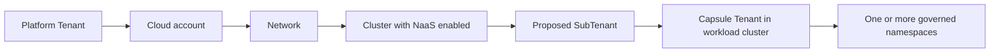

# Namespace as a Service

Research and proposed design, 2026-11-16. Evidence comes from the official Capsule operating documentation, the released Capsule 0.15.2 chart schemas, the platform's existing contracts, and Istio's primary documentation. All service, CRD, and lifecycle additions below are proposals. No examples were applied and no implementation was changed by this research.

## Scope and current implementation

The shipped integration is an optional platform component selected by `Cluster.spec.naas`, default false. It installs Capsule 0.15.2 into the workload cluster, using that cluster's existing cert-manager. It does not create Capsule Tenants, provision namespaces, map identities, or install capsule-proxy. Istio ambient is assumed to be installed already. This design proposes the next layer, a `SubTenantService`, without changing the ongoing operator-installation implementation. See [the component baseline](../components/capsule.md), [the catalog definition](../../pkg/catalog/definitions/capsule.yaml), and [the cluster API](../../idl/cloud/v1/cluster.proto).

The intended service is controlled namespace tenancy for applications within an existing workload cluster. It is not a claim that namespaces, Capsule, or an encrypted mesh provide a hard boundary against cluster administrators or a compromised shared kernel. Workloads requiring that boundary need a separately evaluated sandbox, dedicated nodes, or a dedicated cluster. [Kubernetes multi-tenancy](https://kubernetes.io/docs/concepts/security/multi-tenancy/), [Capsule architecture](https://projectcapsule.dev/docs/operating/concepts/architecture/).

## Resource model



| Name | Location and meaning | Relationship |
| --- | --- | --- |
| Platform Tenant | Existing cluster-scoped `cloud.cluster-vending.io/v1alpha1 Tenant` in the management cluster; an API authorization and registration boundary | Owns the platform account/network/cluster business scope; its management namespace is `tenant-<id>` |
| Cloud account | Existing platform CloudAccount and provider connection | Supplies provider access for Networks; never becomes a workload tenant identity |
| Network | Existing platform Network | Supplies cluster connectivity and inherited rollout tier |
| Workload cluster | Existing platform Cluster, reconciled from the management cluster | Belongs to one platform Tenant and Network; `spec.naas` selects Capsule installation |
| SubTenant | **Proposed** namespaced management CR and RPC resource | Belongs to one platform Tenant and one immutable workload cluster; owns one or more workload namespaces |
| Capsule Tenant | Workload-cluster `capsule.clastix.io/v1beta2 Tenant`, cluster-scoped | One per SubTenant in that cluster; groups its namespaces and policies |
| Workload namespace | Native workload-cluster Namespace | Belongs to exactly one Capsule Tenant; contains application workloads, PVCs, Secrets, and service accounts |

The business hierarchy is `platform Tenant → cloud account → Network → Cluster → SubTenant → namespaces`. A SubTenant remains administratively under its platform Tenant; Capsule does not introduce nested Capsule Tenants. Multiple SubTenants within one platform Tenant still require distinct workload identities and policy boundaries. Never put application namespaces into the management cluster's `tenant-<id>` namespace. [Platform Tenant](../../api/v1alpha1/tenant_types.go), [tenant lifecycle](../../pkg/controller/tenant_controller.go), [Capsule namespace assignment](https://projectcapsule.dev/docs/tenants/namespaces/).

## Decisions carried into the detailed plan

1. Kubernetes CRs remain authoritative; introduce no database and no second source of truth for membership or desired policy.
2. Add a separate future SubTenant service. Require `tenant_id` on every request and resolve the target cluster inside that tenant. Platform authorization does not automatically grant Kubernetes workload-cluster access.
3. Default to one namespace, with an explicit bounded namespace set as the service grows. Namespace names, object UIDs, cluster placement, and ownership are immutable; moving requires a reviewed migration.
4. Install and verify policy before granting developer access. Use restricted Pod Security admission, narrow workload RBAC, protected enrollment metadata, CNI-enforced ingress/egress restrictions, and explicit Istio authorization.
5. Ambient enrollment is not default deny. Ztunnel handles L4 policy; waypoints are required for L7. Native NetworkPolicies are additive, so tenants must not be able to widen mandatory boundaries by creating another allow policy.
6. Keep quotas and namespace governance independent from cloud credentials, cluster release channels, and the Network's rollout tier.
7. Deletion defaults to refusal while workloads or retained data remain. Never silently remove the Capsule Tenant: its Namespace owner references can trigger namespace garbage collection.
8. **Future disable precondition:** refuse `naas: true → false` while active, deleting, retained, or unmanaged Capsule tenants/namespaces still depend on enforcement. Check again during reconciliation. The current operator-only implementation does not yet provide this SubTenant gate.
9. Retaining a CRD or namespace after operator removal preserves some objects, not their isolation. Loss of admission, reconciliation, conversion service, quota enforcement, or replication protection must be an explicit failure state.

These are proposed platform decisions, informed by [Capsule networking guidance](https://projectcapsule.dev/docs/operating/best-practices/networking/), [restricted workload guidance](https://projectcapsule.dev/docs/operating/best-practices/workloads/), [Istio L4 policy](https://istio.io/latest/docs/ambient/usage/l4-policy/), and the [existing freeze contract](../../idl/cloud/v1/freeze.proto).

## Version evidence

The local `/tmp/capsule/Chart.yaml` declares chart/app **0.15.2**, with optional capsule-proxy **0.15.3**. The official chart archive has SHA-256 `df9c4b2eb90909851d38c861520384f236bbe240195b9f478785398809ae7a22`, matching the [official chart index](https://projectcapsule.github.io/charts/index.yaml). Every one of the twelve operator CRD files in `/tmp/capsule/crds` was compared byte-for-byte with that archive and matched. The packaged proxy also carries two distinct CRDs. [Released archive](https://projectcapsule.github.io/charts/capsule-0.15.2.tgz), [pinned chart source](https://github.com/projectcapsule/capsule/blob/v0.15.2/charts/capsule/Chart.yaml).

All operator examples will use `capsule.clastix.io/v1beta2`; only Tenant also serves legacy v1beta1. The optional proxy's packaged `ProxySetting` and `GlobalProxySettings` use **v1beta1**. Do not infer API versions from current documentation examples. The current documentation also mentions Resource Permits, but no ResourcePermit or ResourcePermitTemplate CRD is present in this pinned operator archive; they are outside this baseline.

## Research coverage status

The official [LLM index](https://projectcapsule.dev/llms.txt) and [sitemap](https://projectcapsule.dev/sitemap.xml) were crawled. The sitemap contains **23 operating pages**, including the section landing pages, both authentication routes, all setup variants, all best practices, all concepts, monitoring, and backup/restore. The obsolete `/docs/operating/backup-restore/index.md` route returns 404; the live backup page is `/docs/operating/operations/backup-restore/`. The coverage appendix identifies each available page and the unavailable historical route.

## Proposed management contract

### SubTenant CR

Introduce `cloud.cluster-vending.io/v1alpha1 SubTenant`, namespaced in the parent platform Tenant's management namespace. Its desired state belongs in `spec`; only controllers write `status`. Give it a finalizer such as `cloud.cluster-vending.io/subtenant`. Use an opaque time-ordered UUID as the API ID, consistent with existing cluster IDs; use a stable DNS-safe encoded ID in generated workload names. Display names are mutable and are never authorization keys.

| Field | Proposed contract |
| --- | --- |
| `spec.tenantRef` | Parent platform Tenant name and UID; immutable and server-resolved |
| `spec.clusterRef` | Cluster API ID, management CR name and UID; immutable; must resolve inside this platform Tenant |
| `spec.displayName` | Human-readable name, bounded to 128 characters |
| `spec.namespaces[]` | Stable logical namespace key and generated physical name; at least one; removal requires a destructive plan |
| `spec.access.bindings[]` | Approved identity references and bounded role profiles; never arbitrary ClusterRoles or raw impersonation headers |
| `spec.policyProfile` | Approved, versioned baseline reference; no tenant-supplied CEL or Helm values |
| `spec.quota` | Typed resource quantities and namespace count, bounded by platform entitlement |
| `spec.connectivity` | Explicit approved ingress, egress and same-SubTenant flows; default no external exposure |
| `spec.retention` | Data/namespace disposition; default protect; any destructive override is explicit and reviewed |
| `status` | Phase, conditions, observedGeneration, applied profile/release revisions, remote inventory, ownership UIDs, quota observations, effective freeze, last observation time, and bounded recent events |

Proposed phases: `Pending`, `Provisioning`, `Ready`, `Degraded`, `Deleting`, `Retained`, `Failed`. Conditions separately report `ClusterAvailable`, `NaaSReady`, `IdentityReady`, `PolicyReady`, `QuotaReady`, `NamespacesReady`, `Ready`, and `DeletionBlocked`. `Synced` means resources were accepted, not that network enforcement was proven. An unreachable workload API yields `Unknown` with observation age, not a stale green readiness signal.

IDs, parent/cluster references, namespace keys and physical names are immutable through CRD transition validation and RPC validation. Enforce bounds, uniqueness and mutually exclusive dispositions in both generated protobuf validation and structural CRD schemas. Use names plus UIDs in ownership checks to reject delete/recreate name reuse. Reserve platform ID, profile, readiness, Capsule membership, mesh enrollment and trust labels; tenants cannot edit them. This extends the [existing typed Component ownership/status pattern](../../api/v1alpha1/component_types.go) and [Kubernetes object ownership rules](https://kubernetes.io/docs/concepts/overview/working-with-objects/owners-dependents/).

### Ownership and naming

Use one workload Capsule Tenant named `st-<stable-id>` and namespaces `st-<stable-id>-<logical-key>`, each at most 63 characters. Generate the stable portion from the complete opaque ID with a collision-resistant encoding; reject collisions instead of adopting an unrelated name. Account for the full prefix when validating namespace keys. Keep globally unique names across clusters to simplify future migration and telemetry.

The management SubTenant may have an owner reference to the existing cluster-scoped **platform Tenant** in the same management API server. Its cluster relationship is an explicit immutable reference, not a cross-cluster owner reference. Extend platform Tenant and Cluster deletion guards to count SubTenant records, including retained/deleting records, before permitting parent deletion. Do not rely on garbage collection to implement data retention.

Workload namespaces have Capsule Tenant owner references established through Capsule admission. A namespaced management SubTenant cannot own a cluster-scoped workload Tenant, and owner references cannot span API servers. Cross-link remote objects with protected labels/annotations containing platform Tenant ID/UID, cluster ID/UID and SubTenant ID/UID; record remote UIDs in management status. Labels select inventory but do not prove ownership on their own. On conflict, stop and report it. [Capsule namespace lifecycle](https://projectcapsule.dev/docs/tenants/namespaces/), [platform store ID conventions](../../pkg/database/cloudstore/clusters.go).

### SubTenantService RPC shape

Propose `idl/cloud/v1/subtenant.proto`, `subtenant_service.proto`, generated Go/TypeScript clients, and `pkg/server/subtenant`; these paths are future work, not existing files. Every request carries `tenant_id`. The service reads/writes management CRs; a controller performs remote convergence. Provider adapters supply authenticated workload-cluster access and capabilities; shared contracts contain no AWS credentials, IAM role syntax or CNI-specific manifests.

| RPC | Input and result | Semantics |
| --- | --- | --- |
| `CreateSubTenant` | `tenant_id`, `cluster_id`, typed desired spec, `request_id`, optional `validate_only`/`plan_id`; returns resource and plan when requested | Async acceptance; retry of identical request ID returns the same resource; a different payload with the same ID is rejected |
| `GetSubTenant` | `tenant_id`, `id`; returns desired spec, etag, generation and observed status | `NO_SIDE_EFFECTS`; reads recorded observation, without implying a fresh workload scan |
| `ListSubTenants` | `tenant_id`, optional `cluster_id`, bounded `page_size`, opaque `page_token`, supported typed filters | `NO_SIDE_EFFECTS`; stable ID order and authorization on every page; token bound to tenant/filter scope |
| `PlanSubTenant` | `tenant_id`, create/update/delete intent, ID and etag where applicable, desired change/update mask | `NO_SIDE_EFFECTS`; renders proposed changes and performs authorized read/dry-run checks; cannot reserve quota or create objects |
| `UpdateSubTenant` | `tenant_id`, `id`, `etag`, explicit `update_mask`, desired fields, `plan_id` for reviewed changes | Async; only listed mutable paths change; empty/unknown masks rejected; never replaces identity or placement |
| `DeleteSubTenant` | `tenant_id`, `id`, `etag`, reviewed `plan_id`, disposition, explicit resource-name acknowledgement for destructive deletion | Idempotent async request; default refuses nonempty/data-bearing tenants; returns deletion status until confirmed gone or retained |

Use the [existing Plan](../../idl/cloud/v1/plan.proto): creation/apply order, disruptive changes, deletion last, namespace, GVK, field diff, replacement, and `waits_for`. Add **proposed** explicit `retains_data`/`retains_namespace` facts rather than misusing `retains_cloud_resource` for a PVC. Redact Secret content and credentials from plans, logs and inventory. Bind plan IDs to normalized desired change, etag, parent/remote UIDs and resourceVersions, effective policy/release and discovered data; reject stale plans with `FAILED_PRECONDITION`.

Example request bodies, illustrating the proposed generated JSON contract:

```json
{"tenantId":"acme","clusterId":"00000000-0000-4000-8000-000000000003","requestId":"naas-payments-01","subTenant":{"displayName":"Payments","namespaceKeys":["app"],"policyProfile":"restricted-ambient-v1","quota":{"requests.cpu":"4","requests.memory":"8Gi","requests.storage":"100Gi","pods":"30"}},"validateOnly":true}
```

```json
{"tenantId":"acme","id":"00000000-0000-4000-8000-000000000021","etag":"opaque-etag","updateMask":"spec.quota","subTenant":{"quota":{"requests.cpu":"6","requests.memory":"12Gi","requests.storage":"100Gi","pods":"40"}},"planId":"reviewed-plan-hash"}
```

The exact proto field spellings remain an implementation task; the examples define behavior, not an existing API. Specify protobuf FieldMask JSON encoding as a string. Resource references submitted by clients are IDs; handlers resolve canonical names/UIDs and never accept client-written ownership status.

### Authorization and identity

Existing [RPC classification](../../pkg/auth/access.go) treats methods carrying `tenant_id` as tenant scoped; `NO_SIDE_EFFECTS` permits tenant viewers, while mutations require tenant admin or platform admin. Preserve this classification and its exhaustive tests. A separate Plan RPC avoids classifying preview as a write just because it shares a mutation method. Check ownership again in handlers and reconcilers; a forged `cluster_id` from another platform Tenant must not leak its existence, namespace names, quotas or workload status.

Existing [identity handling](../../pkg/auth/identity.go) permits anonymous callers in configured development modes. A production NaaS offering must use required authentication, authenticated controller identities and auditable grants; do not reinterpret anonymous mode as an isolated hosted service. No existing SubTenant delegation model was found. Until one is designed, platform Tenant viewers/admins retain the existing coarse read/write scope; workload developers receive Kubernetes access only to their assigned namespaces. A future delegated role must be scoped to the SubTenant ID rather than equating every Capsule owner with platform Tenant admin.

Use workload-cluster OIDC identities/groups with issuer-qualified, stable mappings and validated audiences; do not accept arbitrary groups from request bodies. Capsule's user membership configuration identifies which identities its namespace admission handles; it is not the authentication provider. A `TenantOwner` can aggregate a subject into Capsule users, and a Capsule owner can receive namespace provisioning powers even with a limited namespace role. Therefore the initial API-controlled service gives ownership to a trusted bootstrap identity and gives human developers narrow namespace RoleBindings, not Capsule ownership. Disable owner/service-account promotion for this profile. [Capsule authentication](https://projectcapsule.dev/docs/operating/setup/authentication/), [Capsule permissions](https://projectcapsule.dev/docs/tenants/permissions/).

## Lifecycle, plans and installation boundaries

### Cluster readiness and toggle ordering

The current operator-only integration queues NaaS toggles behind freezes and an in-flight `COMPONENTS` or `HALTED` release move. Keep the release move's component order stable; toggling NaaS must not skip a failed step or change its pending list. After the move completes or is normally recovered, reconcile the latest desired toggle. This is different from the future disable precondition, which prevents removal while tenants still need enforcement. [Current component lifecycle](../components/capsule.md).

Before a future SubTenant becomes Ready, verify the actual workload cluster: `spec.naas=true`, Capsule version and CRDs, controller and webhook endpoints, valid serving certificates/CA bundles, required admission hooks, workload-cluster cert-manager readiness, ambient capture, supported policy-enforcing CNI and Kubernetes minor, and successful positive/negative connectivity qualification. Helm `deployed` alone does not establish these conditions. Existing cert-manager and ambient installations remain separately owned prerequisites; SubTenant creation does not reinstall either. Current component support is AWS; keep a provider-neutral contract and explicit capability checks for later providers.

Pin Capsule, CRD schemas, Kubernetes compatibility, policy profiles and tested Istio/CNI combinations through the cluster's existing release model. The Network supplies rollout tier; the Cluster supplies release channel. SubTenant does not get an independent tier or a user-selected Capsule version. The installation guide's old generic Kubernetes minimum is not a support promise: upstream announces compatibility per release and currently supports only its latest Kubernetes minor. Qualify every offered minor rather than assuming that a shared chart pin proves compatibility. [Capsule installation/compatibility](https://projectcapsule.dev/docs/operating/setup/installation/), [existing releases](../../idl/cloud/v1/admin_release.proto).

### Ordered create and reconcile

1. Authenticate, validate entitlement, resolve platform Tenant and target Cluster by ID+UID, and read effective freeze/release state. Persist one idempotent desired-state record; return acceptance promptly.
2. Wait for required cluster capabilities and component readiness. Pending is an observable state, not a reason to bypass policy or run cloud calls inside the RPC handler.
3. Reserve stable names and create the Capsule Tenant with deletion protection, bounded namespace count, policy rules and shared quota. Verify ownership on an existing same-name object; never force-adopt it.
4. Create namespaces through a Capsule-aware trusted bootstrap identity, with correct membership owner reference/labels, `restricted` PSS, ambient enrollment and a platform-controlled provisioning guard. Do not grant developer access yet.
5. Apply protected network/authentication policies, LimitRanges, workload service accounts, quota configuration and any approved replication. Wait for Capsule RuleStatus, generated quota/ledger readiness and all declared policy versions to converge.
6. Verify actual enforcement using the cluster's qualified CNI/ambient test profile. A platform admission guard must reject tenant workloads in an unready namespace; withholding human RoleBindings alone does not stop preexisting CI identities or operators.
7. Grant the approved namespace RoleBindings, mark the provisioning guard ready, and publish status/inventory with the applied generation and observation time. Make the readiness transition retryable and reversible on drift.

Use separate SSA field managers for platform intent and Capsule-generated resources. Avoid fighting Capsule over Namespace owner references, membership labels, generated RoleBindings or RuleStatus. Retry partial convergence by UID and inventory. Do not regenerate credentials or namespace names on retry. Discover drift and unexpected additional namespaces instead of silently treating them as entitled inventory. Replication dependencies are eventual, not cross-object transactions. [Managed resources and SSA](https://projectcapsule.dev/docs/operating/concepts/managed-resources/), [tenant rules](https://projectcapsule.dev/docs/tenants/rules/).

### Update and freeze

Preview quota decreases, role changes, namespace removal, storage disposition and connectivity changes. Refuse quota reductions below usage/reservations; show that revoking Kubernetes RBAC does not necessarily revoke an already-issued cloud token or terminate established sessions. A policy update affects future admissions and does not repair or evict previously accepted workloads automatically. Stage stricter policies with an inventory audit and an explicit remediation plan.

The platform's canonical freeze remains authoritative. Desired changes can be recorded while frozen; remote create/update/delete work waits, while reads and status observation continue. Do not call Capsule cordoning equivalent to platform freeze: it gates selected workload API mutations by configured caller/hook scope, can affect native controllers differently, and does not stop Kubernetes scheduling, running processes, cloud APIs or packet flow. Any future workload-change freeze needs a separately tested Capsule admission configuration and must preserve recovery controllers. [Freeze contract](../../idl/cloud/v1/freeze.proto), [Capsule cordoning](https://projectcapsule.dev/docs/tenants/administration/).

### Delete, retain and disable

Default delete is `RequireEmpty`: enumerate Pods, controllers, PVC/PV relationships, snapshots, external resource claims, replication and finalizers; refuse if deleting would lose workload/data ownership. A separate `Retain` disposition keeps the management record in `Retained`, revokes developer access as planned, and continues governance. It must not count as an empty cluster eligible to disable Capsule.

For explicit destructive deletion: record the reviewed data inventory and approvals in the request; prevent new workloads; stop application controllers/jobs; complete the backup/disposition checks; delete workloads; handle PVCs/snapshots and external claims according to their real reclaim policies; then delete namespaces and verify completion. Keep enforcement and managed policies until workloads are gone. Remove the Capsule Tenant only after its namespace inventory is empty, temporarily clearing `preventDeletion` through the trusted controller. Finally remove remote policy/identity artifacts and the management finalizer. Namespace termination can wait on storage/operator finalizers; report blockers, never strip arbitrary finalizers. [Capsule ordered namespace termination](https://projectcapsule.dev/docs/tenants/namespaces/), [Kubernetes volume reclaim policies](https://kubernetes.io/docs/concepts/storage/persistent-volumes/#reclaiming).

An unreachable cluster blocks destructive finalization. Orphaning is an operator-reviewed recovery operation that retains a tombstone with the last remote IDs and explicitly reports lost enforcement/observation. Do not delete the only management record and claim remote cleanup succeeded.

The future `naas=false` gate must check management SubTenants **and** remote Capsule Tenants/namespaces, including foreign tenants installed outside this service. Serialize the gate with create acceptance and recheck before uninstall, closing the create/disable race. Refuse disable, cluster deletion or parent registration deletion while dependencies exist. A planned migration can transfer governance only after the replacement boundary is verified. Direct out-of-band operator removal is an incident, not a supported bypass.

Retained CRDs do not retain controller enforcement. The pinned chart's pre-delete hook removes webhook TLS material and namespace-provisioner/deleter roles/bindings; the post-delete hook removes dynamic webhook configurations. CRD lifecycle hooks and `keep` behavior differ from ordinary Helm-managed resources. Never delete Capsule CRDs as part of a tenant offboarding: deleting a CRD deletes its custom objects and may trigger downstream garbage collection. Retained CRDs may still reference an unavailable conversion webhook. Preview the exact rendered installation and current objects before any future uninstall and explicitly separate operator removal, CRD removal, Capsule Tenant removal, namespace removal and storage destruction. [Pinned lifecycle templates](https://github.com/projectcapsule/capsule/tree/v0.15.2/charts/capsule/templates/hooks), [CRD deletion behavior](https://kubernetes.io/docs/tasks/extend-kubernetes/custom-resources/custom-resource-definitions/#delete-a-customresourcedefinition).

## Security profile and ambient limits

### Mandatory controls

| Boundary | Required platform control | Residual limitation |
| --- | --- | --- |
| API and identity | Tenant-scoped RPC lookup; workload OIDC/RBAC; no raw impersonation/bind/escalate rights | Cluster administrators, authentication administrators and controllers remain trusted |
| Workload admission | PSS `restricted` in enforce/audit/warn modes, pinned to a supported Kubernetes policy version; additional admission for enrollment, service-account selection and approved resource kinds | Admission changes do not sanitize existing Pods |
| Namespace network | CNI-enforced ingress+egress deny baseline and explicit approved paths; tenants cannot author widening native/CNI policies | CNI behavior, node traffic, non-TCP protocols and provider networking need qualification |
| Mesh identity | Ambient enrollment protected; namespace `STRICT` PeerAuthentication; L4 ALLOW policies for approved identities | mTLS authenticates a workload, not its business entitlement |
| L7 | Dedicated trusted waypoint scope where required, `targetRefs` policies, and destination ztunnel accepting only the authorized waypoint identity | Direct Pod IP, ingress and missing-waypoint paths need explicit controls |
| Data | Namespace-specific service accounts, Secret/PVC permissions and external secret/cloud identity scope | A workload creator can often consume other secrets and service accounts in the same namespace |
| Compute | Resource budgets, noncritical priority, placement constraints; optional sandbox/dedicated nodes | Shared kernel, API server, nodes, CSI and platform agents remain common failure domains |

Do not grant application users the built-in `admin` role by default. Define an explicit workload-editor role: selected workload kinds, ClusterIP Services, ConfigMaps, PVCs and events as needed; no Role/RoleBinding writes, Capsule resources, NetworkPolicies, mesh policies, Gateways/ReferenceGrants, nodes, PVs, CRDs, webhooks, `pods/binding`, `services/status`, EndpointSlices or legacy Endpoints. Keep exec/attach/port-forward/logs/debug and Secret access as separate opt-ins. Kubernetes RBAC is additive; audit all other bindings and aggregated roles. [RBAC escalation prevention](https://kubernetes.io/docs/reference/access-authn-authz/rbac/#privilege-escalation-prevention-and-bootstrapping), [Capsule networking exposure guidance](https://projectcapsule.dev/docs/operating/best-practices/networking/).

Restricted PSS must actually be enforced, not merely warned. It limits privileged containers, host namespaces/ports, hostPath and unsafe capabilities; add policy for writable root filesystems, approved runtimes/images, direct node assignment, alternative schedulers, wildcard tolerations and unsafe workload operators where necessary. Deny or constrain DaemonSets and disruptive PDB settings. PSS does not enforce all resource, supply-chain, service-account or egress requirements. Sandbox and `hostUsers:false` profiles require compatible kernels/runtimes/CSI; do not enable them universally without qualification. [Pod Security Standards](https://kubernetes.io/docs/concepts/security/pod-security-standards/), [Capsule workload baseline](https://projectcapsule.dev/docs/operating/best-practices/workloads/), [additional admission policies](https://projectcapsule.dev/docs/operating/best-practices/admission-policies/).

### L4 is explicit authorization, not automatic isolation

Ztunnel enforces L4 authorization at the receiving workload. Ambient mesh-to-mesh connections use HBONE/mTLS, but the documented default peer policy is permissive for plaintext from outside the mesh; add `STRICT` plus explicit authorization. With no applicable restrictive policy, enrollment alone does not isolate SubTenants. Use approved namespace/service-account principals and destination ports, never a rule accepting every mesh identity. Namespace strings and service-account identities come from authenticated mesh identity, not from a caller-supplied business label. [L4 policy and peer authentication](https://istio.io/latest/docs/ambient/usage/l4-policy/), [mesh enrollment/interoperability](https://istio.io/latest/docs/ambient/usage/add-workloads/).

Do not place HTTP methods, paths, JWT claims or headers into a ztunnel-targeted rule. Current Istio documentation is not uniform about unsupported L7 DENY handling: the detailed L4 guide distinguishes skipped L7-only rules from mixed L4/L7 behavior, while another guide uses simplified fail-safe wording. The design must reject this configuration and test the installed release, rather than assuming every unsupported policy fails closed. [Detailed attribute behavior](https://istio.io/latest/docs/ambient/usage/l4-policy/#policies-with-layer-7-conditions), [L7 attachment guide](https://istio.io/latest/docs/ambient/usage/l7-features/).

### Waypoints and bypass

Use Gateway API waypoint resources for L7, with policy `targetRefs` naming the Service or Gateway. Default waypoint scope covers Services; direct Pod-IP traffic is a different destination type. A `use-waypoint` label alone is insufficient when the waypoint is missing, unready or mismatched. For protected destinations, the ztunnel policy must allow only that waypoint service account, and the waypoint must authorize the original clients. Do not leave the broad same-SubTenant L4 allow alongside this requirement. [Waypoint enforcement and traffic types](https://istio.io/latest/docs/ambient/usage/waypoint/).

At the destination ztunnel, traffic forwarded by a waypoint has the waypoint's identity, not the original client's. Enforce original-client identity at the waypoint. Keep waypoints inside the SubTenant trust scope; shared cross-namespace waypoints require explicit attachment selectors and review. Ingress gateway traffic does not automatically traverse the destination waypoint: the documented ingress label and control-plane feature setting must be supported and enabled, or enforce the complete ingress policy at the gateway. End-to-end application TLS also limits HTTP inspection unless termination is intentionally designed. [L4 enforcement-point considerations](https://istio.io/latest/docs/ambient/usage/l4-policy/#considerations), [ingress waypoint path](https://istio.io/latest/docs/ambient/usage/waypoint/#ingress-and-waypoints).

### CNI, HBONE, DNS and egress

Istio's node CNI integration does not replace the primary CNI's NetworkPolicy engine. Qualify the exact EKS/VPC CNI version, native enforcement mode, node OS, Pod ENI/security-group configuration, IP families and Istio release. Confirm where policy observes source addresses, DNAT/SNAT, and application versus HBONE ports. A Namespace object containing NetworkPolicies is not evidence that they are enforced. In particular, **never blanket-allow TCP 15008 from every namespace** to make ambient connectivity pass. Allow it only between the approved namespaces/endpoints and pair it with ztunnel identity authorization. [Ambient NetworkPolicy interaction](https://istio.io/latest/docs/ambient/usage/networkpolicy/), [EKS ambient prerequisites](https://istio.io/latest/docs/ambient/install/platform-prerequisites/#amazon-elastic-kubernetes-service-eks).

Native NetworkPolicies combine allowances; a protected deny-baseline object cannot prevent a second tenant-written policy from opening the network. Remove such write permissions, or qualify administrator-enforced CNI policy precedence. Capsule's native NetworkPolicy CIDR rules validate submitted grants, but selector-based peers and separate CNI CRDs require independent control; they are not a universal mandatory network firewall. [Capsule policy scope](https://projectcapsule.dev/docs/rules/enforcement/network/#scope-and-limits), [native policy composition](https://kubernetes.io/docs/concepts/services-networking/network-policies/#the-two-sorts-of-pod-isolation).

Permit only the actual DNS service/Pod or qualified NodeLocal DNS path, TCP and UDP as needed. Ambient DNS capture is documented as default from Istio 1.25, with a Pod-level opt-out; protect that annotation where routing depends on capture. DNS success does not grant the resulting destination permission. Guard against arbitrary DNS servers, DoH/DoT, rebinding, raw IPs, IPv6 routes and link-local metadata endpoints. Unrestricted external DNS can itself be an exfiltration channel. Image pulls occur through the node runtime and are not made safe by a workload's egress policy. [DNS capture](https://istio.io/latest/docs/ops/configuration/traffic-management/dns-proxy/).

No public ingress or general internet egress is enabled by default. Add narrow ingress gateway paths and approved external destinations through reviewed profiles. For governed egress, combine an approved egress waypoint/gateway and service definitions with CNI enforcement preventing direct escape; a ServiceEntry, discovery visibility or `REGISTRY_ONLY` setting alone is not a security boundary. Account for gateway DNS and upstream TLS verification. [Ambient egress gateway](https://istio.io/latest/docs/ambient/usage/egress-gateway/), [egress security guidance](https://istio.io/latest/docs/ops/best-practices/security/#securing-egress-traffic).

Host-network Pods are not ordinary ambient workloads; primary NetworkPolicy behavior for them is implementation-dependent. Deny tenant `hostNetwork`, hostPID/IPC, privileged pods and dangerous capabilities; separately protect trusted node agents. Ambient kubelet probes use special SNAT addresses, documented as `169.254.7.127` and `fd16:9254:7127:1337:ffff:ffff:ffff:ffff`; grant narrowly tested probe exceptions rather than all node traffic. UDP and other non-TCP protocols need CNI control rather than a claim of HBONE protection. Qualify same-node and cross-node paths, IPv4 and IPv6, including health probes. [hostNetwork limitations](https://kubernetes.io/docs/concepts/services-networking/network-policies/#networkpolicy-and-hostnetwork-pods), [probe behavior](https://istio.io/latest/docs/ambient/usage/networkpolicy/#ambient-health-probes-and-kubernetes-networkpolicy), [Istio hostNetwork fix](https://istio.io/latest/news/releases/1.31.x/announcing-1.31/change-notes/).

Protect namespace, Pod and Service enrollment/waypoint labels, DNS-capture annotations and sidecar-status/injection controls; never let developers opt out of policy by changing metadata. Include controller Pod templates and subresources in admission tests. Capsule metadata rules explicitly target Namespace and skip some built-in managed keys; complement them with workload admission for mesh-specific escape hatches. [Metadata rules](https://projectcapsule.dev/docs/rules/enforcement/metadata/), [ambient selection precedence](https://istio.io/latest/docs/ambient/usage/add-workloads/#pod-selection-logic-for-ambient-and-sidecar-modes).

### Secrets, cloud identity and storage

Use an unprivileged default service account with token automount disabled, and separate approved workload accounts. Applications needing Kubernetes access receive audience-bound, short-lived projected tokens and minimal RBAC. `automountServiceAccountToken:false` is not a complete boundary when users can create Pods selecting privileged accounts or explicit token projections. Keep provisioner, replication and recovery identities in trusted platform namespaces. [Service-account guidance](https://kubernetes.io/docs/concepts/security/service-accounts/).

For AWS workload identity, scope trust to the exact workload cluster issuer, namespace and service account, and restrict who may choose/annotate those accounts. Never hand workloads the CloudAccount provisioning role, node role or management kubeconfig. Block metadata and infrastructure endpoints through qualified network/node controls; IPv6 and link-local paths must be included. Treat the cloud identity binding as a provider adapter capability, with explicit revocation/retention in the plan, rather than an opaque tenant-set annotation.

No Secret is shared across SubTenants by default. Replication is allowed only for an approved source and audience; avoid copying cluster credentials or common high-privilege pull secrets. A developer able to create arbitrary Pods can often consume Secrets and identities inside that namespace, so independent trust domains require different namespaces or SubTenants. Encrypt sensitive backups and manage external-secret access by SubTenant, not merely by platform Tenant. [Secrets operating guidance](https://projectcapsule.dev/docs/operating/best-practices/).

Capsule labels PV ownership from the claiming tenant namespace and guards explicit cross-Tenant PV references; this does not replace CSI, backend volume authorization, snapshot policy or encryption. Do not permit tenants to edit PVs, storage ownership labels, VolumeSnapshotContents or unrestricted cross-namespace data-source references. Allow only approved StorageClasses with known reclaim/expansion/topology behavior. Retain is not backup or secure erasure. Scope restore exceptions to the trusted restoring service account and specific staging volumes; no wildcard cross-tenant PV access. [Capsule storage rules](https://projectcapsule.dev/docs/rules/enforcement/storage/), [Capsule restore procedure](https://projectcapsule.dev/docs/operating/operations/backup-restore/).

### Quota, placement and resource distribution

Use named `Tenant.spec.rules[].quota` entries to generate one GlobalResourceQuota budget across the SubTenant's namespaces. Do not copy the full budget independently into each namespace. Wait for the current ledger/generation and native accounting readiness before granting workload creation. Include CPU/memory requests, memory limits, ephemeral storage, Pods, PVC/storage, services and selected object counts. Quota is a consumption ceiling, not node capacity reservation or guaranteed performance. Namespace count is bounded separately. [GlobalResourceQuota](https://projectcapsule.dev/docs/resource-management/globalresourcequota/).

For explicit per-namespace allocation, optionally use ResourcePool/ResourcePoolClaim; initialize tracked resources at zero before claims, and account for immutable/bound claims and queued allocations. CustomQuota/GlobalCustomQuota are optional for quantities native quota cannot express. They are observational without the matching calculations admission hook and require target readiness; do not substitute an unqualified custom calculation for the baseline shared native budget. [Resource pools](https://projectcapsule.dev/docs/resource-management/resourcepools/), [custom quotas](https://projectcapsule.dev/docs/resource-management/customquotas/).

Provide realistic per-container defaults through LimitRange or approved resource rules; avoid forcing CPU limits just to claim a stronger QoS class. Limit scratch storage, counts, API churn, PIDs/inodes and noisy-neighbor risks through the appropriate node/admission mechanisms. Reserve platform headroom and maintenance capacity. Optional dedicated node pools must use protected labels, taints, required placement, approved tolerations and scheduler controls; node placement alone is not a complete security boundary. Cluster administrators and shared ztunnel/CSI/CNI agents remain trusted.

Use direct controller SSA for a small explicit inventory, or administrator-owned GlobalTenantResource to distribute approved baseline objects. Do not have both manage the same fields. Prefer per-resource `policy` with explicit `creation`, `protect`, `force`, `deletion`; avoid legacy global `settings` semantics. Namespace/tenant selector removal can delete replicated policies, so preview selector changes as security changes. TenantResource is optional and constrained to the SubTenant; if enabled, use least-privilege execution identities and never grant arbitrary privileged replication or template context reads. [Global replications](https://projectcapsule.dev/docs/replications/global/), [tenant replications](https://projectcapsule.dev/docs/replications/tenant/).

## Complete pinned Capsule CR inventory

The following are **all twelve operator CRD kinds** in the verified 0.15.2 archive. Scope is the workload cluster's Kubernetes scope. `v1beta2` is served and storage for each; Tenant additionally serves v1beta1 through conversion. Installing a CRD does not mean creating one instance per SubTenant. Generated accounting/status objects are not public desired-state inputs. Each schema link is pinned to the release.

| Kind | Scope | Role in this design | Pinned schema |
| --- | --- | --- | --- |
| `CapsuleConfiguration` | Cluster | Required installation configuration, one configured instance per operator; identity/admission/RBAC options are platform owned | [schema](https://github.com/projectcapsule/capsule/blob/v0.15.2/charts/capsule/crds/capsule.clastix.io_capsuleconfigurations.yaml) |
| `Tenant` | Cluster | Required per SubTenant; owns workload namespace membership, rules and namespace cap | [schema](https://github.com/projectcapsule/capsule/blob/v0.15.2/charts/capsule/crds/capsule.clastix.io_tenants.yaml) |
| `TenantOwner` | Cluster | Optional reusable owner identity; not required when Tenant has direct bootstrap owner; selector-based association is not nested tenancy | [schema](https://github.com/projectcapsule/capsule/blob/v0.15.2/charts/capsule/crds/capsule.clastix.io_tenantowners.yaml) |
| `RuleStatus` | Namespaced | Controller-generated effective namespace rule/status; observe, never hand-author | [schema](https://github.com/projectcapsule/capsule/blob/v0.15.2/charts/capsule/crds/capsule.clastix.io_rulestatuses.yaml) |
| `GlobalResourceQuota` | Cluster | Required accounting mechanism for the proposed shared budget; generated by named Tenant rule or explicitly managed, not both | [schema](https://github.com/projectcapsule/capsule/blob/v0.15.2/charts/capsule/crds/capsule.clastix.io_globalresourcequotas.yaml) |
| `QuantityLedger` | Namespaced | Internal controller/admission accounting and reservations for quota systems; not tenant-authored | [schema](https://github.com/projectcapsule/capsule/blob/v0.15.2/charts/capsule/crds/capsule.clastix.io_quantityledgers.yaml) |
| `GlobalTenantResource` | Cluster | Optional administrator-owned baseline distribution; useful for LimitRanges, network policies and approved configuration | [schema](https://github.com/projectcapsule/capsule/blob/v0.15.2/charts/capsule/crds/capsule.clastix.io_globaltenantresources.yaml) |
| `TenantResource` | Namespaced | Optional replication within one Capsule Tenant; deny to developers unless explicitly enabled with constrained execution RBAC | [schema](https://github.com/projectcapsule/capsule/blob/v0.15.2/charts/capsule/crds/capsule.clastix.io_tenantresources.yaml) |
| `ResourcePool` | Cluster | Optional allocator of capacity to selected namespaces | [schema](https://github.com/projectcapsule/capsule/blob/v0.15.2/charts/capsule/crds/capsule.clastix.io_resourcepools.yaml) |
| `ResourcePoolClaim` | Namespaced | Optional per-namespace claim against an approved ResourcePool | [schema](https://github.com/projectcapsule/capsule/blob/v0.15.2/charts/capsule/crds/capsule.clastix.io_resourcepoolclaims.yaml) |
| `CustomQuota` | Namespaced | Optional custom calculated quantity inside one namespace; enforcement requires configured calculations webhook | [schema](https://github.com/projectcapsule/capsule/blob/v0.15.2/charts/capsule/crds/capsule.clastix.io_customquotas.yaml) |
| `GlobalCustomQuota` | Cluster | Optional calculated quantity across selected namespaces; same admission caveat | [schema](https://github.com/projectcapsule/capsule/blob/v0.15.2/charts/capsule/crds/capsule.clastix.io_globalcustomquotas.yaml) |

The optional **capsule-proxy 0.15.3 dependency** packages two more kinds: cluster-scoped `GlobalProxySettings` and namespaced **`ProxySetting` (singular)**, both `capsule.clastix.io/v1beta1` storage/served in that artifact. They are separate from the twelve operator CRDs and remain disabled by the current catalog. `GlobalProxySettings` grants filtered cluster-resource Get/List through the proxy; the pinned `ProxySetting.spec.subjects[].clusterResources` is deprecated and has `maxItems:0`. Do not copy a moving-documentation example into an invented v1beta2 proxy resource. [Pinned dependency](https://github.com/projectcapsule/capsule/blob/v0.15.2/charts/capsule/Chart.lock), [proxy API documentation](https://projectcapsule.dev/docs/proxy/reference/).

If kubectl access needs namespace/cluster-resource listing, optionally deploy the proxy as a separately reviewed component with authenticated TLS, constrained impersonation and read-only selectors. It does not grant native Kubernetes cluster-admin. Keep `SkipImpersonationReview=false`; treat trusted forwarded-client-certificate sources, public paths, RoleBinding reflection and direct API bypass explicitly. Do not expose Nodes/PVs or all-namespace listing merely to improve UX. [Proxy setup](https://projectcapsule.dev/docs/proxy/setup/installation/), [options](https://projectcapsule.dev/docs/proxy/setup/options/), [reflection](https://projectcapsule.dev/docs/proxy/reflection/).

## Illustrative baseline manifests

These are **documentation examples, not applied resources**. They show the proposed per-SubTenant output and required ordering. They are not a standalone installer or a declaration that every EKS networking combination already enforces them. `st-a1b2c3d4e5f6` is a shortened example identifier; production names must encode the complete stable identity as described above. The sample profile uses PSS `v1.35` only for a cluster qualified for that version; it is not a Capsule compatibility assertion.

### Cluster-wide prerequisites, installed once

The existing Capsule, external cert-manager and ambient installations are prerequisites. Before any example namespace is open to developers, the platform must also provide:

- A trusted `naas-system/provisioner` ServiceAccount, authenticated workload-cluster client, Capsule user/administrator mapping and narrow provisioning permissions. These credentials never appear in the SubTenant API.
- A workload-editor ClusterRole such as the example below. Capsule strict RBAC must explicitly permit binding any role it distributes; the controller's strict mode is not a guarantee of namespace-only controller authority.
- Admission that protects namespace readiness/ownership/PSS/enrollment metadata, blocks tenant policy-authoring escape paths, checks workload service-account selection, and prevents workload admission while provisioning is incomplete. Controller-created Pods and external operators must also be covered. No developer RoleBinding is granted until those checks pass.
- A qualified native CNI enforcement profile, Kubernetes admission plugins, protected platform namespace labels, DNS and health-probe allowances, and a connectivity acceptance runner. A default-deny rollout can break probes, DNS and monitoring without these allowances.
- Optional approved PriorityClass/RuntimeClass/StorageClass definitions, Gateway API CRDs and waypoint controller where used; storage/backup integrations and approved external identity mappings.

The installer, not each SubTenant request, owns CapsuleConfiguration, webhook certificates, admission configurations, CRDs, cluster-wide roles and monitoring configuration. User groups and impersonation defaults are merged into the installation's versioned configuration; do not create a competing CapsuleConfiguration per SubTenant. [Configuration](https://projectcapsule.dev/docs/operating/setup/configuration/), [strict RBAC installation](https://projectcapsule.dev/docs/operating/setup/installation/#strict-rbac).

For the initial implementation, the recommended additional admission resources
are platform-owned `admissionregistration.k8s.io/v1 ValidatingAdmissionPolicy`
objects and matching `ValidatingAdmissionPolicyBinding` objects. This is a
proposed design choice, not something supplied by installing Capsule or by the
currently disabled Kyverno definition. Use fail-closed validation and Deny
bindings for these independently testable policy families:

| Proposed policy family | Required protection |
| --- | --- |
| Namespace ownership and readiness | Only the trusted provisioner can set/change SubTenant membership, ownership UIDs, PSS/enrollment labels or the provisioning-ready guard |
| Workload enrollment and identity | Validate Pods and supported controller templates; prevent mesh/DNS opt-out metadata, unauthorized service-account selection and token/identity escape paths |
| Placement and service exposure | Reject unapproved nodeName, schedulers, tolerations/affinity, runtime/priority classes and external exposure choices |
| Incomplete provisioning | Deny workload admission until the namespace baseline is Ready, including Pods created by native controllers or external operators; no blanket system-controller exemption |

Bindings must match protected, platform-owned namespace labels and cannot be
edited by developers. Test admission errors and unavailable parameter resources
as fail-closed states. CEL expressions, allowed exceptions, parameter ownership
and field coverage remain explicit implementation deliverables; these examples
do not substitute for them. [Native admission policy and binding behavior](https://kubernetes.io/docs/reference/access-authn-authz/validating-admission-policy/).

```yaml
# Workload cluster: cluster-wide prerequisite. No RBAC/policy/Secret privileges.
apiVersion: rbac.authorization.k8s.io/v1
kind: ClusterRole
metadata:
  name: naas-workload-editor
rules:
  - apiGroups: ["apps"]
    resources: ["deployments", "statefulsets"]
    verbs: ["get", "list", "watch", "create", "update", "patch", "delete"]
  - apiGroups: ["batch"]
    resources: ["jobs", "cronjobs"]
    verbs: ["get", "list", "watch", "create", "update", "patch", "delete"]
  - apiGroups: [""]
    resources: ["services", "configmaps", "persistentvolumeclaims"]
    verbs: ["get", "list", "watch", "create", "update", "patch", "delete"]
  - apiGroups: [""]
    resources: ["pods", "events"]
    verbs: ["get", "list", "watch"]
```

This role omits direct Pod writes and subresource access, but creating a Deployment still permits running code and choosing its Pod spec. Admission must constrain that spec, including service accounts, and namespace peers must share the same trust boundary. The role does not promise confidentiality from other workload creators in that namespace.

### Per-SubTenant Capsule Tenant and first namespace

Create the Capsule Tenant first and wait for its rules/quota controller. The bootstrap identity is an owner; the developer group is deliberately not a Capsule owner. `forceTenantPrefix` and namespace quota are present in the pinned v1beta2 schema. The rules use current fields instead of legacy embedded `resourceQuotas`, `networkPolicies` or forbidden-metadata examples.

```yaml
apiVersion: capsule.clastix.io/v1beta2
kind: Tenant
metadata:
  name: st-a1b2c3d4e5f6
  labels:
    cloud.cluster-vending.io/tenant: acme
    cloud.cluster-vending.io/subtenant-id: "00000000-0000-4000-8000-000000000021"
spec:
  preventDeletion: true
  forceTenantPrefix: true
  permissions:
    allowOwnerPromotion: false
  owners:
    - kind: ServiceAccount
      name: system:serviceaccount:naas-system:provisioner
      clusterRoles: [naas-workload-editor]
  namespaceOptions:
    quota: 3
  rules:
    - quota:
        - name: budget
          hard:
            requests.cpu: "4"
            requests.memory: 8Gi
            limits.memory: 8Gi
            requests.ephemeral-storage: 20Gi
            limits.ephemeral-storage: 40Gi
            requests.storage: 100Gi
            persistentvolumeclaims: "10"
            pods: "30"
            services: "20"
            secrets: "40"
    - enforce:
        action: allow
        services:
          types: [ClusterIP]
    - enforce:
        action: deny
        services:
          externalIPs: {}
    - enforce:
        action: allow
        metadata:
          - apiGroups: [v1]
            kinds: [Namespace]
            labels:
              pod-security.kubernetes.io/enforce:
                managed: restricted
                required: true
                values: [{exact: [restricted]}]
              pod-security.kubernetes.io/enforce-version:
                managed: v1.35
                required: true
                values: [{exact: [v1.35]}]
              pod-security.kubernetes.io/audit:
                managed: restricted
                required: true
                values: [{exact: [restricted]}]
              pod-security.kubernetes.io/audit-version:
                managed: v1.35
                required: true
                values: [{exact: [v1.35]}]
              pod-security.kubernetes.io/warn:
                managed: restricted
                required: true
                values: [{exact: [restricted]}]
              pod-security.kubernetes.io/warn-version:
                managed: v1.35
                required: true
                values: [{exact: [v1.35]}]
              istio.io/dataplane-mode:
                managed: ambient
                required: true
                values: [{exact: [ambient]}]
---
apiVersion: v1
kind: Namespace
metadata:
  name: st-a1b2c3d4e5f6-app
  # Created through the trusted Capsule-aware bootstrap identity.
  # Capsule supplies/verifies the Tenant owner reference using its actual UID.
  labels:
    capsule.clastix.io/tenant: st-a1b2c3d4e5f6
    cloud.cluster-vending.io/tenant: acme
    cloud.cluster-vending.io/subtenant-id: "00000000-0000-4000-8000-000000000021"
    cloud.cluster-vending.io/naas-ready: "false"
    istio.io/dataplane-mode: ambient
    pod-security.kubernetes.io/enforce: restricted
    pod-security.kubernetes.io/enforce-version: v1.35
    pod-security.kubernetes.io/audit: restricted
    pod-security.kubernetes.io/audit-version: v1.35
    pod-security.kubernetes.io/warn: restricted
    pod-security.kubernetes.io/warn-version: v1.35
```

The provisioning guard and protected labels are a required platform admission prerequisite, not capabilities magically supplied by the label itself. Add a second namespace using the same membership and approved logical key; it shares this budget rather than receiving another full budget. The Capsule controller creates the GlobalResourceQuota and internal ledger; do not author synthetic status or precompute their UIDs. [Pinned Tenant schema](https://github.com/projectcapsule/capsule/blob/v0.15.2/charts/capsule/crds/capsule.clastix.io_tenants.yaml), [quota generation](https://projectcapsule.dev/docs/tenants/rules/#quotas).

### Per-namespace policies and identities

The baseline below allows same-SubTenant **encrypted TCP transport** only, plus narrowly selected DNS. It grants neither general external ingress nor internet egress. It is a policy intent to qualify against the actual CNI; do not add an all-namespace mesh-port exception when tests fail. The authenticated namespace list in AuthorizationPolicy must be generated from the full approved namespace inventory and updated safely when a namespace is added or removed.

```yaml
apiVersion: networking.k8s.io/v1
kind: NetworkPolicy
metadata:
  name: naas-deny-by-default
  namespace: st-a1b2c3d4e5f6-app
spec:
  podSelector: {}
  policyTypes: [Ingress, Egress]
  ingress: []
  egress: []
---
apiVersion: networking.k8s.io/v1
kind: NetworkPolicy
metadata:
  name: naas-allow-subtenant-hbone
  namespace: st-a1b2c3d4e5f6-app
spec:
  podSelector: {}
  policyTypes: [Ingress, Egress]
  ingress:
    - from:
        - namespaceSelector:
            matchLabels:
              capsule.clastix.io/tenant: st-a1b2c3d4e5f6
      ports: [{protocol: TCP, port: 15008}]
  egress:
    - to:
        - namespaceSelector:
            matchLabels:
              capsule.clastix.io/tenant: st-a1b2c3d4e5f6
      ports: [{protocol: TCP, port: 15008}]
---
apiVersion: networking.k8s.io/v1
kind: NetworkPolicy
metadata:
  name: naas-allow-cluster-dns
  namespace: st-a1b2c3d4e5f6-app
spec:
  podSelector: {}
  policyTypes: [Egress]
  egress:
    - to:
        - namespaceSelector:
            matchLabels:
              kubernetes.io/metadata.name: kube-system
          podSelector:
            matchLabels:
              k8s-app: kube-dns
      ports: [{protocol: UDP, port: 53}, {protocol: TCP, port: 53}]
---
apiVersion: security.istio.io/v1
kind: PeerAuthentication
metadata:
  name: naas-require-mtls
  namespace: st-a1b2c3d4e5f6-app
spec:
  mtls:
    mode: STRICT
---
apiVersion: security.istio.io/v1
kind: AuthorizationPolicy
metadata:
  name: naas-allow-owned-namespaces
  namespace: st-a1b2c3d4e5f6-app
spec:
  action: ALLOW
  rules:
    - from:
        - source:
            namespaces: [st-a1b2c3d4e5f6-app]
---
apiVersion: v1
kind: LimitRange
metadata:
  name: naas-container-defaults
  namespace: st-a1b2c3d4e5f6-app
spec:
  limits:
    - type: Container
      defaultRequest: {cpu: 250m, memory: 256Mi, ephemeral-storage: 1Gi}
      default: {memory: 256Mi, ephemeral-storage: 2Gi}
---
apiVersion: v1
kind: ServiceAccount
metadata:
  name: default
  namespace: st-a1b2c3d4e5f6-app
automountServiceAccountToken: false
---
apiVersion: v1
kind: ServiceAccount
metadata:
  name: app
  namespace: st-a1b2c3d4e5f6-app
automountServiceAccountToken: false
```

Do not grant the final RoleBinding or set `naas-ready=true` until readiness gates pass. The DNS example assumes CoreDNS labels and ordinary Pod-network DNS. Adapt NodeLocal/host-network DNS and ambient probe SNAT exceptions to the qualified cluster, including IPv6. CNI selectors must see the expected endpoints after tunneling/address translation; otherwise this profile is not accepted. For a probe on application port 8080, a separate trusted ingress policy can narrowly permit that port from the documented probe `/32` and `/128` addresses after testing. Do not permit every port from node CIDRs. Identity-authorized monitoring/ingress paths need both explicit network and mesh policies. [Ambient transport/probes](https://istio.io/latest/docs/ambient/usage/networkpolicy/).

This example uses namespace-level same-SubTenant trust. If applications need isolation from each other, replace it with explicit principal+port relationships. To add a waypoint-mandatory application, replace its ztunnel allow with a workload-selected policy accepting only `cluster.local/ns/<namespace>/sa/<waypoint>` and attach original-client L7 rules through `targetRefs`. Do not assume the namespace-level allow above remains compatible with mandatory waypoint traversal.

```yaml
# Final provisioning step only: the exact group is resolved from trusted identity configuration.
apiVersion: rbac.authorization.k8s.io/v1
kind: RoleBinding
metadata:
  name: naas-developers
  namespace: st-a1b2c3d4e5f6-app
roleRef:
  apiGroup: rbac.authorization.k8s.io
  kind: ClusterRole
  name: naas-workload-editor
subjects:
  - apiGroup: rbac.authorization.k8s.io
    kind: Group
    name: oidc:acme:subtenant:00000000-0000-4000-8000-000000000021:developers
```

### Optional Capsule resources are alternatives or extensions

This administrator-owned GlobalTenantResource is an **alternative** to directly applying the LimitRange above; do not let both controllers own the same fields. All other optional kinds in the inventory are omitted unless an explicit product feature needs them. Use a tightly scoped execution ServiceAccount with destination LimitRange get/create/patch/delete rights. The example's platform identity and its impersonation configuration are prerequisites.

```yaml
apiVersion: capsule.clastix.io/v1beta2
kind: GlobalTenantResource
metadata:
  name: naas-payments-container-defaults
spec:
  resyncPeriod: 60s
  # Required/defaulted compatibility field in the pinned schema; policy below is authoritative.
  settings: {}
  scope: Namespace
  tenantSelector:
    matchLabels:
      cloud.cluster-vending.io/subtenant-id: "00000000-0000-4000-8000-000000000021"
  serviceAccount:
    name: baseline-replicator
    namespace: naas-system
  resources:
    - policy:
        creation: Owner
        protect: true
        force: false
        deletion: Remove
      rawItems:
        - apiVersion: v1
          kind: LimitRange
          metadata:
            name: naas-container-defaults
          spec:
            limits:
              - type: Container
                defaultRequest: {cpu: 250m, memory: 256Mi, ephemeral-storage: 1Gi}
                default: {memory: 256Mi, ephemeral-storage: 2Gi}
```

No example enables `ResourcePermit`, legacy PodSecurityPolicy, invented `Tenant.spec.proxySettings`, or proxy v1beta2. The active Tenant schema contains owners' compatibility proxy settings, but the optional proxy's filtered APIs have their own schema. Existing cert-manager Certificates/Issuers, native RBAC/NetworkPolicy/ResourceQuota, Istio PeerAuthentication/AuthorizationPolicy and optional Gateway resources belong to their own APIs; they are not additional Capsule CRs.

## Day-2 operation and recovery

Observe controller/webhook availability and latency, certificate expiry and CA injection, failed admissions, quota/ledger initialization, replication processed-item errors, namespace termination, desired-versus-observed generations, and isolation qualification age. Join metrics/logs using protected platform Tenant, cluster and SubTenant IDs, with bounded cardinality. Keep Secret content, bearer tokens and unrestricted workload logs out of shared status. Alert on enrollment drift, unexpected namespaces, missing policies, stale remote observation and Capsule removal while dependencies remain. Capsule supports Prometheus/Grafana and optional admission tracing; tracing credentials belong in Secrets rather than arguments. [Monitoring](https://projectcapsule.dev/docs/operating/operations/monitoring/).

Back up both management SubTenant intent and workload Capsule Tenant/configuration plus namespace resources and volume data. Recovery first restores compatible CRDs, controller/certificates and required classes, then the Capsule Tenant, then correctly owned namespaces with required labels, then application resources/data. Recreate controller-owned baseline resources instead of restoring stale protected replicas or ledger reservations verbatim. A backup of Kubernetes configuration alone does not include PVC data. Validate CSI snapshots/data movement and test restoration into a different qualified cluster. The documented temporary-PV restore exception must be scoped to the actual restoring identity and staging namespace. Provide any tenant-facing backup requests through a constrained platform workflow, not unrestricted access to shared Velero credentials or buckets. [Backup/restore](https://projectcapsule.dev/docs/operating/operations/backup-restore/).

Use a documented administrator break-glass path for failed admission/certificate recovery; exclude trusted infrastructure narrowly rather than opening all namespaces or all callers. Maintain multiple Capsule replicas and appropriate disruption budgets, but recognize that webhook failure policy trades admission availability against enforcement. Upgrade CRDs and conversion paths with the pinned chart lifecycle and test stored versions before a rollback. Do not assume controller downgrades undo schema/data migrations. OpenShift/Rancher integrations remain separate qualification profiles; the operating guides contain provider/distribution-specific settings that must not be generalized to EKS.

## Adversarial acceptance matrix

These are **required future implementation/qualification tests**, not claims of tests run by this document. Run against each supported combination of Kubernetes minor, Capsule, Istio, node OS, native CNI and enforcement mode. Include same-node and cross-node placement, fresh Pods and existing workloads, IPv4 and IPv6 where enabled. Test observable packet flow, not only successful policy creation.

| Scenario | Required result/evidence |
| --- | --- |
| Cross-platform-Tenant RPC IDs, list pages and forged cluster references | Denied without resource/status leakage; tenant/filter-bound pagination tokens cannot cross scope |
| Repeated create, timeouts and concurrent create/name collision | One stable ID/namespace set for the same request; changed payload/conflicting UID rejected; no adoption |
| SubTenant A → B and B → A, both ambient | Denied on application ports and direct HBONE/Pod-IP/Service paths despite both having valid mTLS identities |
| A ambient → B out of mesh; A out of mesh → B ambient | CNI closes outbound escape; strict receiver policy blocks plaintext; failure cannot be fixed by global 15008 allow |
| Rogue same-name ServiceAccount in another namespace/SubTenant | Different authenticated identity; cannot impersonate the approved principal; deny stolen-label attempts |
| Developer selects provisioner/waypoint/cloud-privileged service account or requests its token | Admission/RBAC denies unauthorized selection, token request or annotation changes; no shared cloud role exposure |
| Privileged, hostNetwork/hostPID/hostIPC, hostPath, NET_ADMIN, nodeName, unapproved scheduler/toleration | Rejected through direct and controller-created Pod paths; debug/subresource and custom-operator paths covered |
| Create/edit/delete NetworkPolicy, CNI policy, Istio policy, Capsule rules or RoleBindings | Tenant cannot widen access, remove controls, bind/escalate privileges or spoof controller-managed markers |
| Remove/change ambient/PSS/readiness/membership/waypoint labels, DNS opt-out or fake sidecar status | Rejected or safely restored before workload admission; cannot select an exception profile or bypass enforcement |
| Same-SubTenant approved connection plus forbidden principal/port | Positive connection succeeds only on declared path; forbidden connection denied; capture/mTLS evidence available |
| DNS UDP/TCP, NodeLocal DNS, IPv4/IPv6 and probe SNAT | Qualified resolver/probes work; other DNS, external raw IPs, metadata/link-local endpoints and unapproved IPv6 egress fail |
| UDP/non-TCP traffic and node/host-network sources | CNI-specific behavior is measured and documented; service does not advertise mesh encryption for unprotected protocols |
| Waypoint missing/unready/wrong traffic type, direct Pod IP and ingress path | Mandatory L7 endpoint fails closed through ztunnel waypoint-only identity; no fallback path skips L7 policy |
| HTTP allowed/denied methods, JWT and original-client identity through waypoint | L7 policy attached to correct Service/Gateway enforces decisions; ztunnel sees the waypoint, not an invented original principal |
| Egress ServiceEntry bypass, alternate DNS, direct address and external gateway route | Only approved gateway+destination path succeeds; TLS identity validated; discovery visibility is not accepted as enforcement |
| Concurrent quota consumption across namespaces, reduction below use, ledger unready | Shared limit holds under parallel requests; reduction rejected; readiness/accounting failures block new consumption |
| Cross-SubTenant PVC/PV/snapshot/Secret access and replica-generated workload access | Denied; restore exception works only for trusted staging identity; namespace-local trust limitation documented |
| Freeze and in-flight/HALTED COMPONENTS move while toggling NaaS | Desired toggle queues; no remote mutation during freeze; pending component order unchanged; normal retry still required |
| Disable NaaS/create race, active/retained/foreign Capsule Tenant, parent Cluster/Tenant delete | Future precondition blocks enforcement removal; recheck before uninstall; no GC escape from management records |
| Failure halfway through namespace/policy setup or a delayed replication | No developer workload gap; restart reconciles idempotently; status distinguishes resource delivery from enforcement |
| Delete with PVCs, snapshots, custom finalizers or unreachable workload API | No silent loss/finalizer stripping; reviewed disposition and clear blockers; inventory retained |
| Operator/webhook/CNI/ztunnel outage and cert rotation; restore into replacement cluster | Failure behavior matches declared boundary; restore preserves ownership/policy before access; stale status never implies readiness |
| Shared-node pressure, malicious API churn, PDB/drain interference | Quotas/admission/fairness and operational headroom contain the measured impact; dedicated/sandbox profiles offered when insufficient |

Implementation delivery order: (1) typed contracts/auth/CRDs and capability/readiness observation; (2) idempotent create plus staged access and policy qualification; (3) plans/update/quota/identity lifecycle; (4) guarded delete/retain/disable and parent dependency checks; (5) backup/restore and optional proxy/allocator features. Ship the first provisioning capability only when its mandatory boundary tests pass. This document creates none of those services or resources.

## Source coverage appendix

### Operating: all 23 sitemap pages

Each entry below was fetched as official Markdown using its `index.md` endpoint and reviewed for the design. Landing pages were read as navigation/scope, not treated as independent security guarantees. Distribution tutorials were read as applicability evidence; their historical examples are not copied over the pinned schema. The two authentication pages substantially duplicate content and both were fetched. This list is reconciled against the official sitemap, rather than claiming that an unavailable historical path was read.

| Operating page | Availability and design contribution |
| --- | --- |
| [Operating](https://projectcapsule.dev/docs/operating/) | Available; full section index and crawl boundary |
| [Setup](https://projectcapsule.dev/docs/operating/setup/) | Available; installation/configuration/distribution index |
| [Installation](https://projectcapsule.dev/docs/operating/setup/installation/) | Available; chart lifecycle, strict RBAC, certificates, admission, exclusions, scaling and compatibility |
| [Configuration](https://projectcapsule.dev/docs/operating/setup/configuration/) | Available; Capsule users/admins, promotion, impersonation and global admission scope |
| [Setup authentication](https://projectcapsule.dev/docs/operating/setup/authentication/) | Available; OIDC, API authentication configuration, token audience/client considerations |
| [OpenShift](https://projectcapsule.dev/docs/operating/setup/openshift/) | Available; SCC/metadata protection, storage migration exclusions, separate distribution qualification |
| [Rancher](https://projectcapsule.dev/docs/operating/setup/rancher/) | Available; project/identity/proxy integration; historical example caveats |
| [Managed Kubernetes](https://projectcapsule.dev/docs/operating/setup/managed-kubernetes/) | Available; managed admission/provider prerequisites; older EKS example is not a new credential design |
| [Best practices](https://projectcapsule.dev/docs/operating/best-practices/) | Available; central identity, registry mirrors and secret management |
| [Combined Tenant baseline](https://projectcapsule.dev/docs/operating/best-practices/tenants/) | Available; composed rules, prerequisite classes, shared quota and admission limitations |
| [Workloads](https://projectcapsule.dev/docs/operating/best-practices/workloads/) | Available; resource defaults, QoS/capacity/eviction, PDBs, placement, PSS and user namespaces |
| [Networking](https://projectcapsule.dev/docs/operating/best-practices/networking/) | Available; service exposure, additive policies, trust labels, DNS and enforcement qualification |
| [Admission policies](https://projectcapsule.dev/docs/operating/best-practices/admission-policies/) | Available; additional PDB, scratch volume, debug and certificate/CRD admission needs |
| [Concepts](https://projectcapsule.dev/docs/operating/concepts/) | Available; reusable model/API concepts index |
| [Architecture](https://projectcapsule.dev/docs/operating/concepts/architecture/) | Available; personas, delegation and shared/dedicated compute tradeoffs |
| [Parameter schemas](https://projectcapsule.dev/docs/operating/concepts/parameter-schema/) | Available; schema/CEL/UI separation; ResourcePermit discussion is not evidence of a CRD in 0.15.2 |
| [Managed resources and SSA](https://projectcapsule.dev/docs/operating/concepts/managed-resources/) | Available; apply conflicts, protection/adoption, cleanup and processed-item status |
| [Known metadata](https://projectcapsule.dev/docs/operating/concepts/known-metadata/) | Available; legacy/current membership and management-label distinctions |
| [Templating](https://projectcapsule.dev/docs/operating/concepts/templating/) | Available; fast/Sprout contexts, restricted functions, deterministic names versus generated secrets |
| [Authentication](https://projectcapsule.dev/docs/operating/authentication/) | Available; alternate operating authentication route, reviewed alongside setup route |
| [Day-2 operations](https://projectcapsule.dev/docs/operating/operations/) | Available; monitoring/restore section index |
| [Monitoring](https://projectcapsule.dev/docs/operating/operations/monitoring/) | Available; metrics, status-derived metrics and optional tracing |
| [Backup and restore](https://projectcapsule.dev/docs/operating/operations/backup-restore/) | Available; Tenant-first recovery, namespace owner references, protected resources and temporary-PV exception |

Historical route check: `https://projectcapsule.dev/docs/operating/backup-restore/index.md` returned **404**. It is not one of the 23 current sitemap entries. The initially returned index mentioned that route; the current Markdown index and sitemap point to the day-2 route above. No content was attributed to the missing page.

### Related Capsule documentation reviewed

| Area | Official pages and application |
| --- | --- |
| Tenants | [Overview](https://projectcapsule.dev/docs/tenants/), [namespaces](https://projectcapsule.dev/docs/tenants/namespaces/), [permissions](https://projectcapsule.dev/docs/tenants/permissions/), [administration](https://projectcapsule.dev/docs/tenants/administration/), [metadata](https://projectcapsule.dev/docs/tenants/metadata/), [rules](https://projectcapsule.dev/docs/tenants/rules/), [enforcement](https://projectcapsule.dev/docs/tenants/enforcement/), [quotas](https://projectcapsule.dev/docs/tenants/quotas/): ownership, deletion, current rules and legacy-field distinctions |
| Rules | [Overview](https://projectcapsule.dev/docs/rules/), [mutation](https://projectcapsule.dev/docs/rules/mutate/), [workload mutation](https://projectcapsule.dev/docs/rules/mutate/workloads/), [ingress mutation](https://projectcapsule.dev/docs/rules/mutate/ingress/), [enforcement](https://projectcapsule.dev/docs/rules/enforcement/), [workloads](https://projectcapsule.dev/docs/rules/enforcement/workloads/), [metadata](https://projectcapsule.dev/docs/rules/enforcement/metadata/), [network](https://projectcapsule.dev/docs/rules/enforcement/network/), [storage](https://projectcapsule.dev/docs/rules/enforcement/storage/): order, audience, supported operations and limits |
| Replication | [Overview](https://projectcapsule.dev/docs/replications/), [global](https://projectcapsule.dev/docs/replications/global/), [tenant](https://projectcapsule.dev/docs/replications/tenant/): policy, impersonation, selection, deletion and protection |
| Resource management | [Overview](https://projectcapsule.dev/docs/resource-management/), [GlobalResourceQuota](https://projectcapsule.dev/docs/resource-management/globalresourcequota/), [resource pools](https://projectcapsule.dev/docs/resource-management/resourcepools/), [custom quotas](https://projectcapsule.dev/docs/resource-management/customquotas/): shared limits versus allocation/custom accounting |
| Proxy | [Overview](https://projectcapsule.dev/docs/proxy/), [setup](https://projectcapsule.dev/docs/proxy/setup/), [installation](https://projectcapsule.dev/docs/proxy/setup/installation/), [options](https://projectcapsule.dev/docs/proxy/setup/options/), [ProxySettings](https://projectcapsule.dev/docs/proxy/proxysettings/), [reflection](https://projectcapsule.dev/docs/proxy/reflection/), [Gangplank](https://projectcapsule.dev/docs/proxy/gangplank/), [API reference](https://projectcapsule.dev/docs/proxy/reference/): optional filtered UX and identity/impersonation risks |
| API and examples | [API reference](https://projectcapsule.dev/docs/reference/), [quickstart](https://projectcapsule.dev/docs/quickstart/), [extended quickstart](https://projectcapsule.dev/docs/quickstart/extended/): cross-check only; the pinned chart schemas govern example fields |

### Istio/Kubernetes evidence and version limits

Primary Istio sources reviewed: [L4 security](https://istio.io/latest/docs/ambient/usage/l4-policy/), [enrollment](https://istio.io/latest/docs/ambient/usage/add-workloads/), [mTLS verification](https://istio.io/latest/docs/ambient/usage/verify-mtls-enabled/), [NetworkPolicy interaction](https://istio.io/latest/docs/ambient/usage/networkpolicy/), [waypoints](https://istio.io/latest/docs/ambient/usage/waypoint/), [L7 features](https://istio.io/latest/docs/ambient/usage/l7-features/), [egress](https://istio.io/latest/docs/ambient/usage/egress-gateway/), [platform prerequisites](https://istio.io/latest/docs/ambient/install/platform-prerequisites/), [traffic redirection](https://istio.io/latest/docs/ambient/architecture/traffic-redirection/), [DNS proxying](https://istio.io/latest/docs/ops/configuration/traffic-management/dns-proxy/), and [security best practices](https://istio.io/latest/docs/ops/best-practices/security/). Official source Markdown was also read from the Istio documentation repository. `latest` advertised 1.32 during research; this is not a statement about the installed cluster's version. Features, flags and fixes require a pinned installed-version qualification record before implementation.

Kubernetes primary sources: [multi-tenancy](https://kubernetes.io/docs/concepts/security/multi-tenancy/), [NetworkPolicy](https://kubernetes.io/docs/concepts/services-networking/network-policies/), [RBAC](https://kubernetes.io/docs/reference/access-authn-authz/rbac/), [PSS](https://kubernetes.io/docs/concepts/security/pod-security-standards/), [service accounts](https://kubernetes.io/docs/concepts/security/service-accounts/), [owners/dependents](https://kubernetes.io/docs/concepts/overview/working-with-objects/owners-dependents/), [persistent volumes](https://kubernetes.io/docs/concepts/storage/persistent-volumes/), and [CRD lifecycle](https://kubernetes.io/docs/tasks/extend-kubernetes/custom-resources/custom-resource-definitions/). Moving documentation is guidance, not evidence that a particular CNI/backend supports a feature.

Repository evidence: [platform Tenant](../../api/v1alpha1/tenant_types.go), [tenant registration RPC](../../idl/cloud/v1/tenant_directory.proto), [tenant directory authorization](../../pkg/server/tenant/directory.go), [tenant lifecycle controller](../../pkg/controller/tenant_controller.go), [RPC classification](../../pkg/auth/access.go), [identity grants](../../pkg/auth/identity.go), [Cluster service](../../idl/cloud/v1/cluster_service.proto), [Cluster spec](../../idl/cloud/v1/cluster.proto), [Plan](../../idl/cloud/v1/plan.proto), [freeze](../../idl/cloud/v1/freeze.proto), [Component CR](../../api/v1alpha1/component_types.go), [cluster persistence](../../pkg/database/cloudstore/clusters.go), and [Capsule baseline](../components/capsule.md). Existing release subscriptions are Cluster release-channel selection and Network-inherited tier; no independent SubTenant subscription CR/service was found. Any SubTenant entitlement or delegated subscription would be a future contract, not an existing authority.

Validation scope: research and local document/schema review only. No cluster/cloud/API calls, deployments, code changes, resource creation or runtime isolation tests were performed. Acceptance cases above are implementation requirements. Actual operational readiness remains unproven until the installed stack passes them.
